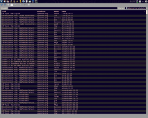

This is how it looks my rss reader:

Mwrender all the time. At last the end of this task is near. Than animations + journal and 0.12.0 is coming. It’s safe to say that 0.12.0 will have this two major features.

It supposed to be GUI time but It won’t. Maybe it’s a fault of poor documentation of mygui, maybe lack of support, maybe We done wrong choosing it but it’s not a time to look backward.

It’s time to look forward!

PS  
I hope that 0.12.0 will come soon so I won’t have to write about mwrender all the time. ;-)
