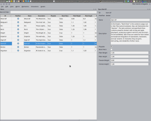

Are there any among us who prefer ranged weapons over close quarters combat with the enemy? Are there any among us who prefer bows, crossbows, or maybe even throwing weapons? Yeah, certainly there are, and certainly they’ll be glad to hear that they can now shoot and throw at will! OpenMW now supports all nasty, harmful things relating to the “Marksman” skill category. Of course, the one behind all this is none other than Scrawl.

However, that’s not all.

Gus contributed another portion of fixes and improvements intended for the still slightly ailing artificial intelligence of NPCs. Zini improves 3D navigation in the rendering panel of OpenCS, while SirHerrbatka is working on the records editing view – which you can see on the following screenshot:

See you next week!
