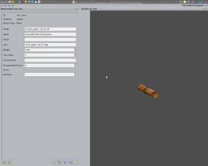

I’ll start a bit differently this time – with OpenCS instead of the usual OpenMW.

Thanks to SirHerrbatka and Zini’s efforts, OpenCS now features the functionality mentioned in last week’s post. For your viewing pleasure, the preview and editing views in all their glory:

Beautiful! And all of this is in the main branch!

Aside from that, we have fixes, fixes, fixes, and Scrawl. Like every other week, Scrawl dealt with some nasty bugs (this time having to do with NPCs not falling down). Slothlife, meanwhile, has included support for saving the current weather state in savegame files. I think that loading and saving the state of a character’s spells list should also appear soon.

And that’s all folks, until next time!
