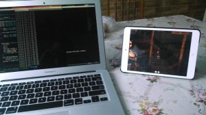

Odpowiadając na liczne prośby i wychodząc na spotkanie oczekiwaniom użytkowników: o to openmw uruchomione na iPadzie. Wydajność jest znakomita, i pozwala na płynne wyświetlanie pięciu klatek na sekundę.

Niestety projekt OpenWW nie będzie już kontynuowany. Zdecydowaliśmy, że tworzenie nowego silnika gry dla pozycji tak już starej, mija się z celem. Zamiast tego skupimy się na OpenSS.

OpenSS to skrót od Open SummerSet: miejsca w którym najpewniej będzie rozgrywać się akcja następnej części serii. Lub przynajmniej jednej z następnych. Decyzja ta może wydawać się dziwna, ale należy podkreślić, że dzięki temu uda nam się stworzyć silnik dla najnowszej gry Bethesdy zanim właściwie powstanie.

Oprócz tego zdecydowaliśmy się wprowadzić daleko idące zmiany w wyborze narzędzi użytych do tworzenia OpenSS. C++ jest krytykowane jako język mocno przestarzały, ale jednocześnie nadal lepiej nadający się do tworzenia gier niż inne. By rozwiązać ten problem, stworzymy nowy język oprogramowania – specjalnie na potrzeby tej gry.

Mam nadzieję, że te, oraz inne, planowane zmiany, ostatecznie zadowolą wszystkich fanów gier z serii TES!
