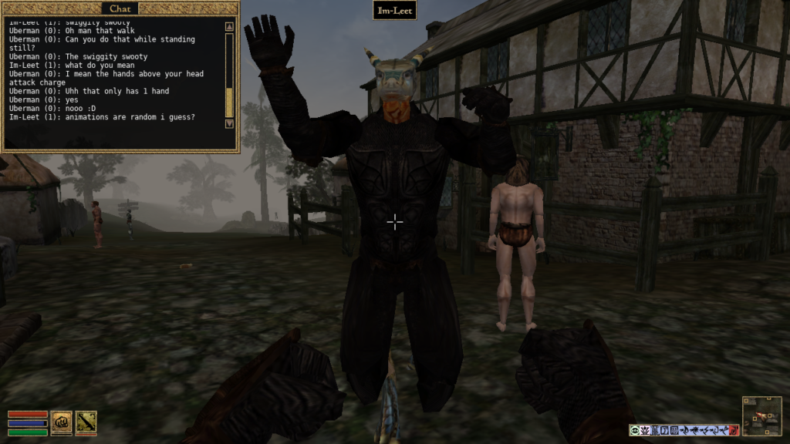
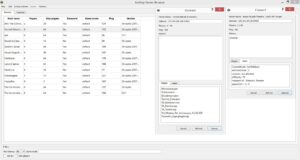

**Edit:** Note that this is an old post about an older version of TES3MP. You can get a newer one from [here.](https://github.com/TES3MP/openmw-tes3mp/releases)



**multiplayer**: “M’Aiq does not know this word. You wish others to help you in your quest? Coward! If you must, search for the Argonian Im-Leet, or perhaps the big Nord, Rolf the Uber. They will certainly wish to join you.” – M’Aiq the Liar

M’Aiq may have been teasing us back in 2002, but today you really can meet the Argonian Im-Leet as well as Rolf the Uber. This is all thanks to OpenMW’s sister project TES3MP and its developers [Koncord](https://www.patreon.com/Koncord) and [David Cernat](https://www.patreon.com/davidcernat). Previously, tes3mp only had pvp, but a recent patch added NPC synchronization. As if that weren’t enough, they also decided to include sync for player faction, journal, topic, time, and plug-ins… You can pretty much play the whole game now, if you just keep in mind that scripts still work locally (as they do in single-player) and custom items made with alchemy/enchanting/spellmaking do not save on the server. [Download tes3mp version 0.6.0](https://github.com/TES3MP/openmw-tes3mp/releases/download/tes3mp-0.6.0/tes3mp.Win64.release.0.6.0.zip) and be sure to read developer announcement [here!](https://steamcommunity.com/groups/mwmulti#announcements/detail/1441567597386587897)

Installation is super easy. If you already have OpenMW installed, you need only download tes3mp and unzip the folder to a destination of your choice and you’re ready to go. In case you haven’t got OpenMW previously installed, it’s sufficient to run the launcher wizard and point it at morrowind.esm, it’s that easy. After that’s done, you can start your own server simply by running tes3mp-server.exe. You’ll have to open a port so other players can join or use a networking program like Hamachi. Or if you’re simply looking to join a server, launch tes3mp-browser.exe and pick your server of choice.

As you can see, there are quite a few options available. A server can be private and password-protected or free for anyone to join. It can have a list of plug-ins, in which case I also need to download the specified mods if I wish to join it. The admin can either require that you have .esp files with the exact same hash as the one he is using or allow for any .esp file so long as the name matches. An admin can also enable or disable console for the entire server, or just for a specific player if need be. Additionally, it is up to him to set the difficulty for players joining the server, as well as the starting location via LUA script.

LUA scripting allows for quite a few interesting tweaks. During the alpha testing phase one of the modders scripted a new game mode – battle royale. It was set up in a way that players would spawn in a waiting cell and when a minimum of 3 players had joined the server, a 60 second count-down would start. Once the numbers ticked down, players were teleported to random cities around Vvardenfel with 25 minutes to arm themselves to the best of their ability before abruptly being teleported into an arena where they’d duke it out. Imagine the possibilities here!

But let’s pretend that I’m launching the vanilla tes3mp and see what awaits us. The first thing greeting me is the outside of Pelagiad and a box asking for my name and password. After entering them, the info is sent to the server, which creates a .json file where my character is stored. A moment later, I fill in my race, class and birthsign and am teleported to Balmora.

Now that I’ve properly logged in, I am immediately brought up to date with every faction, faction reputation and quest. If a player has joined thieves guild, then I’ll also be included in thieves guild. If a person is an archmage of the mages guild, then everyone is an archmage. If someone did a quest, I’ll have his journal entries in my book. I open up my journal and see that a player has started the fighters guild rat quest, killed the rats, got the 100 gold reward, but not yet reported to Eydis Fire-Eye.

I make my way to the fighters guild. As I enter the fighters guild cell, the server sends me info from a cell.json file, which contains all of the changes other players have made to the cell. This might be a dead NPC, a dropped item or a looted item. In my case I find that someone has emptied the fighters guild supply chest. This is multiplayer, after all. I turn in the unfinished rat quest and get an advancement to apprentice.

I ask for more orders and get the egg poacher quest. It may be a little too much for my freshly made character to handle, so I ask in game chat if anyone wants to accompany me. 2 players join and we go to the eggmine. Player 1 has a ping of 356, player 2 has a ping of 72 and my ping is 201. Because player 2 has the lowest ping of us all, he becomes the authority of the cell. When a kwama forager attacks us, player 2 (authority) sends information about the forager’s movements to the server and the server distributes info back to player 1 and me. This is how the synchronization of NPCs and creatures is handled.

After fighting a bunch of kwama foragers and bringing the egg poachers to justice, we are all wounded to an extent. Player 1 needs 7 hours to fully heal, player 2 needs only 1 hour and I need 3 hours to be fully rested. So how is that resolved? The server keeps the time and our individual times are always synchronized to that. When I rest for 3 hours, the resting bar will appear and I’ll start healing as my individual time appears to pass, but as soon as the bar is filled, my client re-synchronizes back into server time.

After we are done, we decide to go back to Balmora. My buddies were smart enough to bring almsivi intervention scrolls, but I didn’t. Instead of running all the way back to Balmora, I decide to kill myself by writing /suicide in chat and triggering a LUA script that ends my life. But don’t worry, I’ll respawn in the nearest temple or imperial shrine, which just so happens to be Balmora temple right now.

We return to the guild of fighters for our reward. A quest may be completed only once and the reward is only given to one player. We split the gold we got for tracking down the egg poachers. Similarly, an item may only be picked up once. However the server admin may reset cells and quests by deleting cell and world .json files, making it possibly to do quests and obtain items you might have previously missed.

We start pvp-ing each other. Bad idea, because the citizens of Balmora report our unlawful behavior! A guard runs to me and gives me an ultimatum – either pay gold or go to jail. Since time is never stopped in a multiplayer environment, the other 2 players are free to continue playing while I sort my business out with the guard. He may not know it, but I’m the Nerevarine (or at least one of them) and there’s a price to pay for so rudely interrupting my business.

I loot the armor off the dead guard and equip it. And then it hits me. I look indistinguishable from a Hlaalu Guard. I turn off my caps lock and start walking around as if I’m wandering in an AI pattern. Nobody will be able to tell the difference – at least not until they get too close and I’ve already drawn my blade. If you ever come to visit Balmora. Remember. I’ll be there. Walking. In an AI pattern. Ready to strike unexpectedly.

With how far tes3mp has come in such a relatively short time, I dare say that it has shown that implementing multiplayer and other projects as such on OpenMW is the preferable route. People have waited years and years for a fan-made implementation of some form of multiplayer for TES3: Morrowind, Oblivion, Skyrim, Fallout 3, Fallout 3 – New Vegas and tes3mp is the first to deliver not only functional NPC sync, but also a mountain of features no other similar project has been able to deliver yet. It only took 2 developers and an Open Source engine to do what even large teams of professional coders struggle to achieve on a closed source TES engine.

OpenMW has been building up to something like this as well as other possible projects for a long time, so it’s a great joy to finally see it forked for a successful multiplayer project. The dream of being able to play Morrowind with your friends is now achieved! But don’t expect us to stop yet. The developers of tes3mp will continue improving it even further, OpenMW main fork continues to receive pull requests and we welcome any who would like to contribute to making OpenMW better or want to make their own forked project similar to tes3mp.

##### [Want to leave a comment?](https://forum.openmw.org/viewtopic.php?f=38&t=4463 "Want to leave a comment?")
