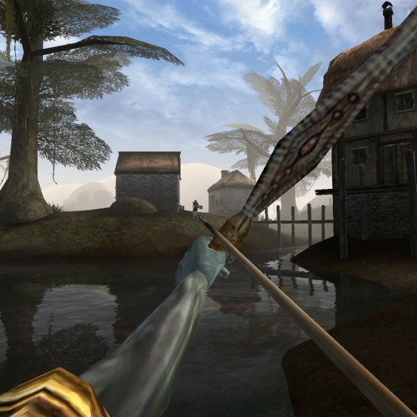

Hello and welcome back for another look at new and upcoming features in OpenMW! There’s a lot to talk about, so let’s dive in!  
  
Perry Hugh has continued his work on [better gamepad support](https://gitlab.com/OpenMW/openmw/merge_requests/151). You may have heard about OpenMW’s keyboard navigation feature which makes it possible to navigate (at least parts of) the GUI with the keyboard. This feature is used by gamepads as well. Perry Hugh’s plan is to expand on the keyboard navigation to make it work in all the UI windows it didn’t before. He is also adding in more convenient controller-specific ways to navigate in the character generation window and resting window. Many of those of you who use gamepads may read this and ask: “but gamepad keyboard GUI when”? Well, Perry is considering adding that too and more! Read about it [here](https://forum.openmw.org/viewtopic.php?f=20&t=6394).  
  
So wish him good luck, or even contribute to his endeavour and our project by testing out his additions!

unelsson has kept on working on the OpenMW-CS. His latest big thing is the long-awaited [terrain shape editing](https://github.com/OpenMW/openmw/pull/2520) feature. With that finally merged into the OpenMW-CS, you’ll be much closer to never even having to touch the old tools intended for a certain game from 2002 to create gorgeous landscapes for your modification or your Starfield killer. See for yourself:



akortunov has made a huge refactor of the [weapon types handling](https://github.com/OpenMW/openmw/pull/2413). Among otherwise mostly technical improvements, it allows content creators to add unique animations and attachment bones for every weapon type in the game (crossbows, short swords, spears etc.). This means that it will be possible for modders to make previously [ambidextrous](https://en.wikipedia.org/wiki/Ambidexterity) characters now purely right-handed like you can see on [these](https://imgur.com/a/uzndAMN) images. Once OpenMW reaches 1.0 and the de-hardcoding phase begins, weapon types are planned to get their own records in the updated ESM format, which will make modding the weapon types possible directly through the OpenMW-CS.   
  
Our favourite hammer-equipped penguin also updated his old [shield holstering support](https://github.com/OpenMW/openmw/pull/2047) branch so that it could finally get merged. In other words, that heavy shield you’re constantly carrying? You’ll finally be able to rest it on your back!

If you read the interview with Capostrophic (you did, right?), you should already know that he has been working on extending the NetImmerse (NIF) file format support to work with the models from other Gamebryo games: games like Oblivion, Fallout 3/New Vegas, Skyrim but also Civilization IV for example. Capostrophic’s work on this is still in very early stages, but a few (mostly under-the-hood) additions have already made it into the master branch. Stay tuned for more really interesting things to come out of this.

bzzt and AnyOldName3 are both figuring out the last bits and pieces to make shadows more ready for a stable release. This is one of the few things holding 0.46.0 back right now. Yes, you may read this as “0.46.0 is just around the corner”. Stay tuned!

A lot more activity has been going on since the last update, but you will hear about that, and much more, in the upcoming release post!  
  
Until then, thanks for reading.

##### [Want to leave a comment?](https://forum.openmw.org/viewtopic.php?f=38&t=6501 "Want to leave a comment?")
