[S3ctor](https://gitlab.com/magicaldave1) is a core developer of OpenMW, and has, like most of us to be fair, odd interests. This is the incredible story how he mixed two immensely cool things: Quake, and Morrowind, narrated by our hero himself!

Possibly the first thing anybody who has met me in person will say about me is that I am obsessed with game engines – and while OpenMW is my baby, my first love was [idTech](https://en.wikipedia.org/wiki/Id_Tech). At eight years old, I picked up a steel-book copy of Doom 3. Surprisingly, I ended up spending more time with the extras than the game itself. The developer documentary and Carmack’s E3 talk about the render pipeline and engine design captivated me completely. I have distinct memories of my young self barely understanding [Carmack’s Reverse.](https://en.wikipedia.org/wiki/Shadow_volume#Depth_fail) I tried to explain it to other kids, to absolutely no reaction. Nobody else really understood, but it was the coolest thing in the world to me. All of this is to say that I have been interested in this technology since before I could read.

What we’re going to explore today is the history and process through which I developed a brand-new workflow for the OpenMW engine that allows modders to utilize arguably the most powerful component of old idTech – the brush-based level editor.

<!--more-->

In order to fully grasp what we’re about to discuss, you’ll need some background on both early idTech and OpenMW/Morrowind. First things first: many modern game engines use a *mesh*-based workflow. This is somewhat like building a house. The artists are carpenters, creating individual pieces (3D models) independently. Then, level designers – the general contractors in this analogy – take these pieces into the engine’s toolbox and construct the game world around them.

In the modern era, studios have mastered the mesh-based workflow, building their entire operations around it. However, no individual can match the output of a full studio. Take [Blender](https://www.blender.org/), for instance. It’s an incredible tool, but its complexity matches its capabilities. Learning Blender, or any game engine for that matter, is no small feat.

The mesh-based workflow is intentionally designed to separate level designers and artists. While this isn’t necessarily bad, it does add a layer of complexity that brush-based games simply don’t have. Blender won’t light a scene the same way your engine will, nor will it handle post-processing, interactivity, or your game’s unique features. It’s an amazingly flexible tool – but it’s not tailor made for the experience your game is meant to provide. Nor are [Max](https://en.wikipedia.org/wiki/Autodesk_3ds_Max), [Maya](https://en.wikipedia.org/wiki/Autodesk_Maya), [Crocotile](https://crocotile3d.com/), or whatever your preferred modeling tool is.

In contrast, brush-based workflows blur these lines. Here, the level designer wears multiple hats, acting as both a formal designer and a modeler. This approach, inherited by Half-Life through its modified Quake engine, persists in Valve’s design philosophy even today, driving their continued innovation and industry-redefining success.

This was a very difficult concept for me to come to grips with, having always modded and developed OpenMW – it didn’t even *occur* to me that it was possible to go outside the mesh-based workflow. So let us now demonstrate the difference.

[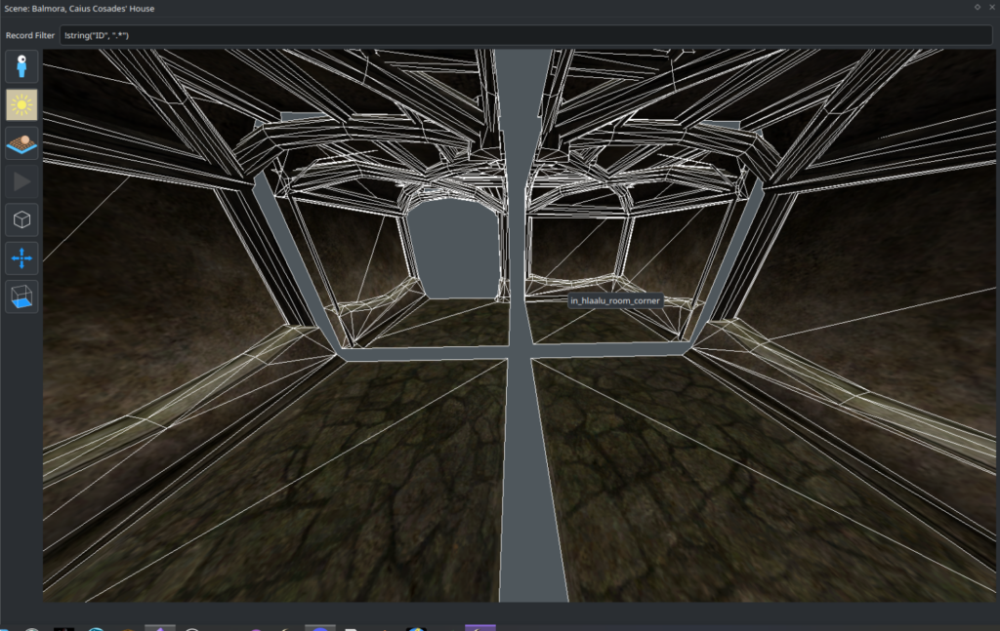](image.png)

Here’s an image of a house in OpenCS, OpenMW’s native game development tool. You can see the frame of the room is made up of four static pieces which I’ve been glued together. This type of prefabbing makes it impossible to add little details or variations into the structure of an existing asset, you need to change the one, or make a new one. Let’s now attempt to reproduce this in my favorite Quake editor – [Trenchbroom](https://trenchbroom.github.io/)!

[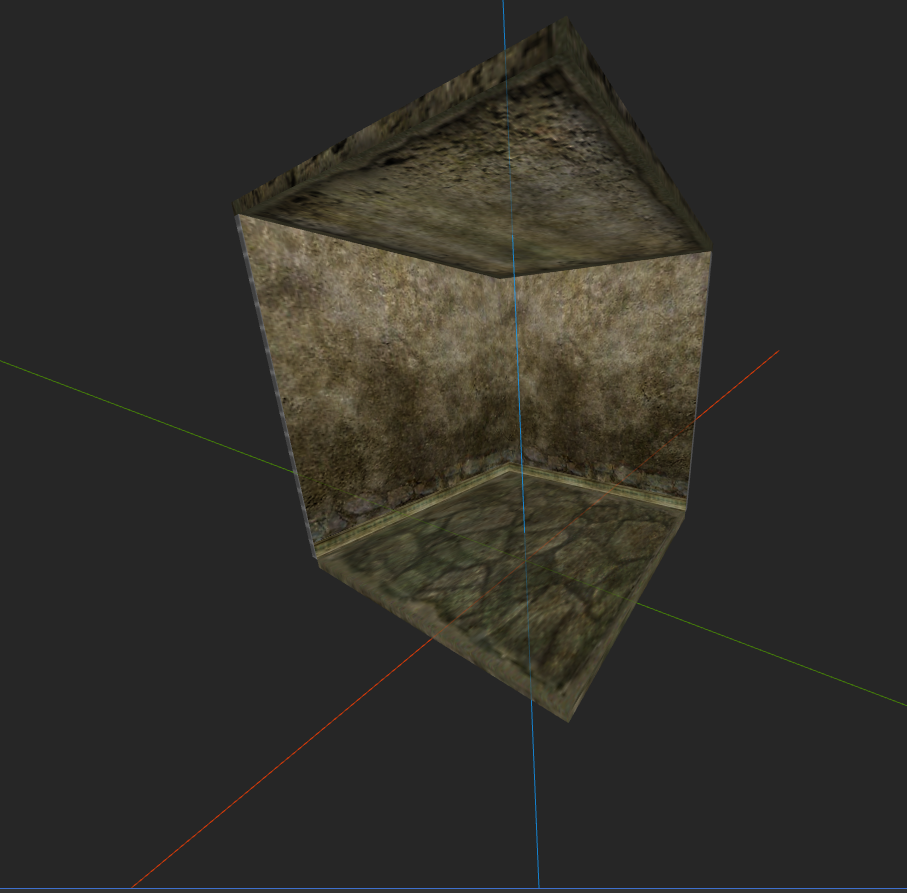](image-1.png)

In just a couple of moments, we’ve got the frame for a brand-new one. Here, there are six “brushes” – I really dislike this term as it can be extremely confusing. Brushes are simply individual polyhedron – cubes, pyramids, anything that could be expressed as a single convex shape is considered a brush. Notice I mentioned `convex` explicitly – this is a key detail, as the mathematics behind brush-based workflows necessitate that all shaped be convex. More on this later.

[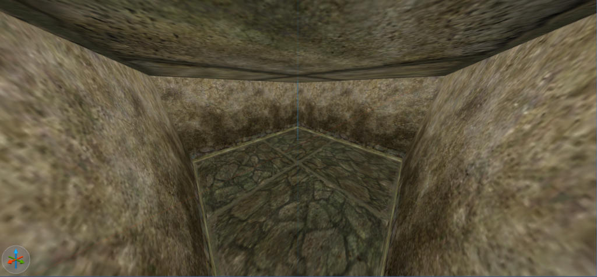](image-2.png)

And here’s an entire room! It’s not a very good one, though, so let’s make a variant with a door.

[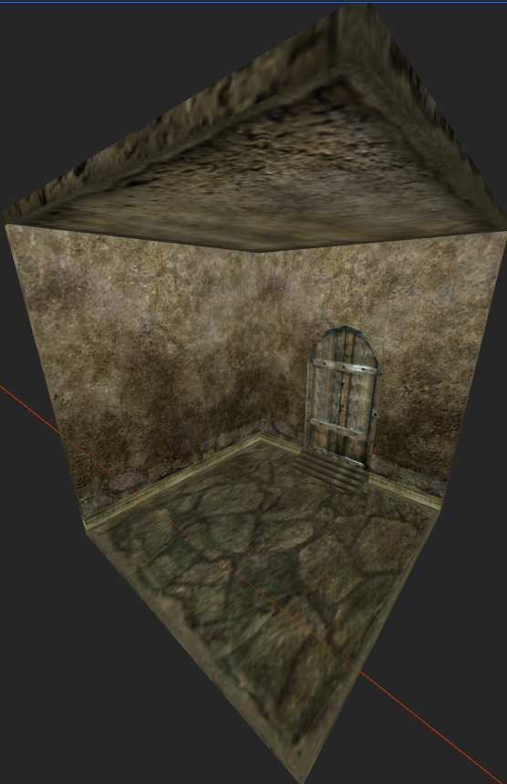](image-3.png)

Now let’s iterate a bit, bring the wall trim out some, change a few textures here and there…

[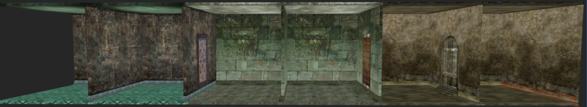](image-4.png)

We’ve now got three brand new template sets of our own to work with. Just like in real life construction, we can expand and tweak these as we build each unique house or area. No two homes need to be identical – we’ve got the freedom to customize! While these assets were whipped up quickly for this article, there’s plenty of room for improvements and personal touches. The key takeaway here is the accessibility and rapid iteration of our tooling. We’ve streamlined the level design process by eliminating the need for separate 3D modeling tools. Naturally, you won’t be animating here, but you’re not meant to – Quake editors are level editors, not entire replacements for modeling software.

But wait, now I’m back to talking about idTech stuff again – this is supposed to be about Morrowind, isn’t it? Well, I’ve been modding OpenMW for a couple of years and in that time used the engine itself as a springboard to get further into game development, netcode, and C++ in general! In that time I’ve made a decent few friends whom I’m proud to call that. [Epoch](https://github.com/EpochWon%29) was the first person who’d turned me onto the concept of Trenchbroom in general – we’d discussed it offhandedly a few times while probing for features we could implement into OpenMW’s rendering pipeline.

Later, at some point, a mutual acquaintance of ours challenged me to a match of Fortnite. *Insulted*, I did what any old-school gamer like myself would do: I rolled a Quake 3 server at <https://s3kshun8.games> and challenged him to a match instead. As it turns out, our mutual friend was *also* a fan of Quake and within minutes was mopping the floor with me. But, nevertheless, Epoch and I continued diving into the depths of modding idTech to see what we could come up with.

Our first idea was to port Morrowind assets into Quake. Everything goes downhill from here. First came Stroggvarine:

[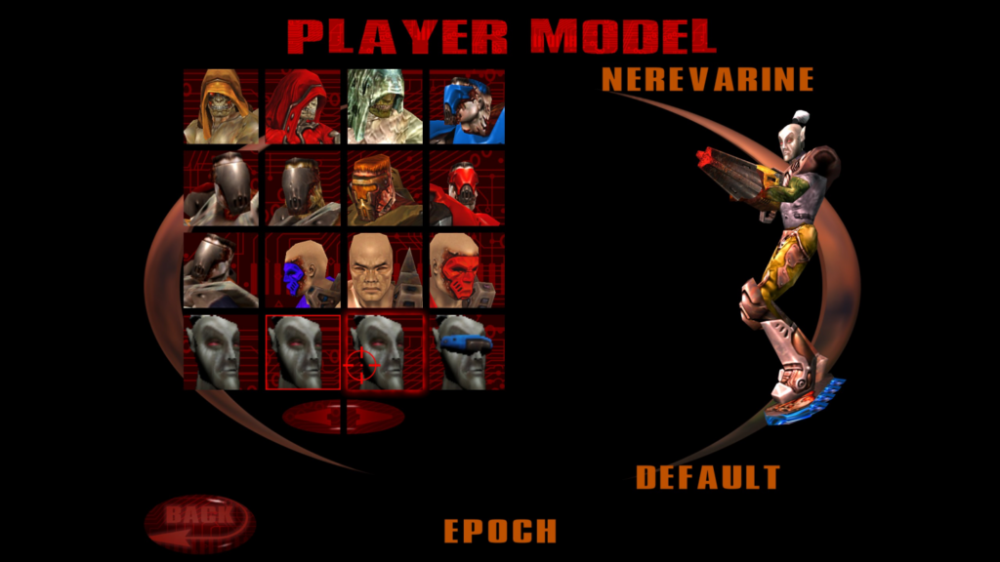](image-5.png)

Then Crassius Curio.

[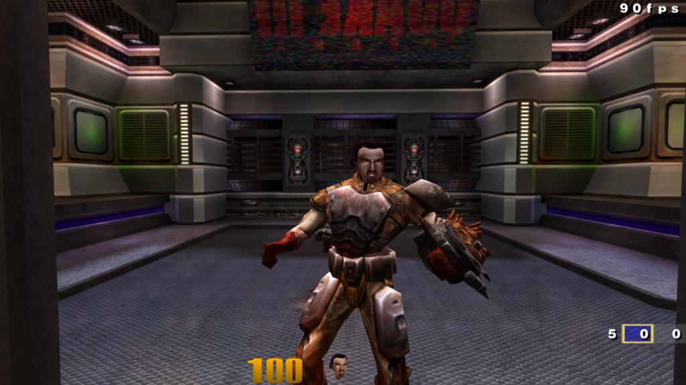](image-6.png)

Then Epoch had an even worse idea:

[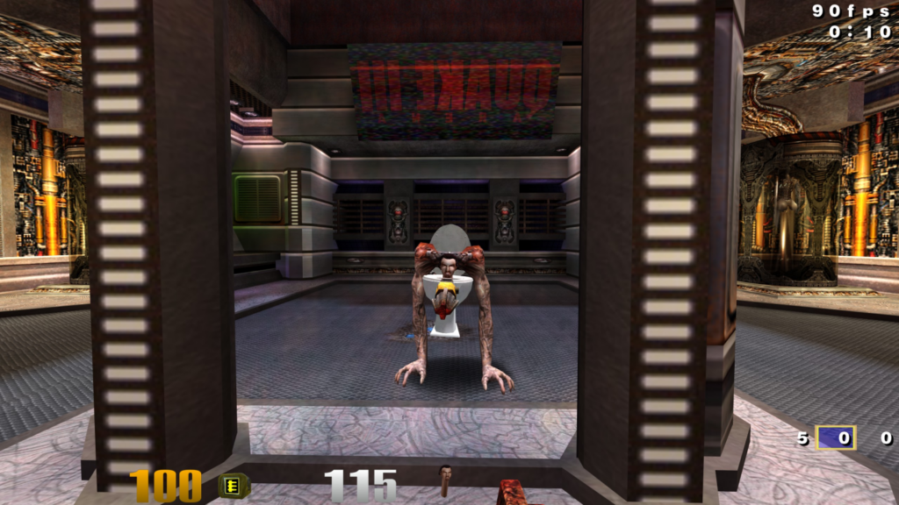](image-7.png)

Okay, so, now we’ve got characters in, what about *structures*? How could we recreate Balmora, Vivec, or Sadrith Mora in Quake 3? (Tell me you wouldn’t play FFA in Sadrith Mora, I dare you) There *seemed* to be a solution to this according to some old research I dug up from [katsbits.com](http://katsbits.com). I found their discord and joined, looking to figure out how to integrate 3d models into a Quake 3 map using patches. I got all the details, but, it just seemed like too much work at the time and the process was so… raw, and based on old tools – I never did give it much of a chance to get fleshed out.

Because along the way, I had another, much better idea. I’d started playing with Quake editors like [JACK](https://valvedev.info/tools/jack/) and [NetRadiant-Custom](https://github.com/Garux/netradiant-custom), trying to learn how the level design flow worked – and I immediately fell in love. Having tried and failed (not particularly seriously) to use Blender many times, having a way to make my own assets felt as though I’d unlocked the missing piece to being able to ship an entire game on my own. I wondered, idly, if we could apply this to Morrowind somehow. And then I noticed an `export to .obj file` button in Trenchbroom. The tool itself did this, to some degree, so I *knew* it had to be possible, beyond all shadow of a doubt – it *was* doable. So I sidled on over to the Trenchbroom GitHub and [opened a discussion](https://github.com/TrenchBroom/TrenchBroom/issues/4448) about it.



What you see above is the first attempt at getting a Quake map into Morrowind. We exported a map out of Trenchbroom, imported the OBJ into blender, and re-exported the NIF. Textures got lost and the scale is all wrong – it’s actually a lot smaller here than it should’ve been. At the time, we had no idea what the scaling ratio would be between Morrowind and Quake 1. As it turns out, this was really simple – there’s no fancy asset-level scaling happening in either engine with regard to assets. The only scaling difference between the two engines is that a Quake 1 player is almost exactly half the height in units of the default male Dunmer in Morrowind.

You might be curious about how we figured that out. Well, Quake editors define the player as some or another kind of game object, whose bounding box is displayed in the editor. Like this:

[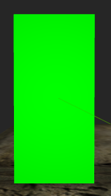](image-9.png)

The player themselves is represented in Morrowind.fgd file like this:

```
@baseclass size(-16 -16 -34, 16 16 33) color(0 255 0) = PlayerClass []
```

The same line exists in Quake.fgd, there the player is 56 units tall:

```
@baseclass base(Appearflags) size(-16 -16 -24, 16 16 32) color(0 255 0) = PlayerClass []
```

All we actually had to do was launch OpenMW and check the player’s bounding box like so:

```
self:getBoundingBox().halfSize.z
```

and there we go. We prefer building at smaller scale, so, we just based the Morrowind.fgd off the halfsize instead of the player’s true height and build at half scale by convention. It’s just easier.

Having figured the basics out, the *real* work could now begin. What we needed at this point, was a compiler – except instead of compiling a *BSP*, we’d be compiling an *ESP*. But it’s the same concept Quake uses – in-development, maps are passed around as text-based source files, and then a compiler converts them into actual 3D geometry, gameobjects, et cetera.

Inside of a `.map` file, brushes are stored as a set of planes with some data about their extents and mapped textures.

For reference, here’s a simple cube – the default map Trenchbroom creates along with each new document:

```
// brush 0
{
( -64 -64 -16 ) ( -64 -63 -16 ) ( -64 -64 -15 ) __TB_empty [ 0 -1 0 0 ] [ 0 0 -1 0 ] 0 0.25 0.25
( -64 -64 -16 ) ( -64 -64 -15 ) ( -63 -64 -16 ) __TB_empty [ 1 0 0 0 ] [ 0 0 -1 0 ] 0 0.25 0.25
( -64 -64 -16 ) ( -63 -64 -16 ) ( -64 -63 -16 ) __TB_empty [ -1 0 0 0 ] [ 0 -1 0 0 ] 0 0.25 0.25
( 64 64 16 ) ( 64 65 16 ) ( 65 64 16 ) __TB_empty [ 1 0 0 0 ] [ 0 -1 0 0 ] 0 0.25 0.25
( 64 64 16 ) ( 65 64 16 ) ( 64 64 17 ) __TB_empty [ -1 0 0 0 ] [ 0 0 -1 0 ] 0 0.25 0.25
( 64 64 16 ) ( 64 64 17 ) ( 64 65 16 ) __TB_empty [ 0 1 0 0 ] [ 0 0 -1 0 ] 0 0.25 0.25
}
```

By convention, they’re numbered, but this is not a crucial aspect of the format. The important bit is that this is a representation of each face of the cube, stored as three (three-dimensional) points. These three points define a plane which is a half-space – an infinite set of points bounded by a plane. It sounds complicated, and the mathematics are, but essentially – you’re looking at each side of a cube here.

BSP compilers then use a range of techniques to extrapolate vertices from these half-spaces, such as computing them directly, or the original Quake compiler’s approach of using a large cube to determine points of intersection. For more of the mathematical details, you can read up [here](https://quakewiki.org/wiki/Quake_Map_Format). Originally I attempted to reproduce this approach on my own with little success – I tried many variations on the formula, and eventually hit one that seemed to work, but actually, was only valid on perfect cubes. It did work on every possible cube, though. But only cubes.

Defeated, I researched further and learned about [Qodot](https://github.com/QodotPlugin/Qodot). I wasn’t the first person to have this idea. Now known as [func_godot](https://github.com/func-godot), a project already existed which used Trenchbroom in another unintended engine. Digging around in their repositories didn’t net me much, until I stumbled into [this](https://github.com/QodotPlugin/shambler/) little ditty. Apparently, the original developer of Qodot suddenly got *very* into Rust one day and rewrote all of the necessary tooling in Rust and then vanished. The team was very cagey about discussing this particular developer, and they seemed to have been gone for a while, and I couldn’t reach them for months. It happened to be *precisely* what I needed in ways I didn’t even think of originally, and seemingly was all mine to whatever I pleased with.

Now we’re really going to get into technical details, so please bear with me – I’ll take you through it as best as I can, and I pinky-promise this won’t be half as bad as you think it’ll be! Once you’ve built a map, the final step is to compile it and get it in-game. So how does the compilation process work for OpenMW? Let’s crack open the [Morrobroom](https://github.com/magicaldave/Morrobroom) source code and take a high-level overview of what it’s doing.

[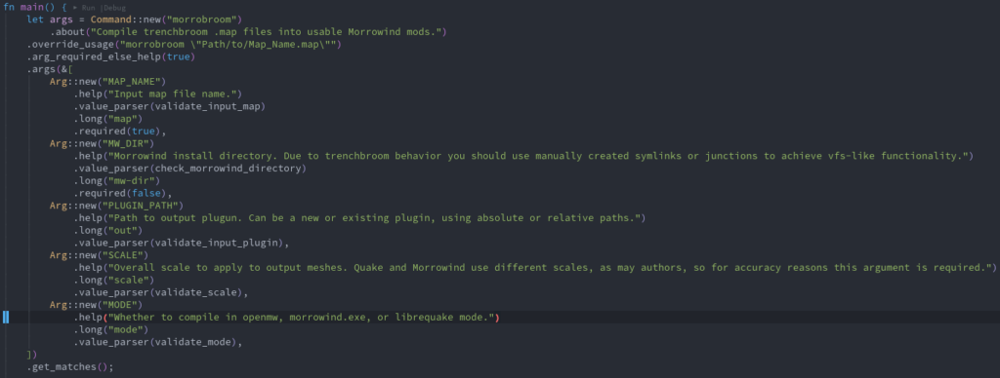](image-10.png)

It all starts… with startup arguments. Not a lot to see here – you give it a path to a `.map` file, the ESP it’s supposed to save to, and an optional scale argument to increase or decrease the overall asset size. This is handy for making maps for both Morrowind and Quake (yes, really).

[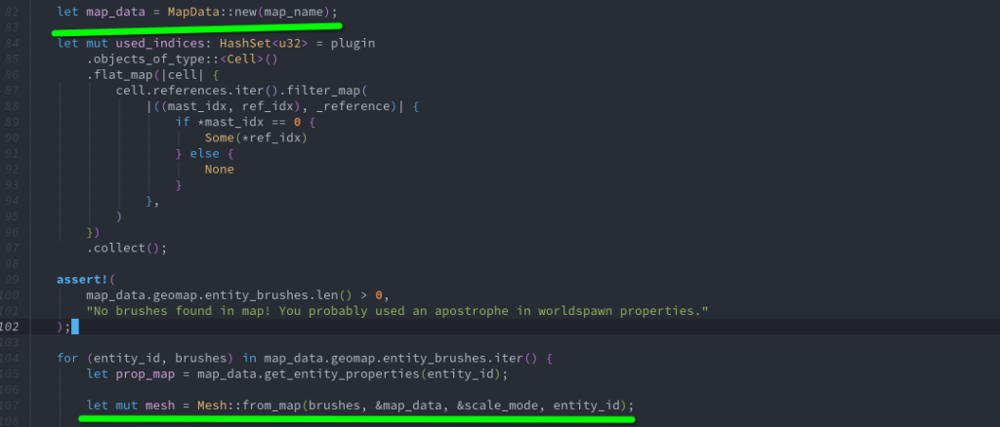](image-11.png)

Some key points here – `MapData` is a class which does the necessary Shambler calls in order to get all of the texture and geometry data out of [Shambler](https://quake.fandom.com/wiki/Shambler_%28Q1%29) and into a struct we can work with later. This includes the texture info, entity data, vertices, vertex normals, et cetera. We then loop over all *brush* entities inside of the map and generate a `Mesh` from them. The Mesh struct is halfway between a custom representation and an actual NIF file – there’s just a little bit of extra info there to make the compiler work properly. This segment is also responsible for making sure that game objects do not have duplicate definitions inside of the final ESP file.

[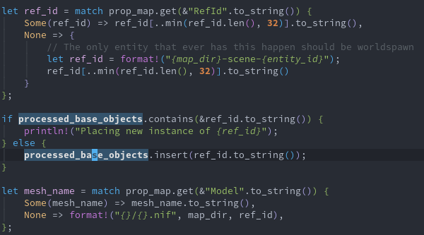](image-12.png)

We then get the reference’s object ID and if assigned, the model override which they’ve been given. Trenchbroom doesn’t support OpenMW’s primary model format, NIF, so the best we can do is just tell it to use a different asset instead of the one the mapper put together. I’ll omit the next part, but, we simply do a big match against the name of the type of the brush entity, and use that to decide if it should become a light, or an NPC, or a door, et cetera.

[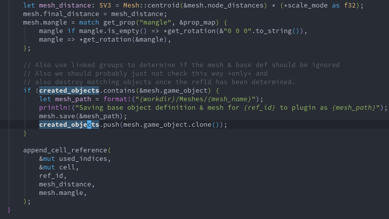](image-13.png)

Finally we get the center point of each brush asset and use that position as the reference position in-engine. This means they’ll be placed in the same spot in-game as they were in Trenchbroom. Buried underneath all this are also advanced model editing options, such as configuring alpha testing vertex colors, and whether or not collisions are used. More features are consistently being added over time as we improve the compiler and find new things to add!

That was a highly simplified overview, but, that’s the entire main loop for the OpenMW compiler. There is a lot more code which was not showed or explained for brevity – please do review the Morrobroom GitHub or simply reach out if you have any questions about it! So, now, all compiler’d up and nowhere to go… What do I do from here?

Well, naturally, you try to port Quake whole-hog into Morrowind at this point. What else *would* you do as a responsible Morrowind-modding Rustacean who really needs a job and plays too much Quake? Now, this gets into dicey legal territory. I refuse to publish the compiled assets myself, because this is an area that’s way too ambiguous for me to mess with. However, it’s worth mentioning that the Quake community tosses around the entire texture set for the game all over the place, and way back when, John Romero released the map sources *claiming* that he made them GPL, but that claim has been disputed. Now, John Romero can get away with just saying he made the maps GPL and nobody’s gonna go argue with *him* about that, but I don’t have that luxury.

Instead, I will just share some screenshots and mention that both the necessary textures and .map sources are easy to get, if you’d like to reproduce this for yourself:

[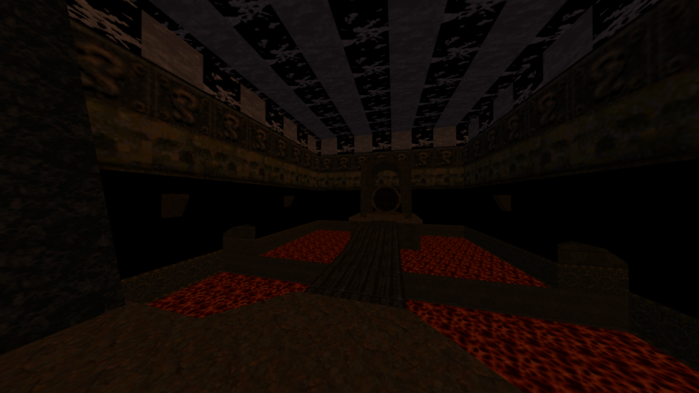](image-14.png)

Is it cursed? Yes. Is it my crowning achievement as a technologist? Probably also yes. So far. We still have even further to go. You might notice the maps are empty. We don’t support quake entities yet, and we dropped porting official Quake because of above licensing issues I wasn’t able to get solid answers on. Enter [LibreQuake](https://librequake.queer.sh) – much like FreeDoom, LibreQuake is an open-source reimplementation of the game code and assets that made up Quake. It’s not the exact same thing, but it’s intended to be visually and technically compatible with any Quake engine or mod.

And thus began the port. First came the shotgun:

[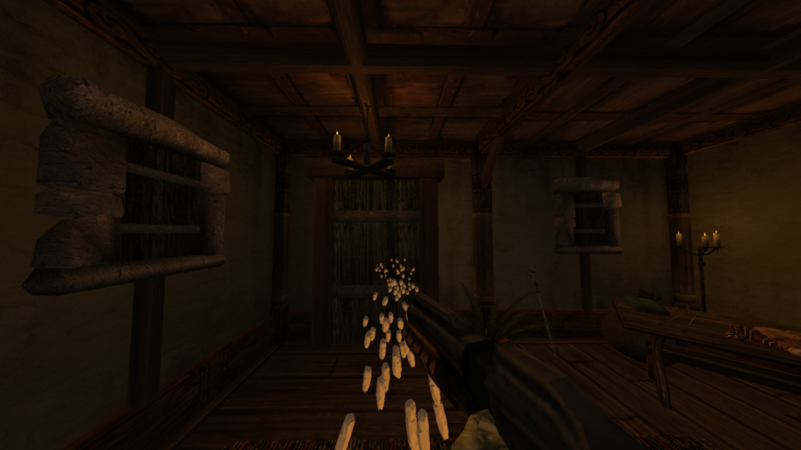](image-15.png)

This is the first screenshot I took with it, but it worked! Later versions have much better bullet spread and are actually capable of killing targets which they hit. They even use real objects, although it’d be much more efficient if we simply used raycasts to do hit scanning instead of these slow-moving projectiles.

We’re almost done, actually. Research is ongoing into porting creatures. Fortunately, LibreQuake has the source `.blend` files in its repository, so this won’t be too awful to figure out… eventually. However, I’d like to demonstrate Epoch’s technique he developed for reproducing the Quake skybox! You might’ve noticed in previous images the sky looks really odd.

This is because The Quake sky was implemented at a time before transparency in textures was a common technique – the sky there is actually one texture, folded on top of itself, with the black pixels masked out, and then the result scrolls across any brush which uses the sky texture. Epoch’s postprocess shader is able to replicate this effect, mostly, by essentially utilizing a greenscreen. We place green sky brushes as usual, and then:

[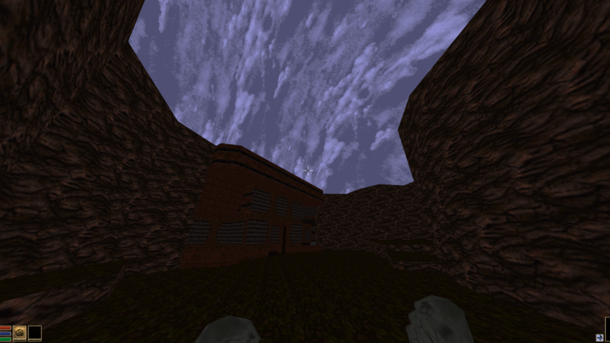](image-16.png)

It has all the problems of a typical greenscreen though:

[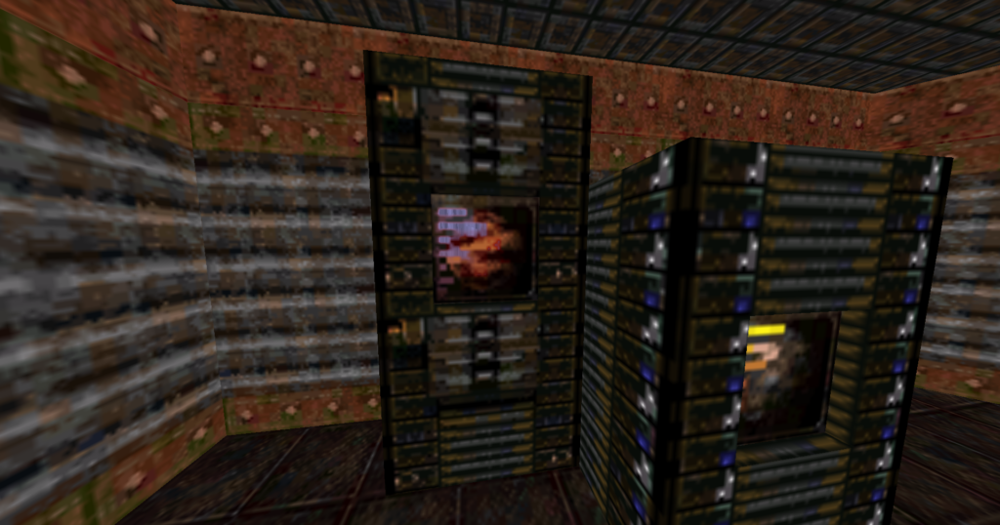](image-17.png)

Later, we’ll be able to implement a much nicer version of this technique by using Morrobroom to apply animations directly to these assets and *maybe* use alpha testing to similarly mask out the black pixels. The great thing about it is… We don’t even know yet!

So what’s the value add in all this? Well, we’re able to iterate much faster on level design and create more unique assets than almost anybody else using this engine. They’re not necessarily as high fidelity, but they’re much more satisfying to work with and really allow to execute one’s artistic vision. Our results speak for themselves: !

[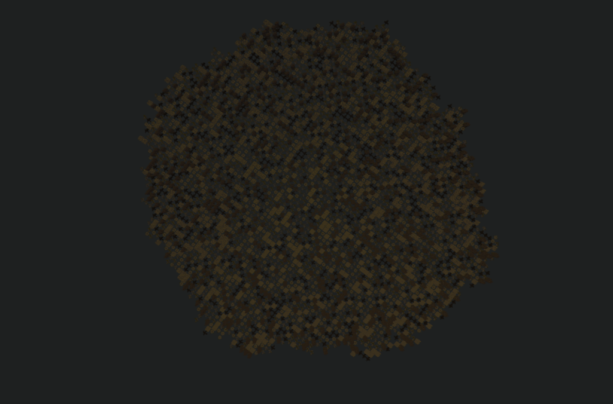](image-18.png)

[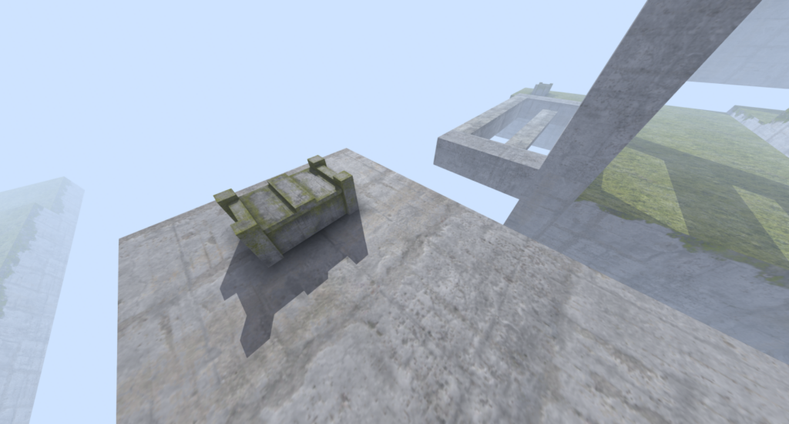](image-19.png)

[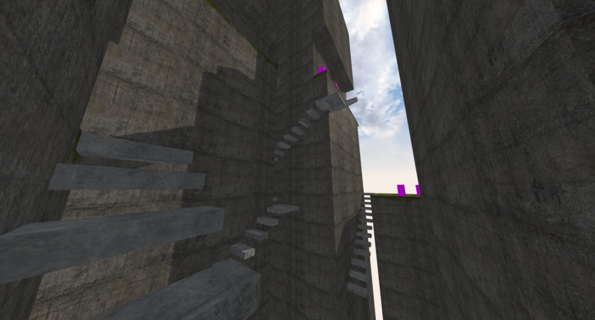](image-20.png)

[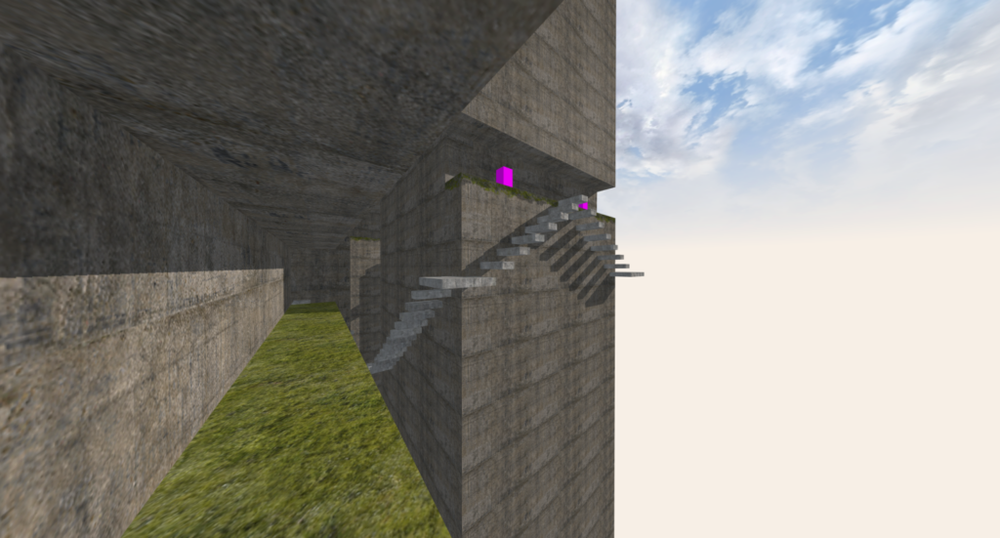](image-22.png)

[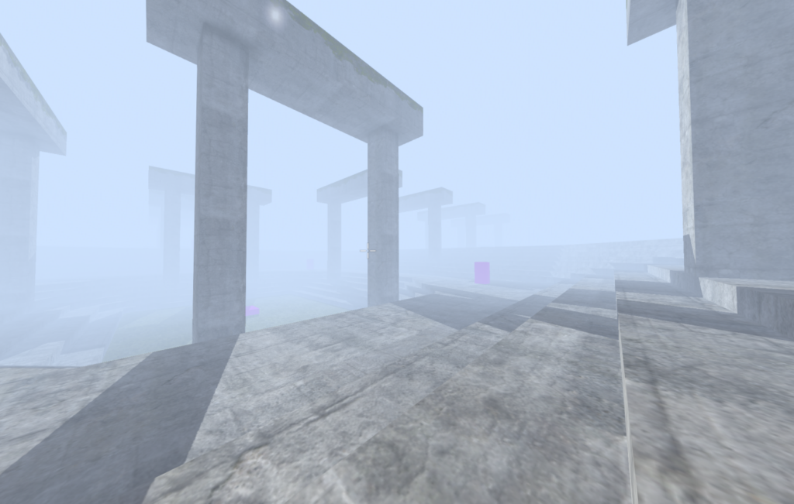](image-23.png)

What you see above are maps which Epoch and I produced together, and he worked to develop baked lighting, normal, and specular maps for. Along with a creepy postprocess fog visible in the last image. The first image is a set of 2500 chunks procedurally generated based on the Trenchbroom maps we made. Eat your heart out, Starfield!

If you want to know more about our stack, the OpenMW project, or just to talk, [please do reach out](https://discord.gg/YegsVV3aRb)! I love discussing this topic and am always open to explore game development concepts (and OpenMW) with new friends.

## What does this mean for OpenCS?

Great things. Trenchbroom has a very similar stack to OpenCS – both are Qt-based level editing applications running OpenGL. The similarities *mostly* end there, though, and in a good way. I borrowed some of Trenchbroom’s code for [an early attempt](https://gitlab.com/OpenMW/openmw/-/merge_requests/3974) at Windows dark mode support. My implementation didn’t manifest, but the relevant Trenchbroom bits from that old MR will allow better usage of the ALT key in our editor to more closely reflect the orbit camera behavior of the original TESCS.

Additionally, I’ve (politely) butted heads with the Trenchbroom author once or twice about adding new preferences in TB – something which they are *very* resistant to. And rightly so! I’ve spoken with many people who thought they had feature requests for OpenCS and it turned out they were asking for something buried in its preferences menu.

Finally, after implementing [!3675](https://gitlab.com/OpenMW/openmw/-/merge_requests/3675), I realized we could do even better than that when it comes to moving objects in the editor. In Trenchbroom, you simply hold shift to move an object only along whichever of the X and Y axes has moved further, and alt to move on the Z axis. It’s not at all like how TESCS works, but it’s very fast once you’re used to it and far less laborious than either my or Blender’s versions of the same feature.

To cap this article, I’d like to also share [Tremble](https://assetstore.unity.com/packages/tools/level-design/tremble-map-importer-277805), the Unity integration for Trenchbroom, and [HammUEr](https://forums.unrealengine.com/t/hammuer-a-hammer-worldcraft-map-importer-for-unreal-engine/50145), the Unreal integration. You can use Quake-based workflows in essentially any 3D-capable game engine! Consider using it if you find Blender difficult or just don’t have the time or interest. It might just revolutionize the way you think about level design.
