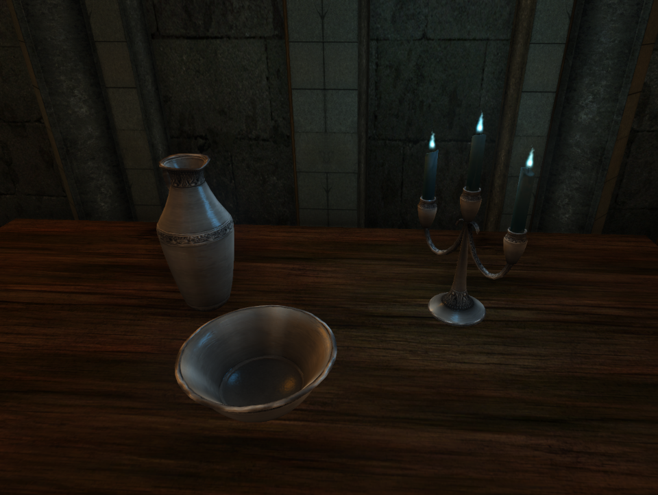
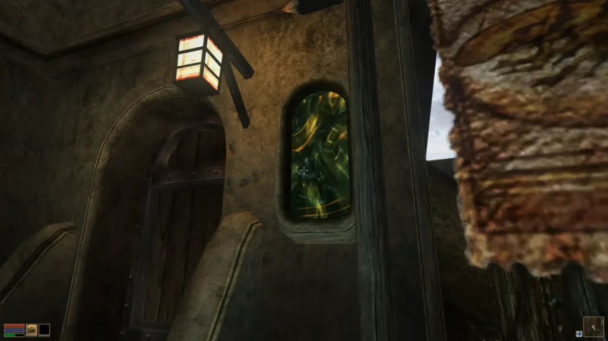

## You’ve already [been interviewed on this very blog in 2019](/news/2019/interview-with-capostrophic), but you didn’t mention if you have a cat. Who are you again, by the way?

It’s me. I’m the cat.

…

I have to reveal the darkest of my dark secrets: I am not in fact a cat.

I’m still Alexei, still best known as Capo. I’ve since moved to Southern Russia, though I hope to eventually move somewhere else. I’m now 21 and thankfully, I’m not a high school student anymore. Right now I’m trying to get a CS degree. Yes, I’m younger than Morrowind itself, by a month or so.

As mentioned in the original interview, I discovered The Elder Scrolls series proper and OpenMW in 2015, stuck around since then and started actively contributing in early 2018. I generally focus on file format support (NIF, ESM, BSA), mod compatibility and high-level mechanics.

I do have a cat. Her name used to be Behemoth, and now it’s Plague. Is cat tax evasion a crime? I’m committing it.

## What have you been working on recently, and what’s your new five-year plan for OpenMW?

Assuming the entire 0.49 development cycle counts as “recently”, I would put a few things from that here as the highlights.

I’ve recently added NiFogProperty and NiParticleBomb NIF record type handling — the former is responsible for setting up fog settings in NetImmerse and it’s useful for disabling fog for a part of the scene and the latter produces an explosion effect during particle simulation. I’ve soft-rewritten the entire NIF parser for the upcoming 0.49 release, which is not something an end-user should notice, but what it should do is make further updates to it much easier.

I’ve also updated lighting. Notable addition is specular lighting support for all lights, which basically means objects with specular maps will get shinier from any light, not just the sun, as can be seen in [Silverware Repolished by Pherim](https://www.nexusmods.com/morrowind/mods/46385):

Speaking of the sun itself, with [Hrnchamd](https://www.nexusmods.com/morrowind/users/843673)‘s help its exterior trajectory and interior position have very recently been corrected, which should make Morrowind’s look noticeably more accurate in every single interior and exterior location, e.g. reducing lighting seams caused by poorly made models — to an extent — and making everything lit as originally designed — also to an extent.

I’ve made it so collision shape generation and attack animation state machine no longer rely on educated guesswork and hopes and dreams of all who contributed to them (as much). Melee combat hit processing in particular is radically different under the cover in 0.49, which you might or might not notice or have noticed. The goal was of course to make it more accurate to Morrowind, for better or worse. The general consequence is that it should be easier to hit cliff racers and more difficult to avoid them.

But I’d rather not bore the reader with extended explanations of what I’ve addressed or added. It’s mostly bug-fixing, and while 45% of closed bugs on 0.49 milestone as of this point in time are assigned to me, most of them are not particularly flashy or worth mentioning. I will bore the reader with extended explanations of what I’ve addressed or added in some other place.

As for a new five-year plan, well… It exists. For various reasons I’d rather not expose it right now. To make things more interesting, you know?

## Five years ago, you said that you wanted to work on the [VulkanSceneGraph](https://github.com/vsgopenmw-dev/vsgopenmw) port, extended ESM reader, adding missing NIF features, [bump-mapping](https://en.wikipedia.org/wiki/Bump_mapping) and so on. What’s the status on those fronts?

So I did. Well, I certainly did add various missing NIF features since roughly around then, including but not limited to bump-mapping as mentioned, gloss-mapping, [triangle strip geometry](https://en.wikipedia.org/wiki/Triangle_strip), line geometry, various internal texture formats, a couple of animation interpolation methods, as well as proper handling of depth buffer settings and UV animations, a bunch of other things mentioned earlier that will come around with 0.49, and various other little things I remember or don’t remember doing. And an unimaginable number of rewrites. And one other small thing that shall remain an open secret. It’s not very impressive when you look back and round it up like that, but all the little things add up.

[VulkanSceneGraph port](https://github.com/vsgopenmw-dev/vsgopenmw) and [extended ESM reader](https://gitlab.com/OpenMW/openmw/-/merge_requests/1610), however, ended up being handled by more knowledgeable people – and perhaps the best people for the task – in the meantime. Well, it was more of wishful thinking. I would probably have spent decades on attaining all of the involved wisdom.

(Though I did end up adding [Enderal](https://sureai.net/games/enderal/) and [Fallout 4](https://en.wikipedia.org/wiki/Fallout_4) support to the latter.)

## What was the most exciting thing for you to work on?

The open secret.

## Is it support for The Elder Scrolls: Arena‽

Close.

## Any cool things you plan to implement that you haven’t already started working on?

If I’m not to expose the five-year plan, I’d like to address issues [#6000](https://gitlab.com/OpenMW/openmw/-/issues/6000) and [#7777](https://gitlab.com/OpenMW/openmw/-/issues/7777) from our issue tracker.

## What’s your opinion on the Lua-fication of OpenMW?

It’s a logical development on the idea of the Great Dehardcoding™. Turning Morrowind-derived functionality into custom content is essential for transforming OpenMW into a general-purpose open-world video game engine, and even if you don’t particularly care about that prospect, you should appreciate the increased moddability for Morrowind. It happens that the chosen path was to design a Lua-based scripting API and turn various C++ logic into scripts that use that.

However, at the current point in time I feel like my efforts are best directed towards reaching Morrowind/”BethImmerse” parity, so I’m not actively contributing to Lua API or editor development. Eventually I’ll move on, sure. Not now.

## What motivates you to continue working on OpenMW?

The fact that seeing things just work is immensely satisfying on one hand and the feeling that I still haven’t done enough to leave a meaningful imprint/immortalize myself on the other.

When you’re playing Morrowind, you probably won’t be seeing any killer feature you can easily associate with my work that’s not just doing what Morrowind was already doing 20 years ago. Nothing I’ve worked on is particularly sophisticated. Nothing ventures much beyond what could be classified as a backward compatibility improvement. Anyone could have done the same things, given time and motivation. Bringing OpenMW to 1.x with that somewhat fragmentary effort would be the ultimate manifestation of “little things add up” quote. So I hope to at least do that.

That was rather pessimistic, wasn’t it?

Let’s be have a more optimistic spin on this, then. Working on OpenMW combines doing what’s fun, which is playing The Elder Scrolls and who’s to say, maybe even Fallout, and discovering the magic behind them, with doing what’s useful, which is getting experience in C++ and OpenGL programming, **MATH**, game design and software architecture in general, problem solving, teamwork, testing/debugging, and various other skills and areas important for a software engineer. If that also helps thousands of other people have a great deal of fun too, that’s even better. As great as the heights OpenMW has reached are, there’s a great deal more things that could be done, so I hope to stick around for a while, and who knows, maybe some things I did could even be helpful for my CV.

## If you could change one thing about OpenMW, what would it be?

Compilation time.

## So, what you’re saying is that we should rewrite OpenMW in go (it’s really fast to compile) and rename it GopenMW?

I tried hard to make “the Rust-y Argonian-made” pun work but it just can’t.

## Any particular wishes for the OpenMW 1.0 release party?

For it to happen and for me to be able to visit it at all.

Bring snacks and sweetened tea.

## Any cool things you’re working on that *aren’t* OpenMW-related?

There are, actually. I’ve been an amateur music producer for a few years now, though I’m not yet at the point I would consider myself decent, and truth be told I don’t spend as much time as I should on it. More recently I’ve been (extremely slowly) designing a game called *Crescent*, a vaguely *Cave Story*-inspired platformer with a vaguely *[Alice’s Adventures in Wonderland](https://en.wikipedia.org/wiki/Alice%27s_Adventures_in_Wonderland)*, *[Through the Looking Glass](https://en.wikipedia.org/wiki/Through_the_Looking-Glass)* and *[The Wonderful Wizard of Oz](https://en.wikipedia.org/wiki/The_Wonderful_Wizard_of_Oz)*-inspired ~~isekai~~ dreamworld setting and plot. It’s meant to be a lighthearted modern fairytale-like adventure with a colorful cast, exploring the concepts of free will and destiny, cold logic and unhinged creativity, dreams and delusions, and why curiosity killed the cat.

Among its light RPG and metroidvania elements is its gimmick that is supposed to be an unnecessarily convoluted spellcasting and spellcrafting system that all my friends who help me out tell me is very reminiscent of [Magicka](https://en.wikipedia.org/wiki/Magicka) (which I’ve never played).

Unfortunately while all of that already got a small novel worth of writeups I don’t excel at anything and have to first bring all my ART-related skills up to some point where I would be satisfied with my work, and I also have procrastination tendencies, so maybe you’ll only see something substantial in 2090. That will truly be a glorious year.

And while I mentioned an OpenMW-based game as a possible plan in 2019, OpenMW happens not to be a 2D sprite-based game engine at the moment, so it’s not going to be built on that. Probably.

You can, however, get an idea of what the soundtrack could be like from this little [compilation](https://drive.google.com/drive/folders/1jjnHXmLVA_em1vmQGomcYiToSLmimNms). Don’t take this too seriously, the tracks will probably get rewritten several times over. It will get updated from time to time. If you’re reading this in distant future and this link is dead, well, that sucks.

## What questions would you like us to ask you in the next interview in 5 years?

Hey, that’s cheating.

## Anything else you’d like to add?

I would like to thank everyone who has been supporting me through all these years and to thank every single OpenMW contributor for collectively creating something truly special. I would also like to give special thanks to the following people. They probably know for what: Abdu Sharif, [Andrei Kortunov](https://gitlab.com/akortunov), [AnyOldName3](https://gitlab.com/AnyOldName3), [CMAugust](https://gitlab.com/cmaugust), [David Cernat](https://gitlab.com/davidcernat), EJ-12, [elsid](https://gitlab.com/elsid), [Evil Eye](https://gitlab.com/Assumeru), [Greatness7](https://gitlab.com/Greatness7), [Hrnchamd](https://gitlab.com/Hrnchamd), [jvoisin](https://gitlab.com/jvoisin), [Lysol](https://gitlab.com/lysol), [psi29a](https://gitlab.com/psi29a), scrawl, and of course, you the reader!
