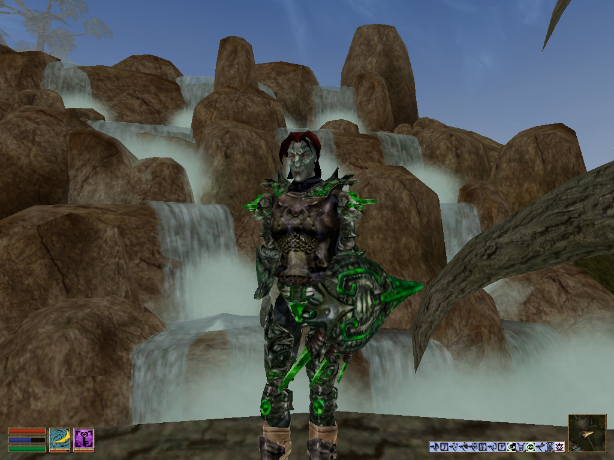

## Who are you and are you really an eye? What’s your villain origin story? Why do you have so many names? Are you really the Batman?

I’m Evil Eye, or [Assumeru](https://gitlab.com/Assumeru) when that name isn’t available. My contract says I’m a devops engineer, but I’m really a detached eyeball with psionic powers who types by blinking. Using a computer is bit of a hassle, but overall I’d rate being me 8/10; would recommend. I am not Batman, although that is something Bruce Wayne would say. As for my dank and secret past, it all began when I was but a mere pupil…

Okay, jokes aside, I first saw Morrowind over at a friend’s in 2005 or 2006 – summer, I think. I got a small tour: a look at character creation, a bit of the world, and a cliff racer. It was a case of love at first sight for me and I ended up ordering the game from eBay when I got home. Fast forward a bit and I’m messing around with mods and the Construction Set. At this point in time I didn’t know anything about 3D modeling other than how to use [NifSkope](https://niftools.org/) and I’d look at the models added by whatever mods I’d download and try to use them in different ways. One such mod, I think it was [Abu’s Retreat](https://web.archive.org/web/20161103132906/http://mw.modhistory.com/download-44-3357), added some sort of wooden wall decoration that looked vaguely like an eye. I tried to set it up as a creature. Obviously that failed as it had no animations whatsoever, nevermind creature animations, but the name stuck and I used it when I registered my account on the (now defunct) Bethesda Game Studios Forums. As for the other name, Assumeru was a character I played. A glass armor wearing, Trueflame wielding dunmer who I first completed the main quest with, as well as Tribunal’s main quest, a good number of faction quests, and some of [Tamriel Rebuilt](https://www.tamriel-rebuilt.org/)‘s Telvanni content. I ended up joining TR shortly after, in 2009.

## When did you join the project and why?

OpenMW first crossed my screen in the form of a thread on the aforementioned Bethesda forums. I thought it was interesting in much the same way I thought the [MCP](https://www.nexusmods.com/morrowind/mods/19510), [MGE](https://www.nexusmods.com/morrowind/mods/5535), [TR](https://www.tamriel-rebuilt.org/), and [S:HotN](https://en.uesp.net/wiki/Project_Tamriel:Skyrim) threads were interesting so I watched it for updates. The project wasn’t really a game at that stage, more of a tech demo, but it was progressing rapidly. You can still see the videos from 2012 on the [YouTube channel](https://www.youtube.com/@MrOpenMW).

For the next few years I’d download the latest version once in a while, play it, and report whatever bugs I ran into. In 2014 I reported [#1138](https://gitlab.com/openmw/openmw/-/issues/1138), by 2016 it still hadn’t been fixed so I decided to take matters into my own hands and, with copious help from scrawl, fixed the issue. Then I fixed a handful of other minor issues until I got back into TR development in 2019 (after doing next to nothing for the project in the intervening ten years.) I was working on a quest (that finally got released in last year’s [Andaram release](https://www.tamriel-rebuilt.org/content/tamriel-rebuilt-2310-release)) and I’d written some scripts that didn’t work in OpenMW due to [#2311](https://gitlab.com/openmw/openmw/-/issues/2311). I wasn’t about to roll over and accept that and, well, you could say things got out of hand.

So to actually answer the question, I joined the project because OpenMW was doing things that annoyed me. And my only C++ knowledge being a Tic-Tac-Toe program I wrote when I was 13 or so wasn’t going to stop me from changing that.

## So you’re ones of those completely reasonable people who learned C++ to work on OpenMW?

I wasn’t going to defend my sanity! I did have a little C and PHP5 experience, the latter being an embarrassingly thin wrapper around its C and C++ roots sometimes.

## Has OpenMW lived up to what you expected when you first discovered the project so far?

I’d say it’s done better than I expected. Of course when you consider that the Bethesda forums and a good number of interesting projects that posted there have gone the way of the dodo since then, my expectations might not have been that high to begin with.

## You’re the resident bug-fixer in chief of the project, what’s so exciting about fixing all those obscure edge-cases?

I don’t know about exciting, but it’s gratifying to see the reduction in people complaining about OpenMW compatibility. In the non-MWSE sense that is. It (mostly) just works now.

## Speaking of MWSE, what’s your opinion on it in the context of OpenMW?

In that context I suppose its functionality is something to strive for in OpenMW, but it’s not something I give much thought to. It’s too broad a subject, really.

## What have you been working on recently?

I started the 0.49 development cycle with a good amount of partial dehardcoding. As we get closer to branching, I’m trying to get in more minor issues that are easy enough to resolve. Thanks to [Capo](https://gitlab.com/Capostrophic) and Abdu I’m also playing some ancient mods of dubious quality in an attempt to find more bugs.

## What was the most exciting thing for you to work on? Oh, and since you’re fixing so many bugs, what’s your favourite one?

I had fun figuring out how Cortex’s transformation scripts and GCD’s levelling scripts worked for [#3905](https://gitlab.com/openmw/openmw/-/issues/3905) and [#2036](https://gitlab.com/openmw/openmw/-/issues/2036), respectively. Bug fixing has led to me playing lots of mods I otherwise never would have. Some of them very impressive, a lot of them pretty bad, but all interesting enough for someone to have reported a bug.

My favourite fixed bug is [#4414](https://gitlab.com/openmw/openmw/-/issues/4414), at least for today. How we could have ever lived without NPCs redressing themselves is beyond me.

## Any cool things you plan to implement that you haven’t already started working on?

Technically I’ve already laid some groundwork by starting that partial dehardcoding mentioned earlier, but I want to dehardcode magic. Having rewritten a large part of the magic code not that long ago, it’s a daunting prospect, but I want those new summon icons we have in Tamriel Data to show up in OpenMW already! Other than that I’m not a big planner; I just do whatever I feel like doing.

## If you could change one thing about OpenMW, what would it be?

Just one? Guess I’ll have to close my open merge requests.

## Any cool things you’re working on that *aren’t* OpenMW-related?

The province mods are pretty cool… and always looking for more hands. So if you don’t feel like you can contribute to OpenMW, [try there](https://www.tamriel-rebuilt.org/content/join). How’s that for a segue? I promise it’s not a pyramid scheme! Not since the [Necrom pyramid](http://web.archive.org/web/20040414043357/http://necrom0.tripod.com/) got removed anyway…

## Anything else you’d like to add?

A very general shout-out to anyone involved in any of the things mentioned above. A much less general observation that mwscript is deeply cursed. And last but not least, please [keep the bug reports coming](https://gitlab.com/OpenMW/openmw/-/issues), folks!
