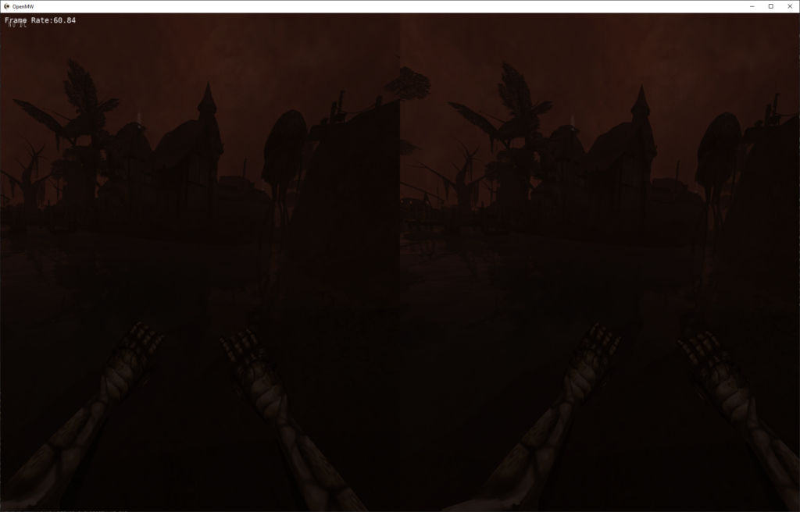

## Who are you, and for how long have you been a horsie?

I am and have always been a little horse. Neigh.

## When did you join the project and why?

2020\. I was dabbling in VR at the time and thought it would be cool to play Morrowind in VR. I was aware of the OpenMW project since a couple years prior and decided to implement it myself. For a while I was hardly a member of the project, just working on [my VR fork](https://gitlab.com/madsbuvi/openmw) occasionally asking questions in the [Discord](https://discord.gg/YegsVV3aRb). I don’t remember exactly when I ended up being an actual team member though.



## What have you been working on recently?

Dehardcoding combat. Recently my Lua API for animations and skill progression were merged which were a big roadblock to dehardcoding combat. The goal is to dehardcode combat entirely, so that the entirety of combat can be modded in any way. For example, to allow implementing Oblivion/Skyrim style combat, or VR “realistic” combat, as mods rather than as engine hacks.

## So you’re part of the OpenMW Lua cabal ‽

I don’t know about any cabal. I am just dehardcoding the things I need to be dehardcoded to meet my ultimate goal, which is to do VR as a mod instead of as a fork full of engine hacks.

## Keep your secrets, it’s ok. Any cool things you plan to implement that you haven’t already started working on?

Once dehardcoding spellcasting is in review/merged I’ll begin to dehardcode weapon combat. After that I don’t have anything non-VR planned, so I’ll be off to bring the VR fork up to date with .49 and port as much of it as I can to Lua.

## Has OpenMW lived up to what you expected when you first discovered the project so far?

I’m not sure I had much in the way of expectations. When I first found the project I was stunned that someone had gone so far in writing an open-source engine able to play Morrowind, it wasn’t something I would have expected to ever see! So at the time I was simply happy to find a way to play Morrowind that didn’t crash at every turn. I’ve never been the kind of purist who needs every detail to be exactly like the original game, I considered its current state as fully playable at the time, probably in 2018.

## What’s the current or next big thing you’re hyped about?

The Lua API for [RTT viewports](https://en.wikipedia.org/wiki/Render_to_Texture). This will hopefully allow me to move some of the VR-related RTT to Lua mods, and as this API will include scene graph manipulation it might let me do VR-related manipulations of the scene graph too. Especially, pointer geometries and body tracking. Although this might still need some additions/tweaks to allow same-frame modifications, which is required for VR.

## What’s your favourite OpenMW mods?

[Tamriel Rebuilt](https://www.tamriel-rebuilt.org/) is an easy favorite, and I always play with a leveling mod like [NCGD](https://www.nexusmods.com/morrowind/mods/44967).

## If you could change one thing about OpenMW, what would it be?

Assuming I could just wave a wand and have it: porting OpenMW from OpenGL to Vulkan of course!
