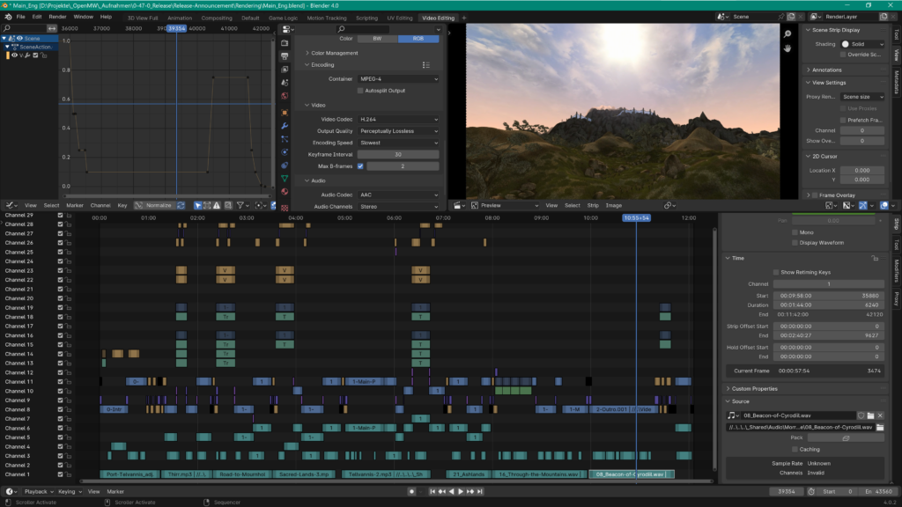

## Good morning and welcome to this joint interview. Can you tell us a bit about yourselves?

A.: Hey, anonymous interviewer! I’m neither a cat nor a month, but a rather fortunate bird — if you believe some historians’ hypothesis about my nickname’s origin. In my day-to-day life, I prefer to take the form of a German electrical engineer doing his PhD in the field of battery technology. Thanks for reminding me that I still was an undergraduate when I joined the project in early 2016, technically transforming from long-time lurker to, well, bird.

J.: Hello there! I enjoy the company of cats but like my fine friend Atahualpa I also am not a month. I also may not always be that hostile. When I’m not poking around in OpenMW-related things I do enjoy cycling, nature hiking, and playing music. I started hanging out in the OpenMW IRC channel back in 2013 or so and have just been hanging out ever since.

## Word on the street is that you’re the dynamic duo of OpenMW’s massive video production industry. Is that true?

J.: I remember learning about OpenMW, and of course part of that first exposure was a classic release video. I forget which was the first video I saw, but what did stay with me was the style — and I hope we’re staying true to it with our work.

A.: While we might be the somewhat dynamic video duo today, we are standing on the shoulders of giants: Star-Demon, who started the whole concept of presenting OpenMW’s progress in video format over twelve years ago for version 0.6.0, and the brilliant WeirdSexy, whose great voice and even greater love for spears have been ingrained in our [collective memory](https://www.youtube.com/watch?v=WSr3k9ubR7w&t=136s).

<!--more-->

## Producing video sounds like work. What does it look like, what’s the secret sauce?

A.: At this point, a short disclaimer: We aren’t professionals by any means, so take everything we say with a spoonful of salt.

J.: Oh please, everybody knows that Atahualpa is a Blender video-editing Arch Magister. I learned everything I know from him!

A.: Alright then, let’s look at some of the things we need to cover in order to produce a somewhat entertaining release video. Please note that this is a simplified breakdown and that many of these steps may overlap, change order, or require several iterations and feedback loops. Video production is reaaaaally time-consuming (maybe we should start doing reaction videos).

1. Content considerations  
   We usually take the complete list of changes (nowadays 100+ closed issues per release), add changes without tickets on our issue tracker, put them into suitable categories, and rate their video eligibility:
   - Importance?
   - Interesting to the viewer?
   - “Easy” to demonstrate?
2. Content outline  
   After choosing the issues we want to cover, we define their order of appearance. The structure might look like this:
   - Intro
   - Credits
   - Main video
     - Section 1
       - Cool new feature
       - …
     - Section 2
     - …
   - Outro
   - Fake “end card”
   - “Post-credit” scene
3. Script draft  
   Having a rough outline, we start writing the script. Especially this step might go through several feedback loops by discussing it among us or passing it to the team for review.
4. Audio recording  
   We usually divide our speaking parts evenly. Then, we record our paragraphs, optimise audio quality, put in labels, and export them into single files for greater flexibility.
5. Video recording  
   With the script and audio in place, we can start recording video footage. This is, of course, heavily guided by the script — not only in content but also in length. Moreover, many of the scenes might require a certain setup, even including mods or custom editor content to fit in those little inside jokes no one will catch anyway.
6. Pre-postproduction  
   Each video requires title screens, text overlays, and pre-rendered audio visualisers (see intro of 0.47.0 video). Those are done in Blender.
7. Postprodcution  
   In this step, everything is put together using Blender’s video sequence editor: video and audio files, background music, overlays, video and audio transitions, and additional effects, e.g., speed modifiers or zoom effects. The final Blender file might look like in the image below.
8. Rendering  
   The video is rendered in 4K to ensure highest quality on YouTube — yep, even 1080p viewers benefit from a 4K source file due to YouTube’s infamous compression shenanigans! Early video tests are usually rendered with a lower resolution to speed up the process.
9. Post-postproduction  
   Before the video is published, we create closed captions in English (as well as subtitles in German if there is no separate German video) and a custom thumbnail.
10. Pre-release tests  
    The last step before a release is extensive test viewing by other team members to catch any remaining errors. — Et voilà, a new release video is ready to go!

## Is it true that you’re mysteriously showing up in time of need, like, right before an OpenMW release?

A.: Nice try to get that famous quote from this wizard in Star Wars. Ehm, Spock it was, right?

J.: Think of me as the reverse homer-in-the-bushes gif. Oh, and yeah Atahualpa: that was Captain Spock for sure.

A.: In fact, OpenMW releases tend to spawn right after one of our videos. Except for 0.48.0, which, to this very day, is a great mystery in and of itself.

## Wait, does that mean you’re cooking a release video right now‽ Can you share some details? Can you *leak* the date of the release?

A.: My estimate is that we will release the video at least one day too late from everyone’s perspective, which is going to be mitigated by delaying the actual release which, in turn, is going to annoy everyone even more. It wouldn’t be the same otherwise.

J.: Maybe a few days plus or minus from that. I can’t be too sure. It’s likely we won’t know when it will be out until it is.

A.: Seriously though: 2024 would be awesome — looking at you, extended release phase for 0.48.0.

## Previous videos have been awesome and thus rightfully well-received. How do you handle so much fame?

J.: Give the people what they want! And by that I, of course, mean Fargoth jokes and Imperial guard mosh pits.

A.: Not to rain on your parade, but I measure fame in the amount of bot comments below our videos — and going by that metric, we are as famous as the menu pinning feature in Morrowind.

## Speaking of videos, since you’re obviously domain experts, any recommendations with regard to movies and TV shows?

A.: Boomer advice: Don’t let your consumption of movies and TV series become arbitrary. Oh, and consider reading the source material (if it exists), especially if you happen to love fantasy and sci-fi works like I do — it usually allows you to imagine and explore other worlds in much more depth than a TV adaption can provide. As to actual recommendations, my last movie was “Dune: Part Two” (you might have heard about it). One of the best audio-visual experiences I’ve ever had in cinema. (Again, read the books! Well, at least the first three, I guess. The series gets increasingly more complicated and esoteric.)

J.: Oh yeah, Dune is on my “to-watch” list, and I guess now on my “to-read” list as well! Ahem, as TV shows go, I must take this opportunity to give a shout out to “Star Trek: Deep Space Nine”. When I think about movies, I think about “Fear and Loathing in Las Vegas” and I think of mine and Atahualpa’s adventures in making OpenMW-related videos. Yeah… it’s kinda like that!

A.: Uhm, okay. But who is which character in that analogy?

J.: I do think of you as my attorney and you *are* doing the PhD thing, so that makes you Dr. Gonzo. I’ll be Hunter S. Thompson; I can wear cool hats and take all the \~screenshots\~ photographs.

## Have you ever thought about learning C++ to contribute by writing code, like some other contributors did?

J.: Years back, my first experience with (very roughly) hacking on C++ at all was with OpenMW — I wanted to hack in the ability to wear more rings and kind of grepped my way to it. More recently, I actually did decide to dive back in to get a small feature added into the Lua API. Major thanks to everyone who helped, especially S3ctor and Evil Eye! It’s a big, complicated codebase but it can be reasoned about. The C++ itself is just another thing you must cope with, but things can come together surprisingly quickly.

A.: Truth be told, I learned C++ at technical college back in 2008. The problem is that an engineer’s ability to produce completely functional spaghetti code doesn’t qualify them to work as a game engine developer. Nonetheless, I’ve already contributed some smaller changes and bugfixes, with an emphasis on our editor, OpenMW-CS. — Even more truth be told, I have several thousand lines of unpublished code for various parts of the CS buried in my local OpenMW folder. Programmers can be harsh at times, and OpenMW developers are especially good at humbling you, allowing you to sustain your personal coding insecurities and letting you keep your work for yourself.

## What’s the next big OpenMW thing you’re super excited about?

A. and J.: Lua!

J.: Of course it’s playing Half-Life 3 in OpenMW: Unity Edition. Seriously though: I’m looking forward to the awesome work that’s being done with spell casting and combat for the Lua API. These are some of the most sought-after features for modding and I think we’re going to see a lot of cool content that will utilize this. There’s also been some hacking on sky shaders that looked amazing, hopefully that can be on our pre-2090 list.

A.: I also like to see new stuff which I’ll probably never use myself, but which sets OpenMW apart from the original TES games. Upcoming features like (eventual) native support for multiplayer and VR are not only great for the people that use them — but they’ll also make OpenMW more accessible to other audiences which, in turn, might draw new contributors to the project. Moreover, let’s not forget that all these features will be most likely integrated into one platform, i.e., multiplayer users should be able to join using the Android version of OpenMW, VR users get to enjoy full support for OpenMW-Lua mods, etc.

## Following, OpenMW intends to be a platform for independent games. Do you have a “dream” OpenMW game, and if so, what’s that look like?

A.: With “Tamriel Rebuilt”, “Skyrim: Home of the Nords”, “Province: Cyrodiil”, and the other “Project Tamriel” projects, Morrowind-era Tamriel is already covered if you ask me. What I would like to see — and, yes, I’m a sucker for Daggerfall, especially Daggerfall Unity — are large-scale approaches to a fantasy game. Maybe not as massive as Daggerfall or the (hopefully) to-be-released “Wayward Realms”, but with a greater sense of scale than the tiny theme parks current TES games are. Eventually, OpenMW-CS should allow for some kind of random/procedural generation, and I would like to see somebody take advantage of that possibility.

J.: I’m looking forward to community-driven projects that are using OpenMW for their engine such as Open-Z; My dream game made with OpenMW might be something surprising, maybe something with Katamari-like gameplay or some kind of recreation of a classic game. I love to see unexpected, not-Morrowind things as much as I love the Morrowind things.

A.: \*cough\* RoboWind Construct (RWC). Google it.

## If you could change one thing about OpenMW, what would it be?

J.: I would remove the team’s harsh ban on hardcoding every actor in any game using OpenMW as Fargoth. It’s a crime, really!

A.: Speaking of hardcoding: the father of OpenMW, Nicolay Korslund, found it funny to hide most of our engine’s features behind a hardcoded 2090 timestamp which can only be removed for each feature individually by wasting huge amounts of energy to mine a developer token. That must have been the single biggest mistake in computer history! I want my vanilla-style water now!

## Someone told me that johnnyhostile was going to jam with lysol in a sludge metal cover of the Morrowind theme. Is this true?

J.: It is true! This is actually the epitome of vaporware, 2090 edition projects. Coming soon^TM^.

A.: Not to spoil anything, but having heard an early demo of johnnyhostile’s guitar part, I’m more than hyped for the full album release!

## Anything you’d like to add?

A.: To avoid a shameless self-plug by my wonderful partner in crime: If you want to mod OpenMW, go visit [modding-openmw.com](http://www.modding-openmw.com)! I consider it to be OpenMW’s sister project, a hub for mod creators and modders alike that allows the community to decentralise mod hosting, while it ensures easy access to mods and modding instructions for everyone. It’s johnnyhostile’s baby, and he’s managed to build a team of dedicated contributors who help maintaining and improving the site for all of us to benefit from! Oh, and if you are a modder who wants to dive into OpenMW-Lua, have a look at johnnyhostile’s [Lua mod template](https://gitlab.com/modding-openmw/momw-mod-template). It even allows you to host a little static website for your mod. — End of ad break.

J.: That’s it for today’s interview. See you next time — and as always: thanks for watch-, uhm, reading!
