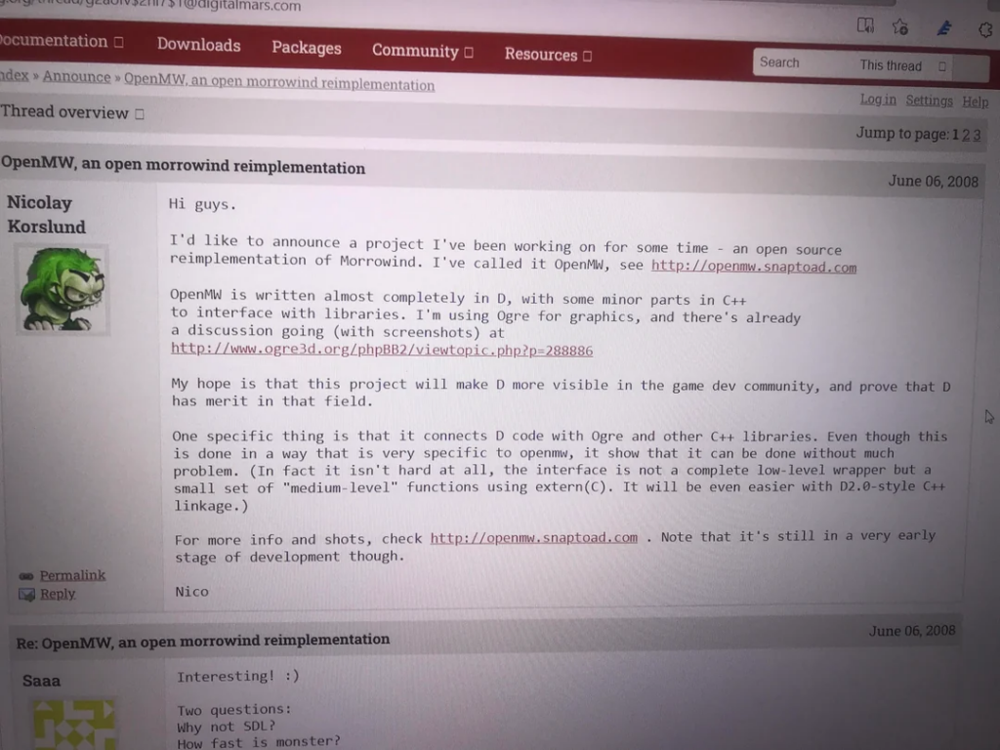

## Who are you?

I’m jvoisin, a security engineer by trade. I’m involved in way too many projects and software, and ramble ~~write~~ on a regular basis on [dustri.org](https://dustri.org/b)

## Where did you get your avatar from, and are you actually a beaver?

Every time someone asks me this question, it’s a different animal: beaver, rat, shrew, otter, mouse, ermine, but it’s none of them! It’s the bear from [I want my hat back](https://en.wikipedia.org/wiki/I_Want_My_Hat_Back) from [Jon Klassen](https://en.wikipedia.org/wiki/Jon_Klassen). And yes, it’s me, I’m the bear from the book. I’m happy I got my hat back, and I’m more careful with it now.

## When did you join the project and why?

I think I’m a bit the Tom Bombadil of OpenMW: I’ve been there since the beginning, and I will likely be there at the end, always in the background. I “joined” the project around mid-2008, when [Nicolay Korslund](https://github.com/korslund) announced OpenMW. Back in the day, it was written in [D](https://dlang.org/), used [OGRE](https://www.ogre3d.org/), [Audiere](https://audiere.sourceforge.net/), [OIS](https://wgois.github.io/OIS/) and [Monster](https://sourceforge.net/projects/monster-script/), and lived on [openmw.snaptoad.com](https://web.archive.org/web/20080701212816/openmw.snaptoad.com).

I’ve been following it on the Google group, on openmw.net and finally on openmw.org. I survived the transition from D to C++, from OGRE to OpenSceneGraph, from GitHub to GitLab and a couple of project leader changes.

I joined the project because Morrowind is one of my favourite games. I remember going to my local [multimedia library](https://en.wikipedia.org/wiki/Multimedia_library), and seeing this yellow/brown-ish video game box on the shelf. The computer we had at home couldn’t display the game at first, since it couldn’t handle the 640×480 resolution, but the booklet fascinated me. When we got a better screen, I could finally play, and it was so impressive at the time: you could do whatever you wanted: follow the main quest, talk to anyone, hunt, fight, become a wizard, a warrior… it was incredible. A couple of years later, in 2008, I was looking to make it run on a Linux machine, and stumbled upon this new project of complete re-implementation. The rest is history.

I guess I should write a blog post here about the history of OpenMW at some point.

## So what have you been doing/working on this whole time?

In the beginning I didn’t do much. And now that I think about it, I never did much to be honest. I started by joining the PR team, doing blog posts and translations. I know C, so I can read some C++, and thus contributed a bit to the codebase, but never did anything major or groundbreaking, mostly fixing bugs and trying to make contributing to OpenMW easier and the code better. I ended up becoming the main system administrator, taking care of our server, website, wiki and so on. Nowadays, I mostly do sysadmin, code reviews and taking care of this very blog, as the amount of time I can dedicate to the project has shrunk significantly lately.

## Any particularly cool things you’ve worked on?

I had a lot of fun [writing fuzzers](https://dustri.org/b/finding-bugs-in-openmw-with-afl-and-honggfuzz.html) for OpenMW. They found some bugs, but I think the best part is that it led me to profile OpenMW to make things run faster, resulting in a better OpenMW for everyone. It also improved its robustness against all kinds of weird mods people are coming up with.

## What have you been working on recently?

I’ve been [interviewing](/categories/interview) various people from the core team, hence the surge of activity on this very blog. I find it fascinating that random people from all around the world, with different backgrounds and interests, are spending their time trying to work together on OpenMW, a custom engine for a \~22 years old game. It’s incredible really, when you think about it!

## Has OpenMW lived up to what you expected when you first discovered the project so far?

I think so. Heck, when I discovered the project, it could render some statics… and that was pretty much it. When OpenMW was able to handle and render some parts of the terrain, everyone was so excited! Now we have Lua bindings for most of the mechanisms, and some gorgeous shaders that I wouldn’t have dreamt of, a prototype for multiplayer, and so much more!

## What’s the current or next big thing you’re hyped about?

Everyone is raving about Lua support, but I think that the future move from OpenSceneGraph to VulkanSceneGraph will bring a lot of great things, if it happens: performance improvements, portability, easier eye-candy…

## Any favourite mods?

Tough question. I spent hours on [Wiwiland](https://wiwiland.net), the French Morrowind modding community, downloading and playing so many of them. I think that my favourite small mod is [Maison du voyageur](https://morromods.wiwiland.net/spip.php?article134), a hut near Seyda Neen. As for bigger mods, I’m always impressed by how big and well-done [Tamriel Rebuilt](https://www.tamriel-rebuilt.org/) is, of course. Maybe one day they’ll ship with OpenMW by default, who knows?

## If you could change one thing about OpenMW, what would it be?

I would love to have it written in a different language. Even though C++ a popular language, it has so many drawbacks: mistakes are easy to make, compilation times are abysmal, so many subtleties everywhere…

## In that case, what language would you rather be used?

No no no, I’m a security engineer, I only point out things I don’t like, I’m not here to provide actual actionable solutions.

More seriously, I don’t think there are good choices in 2024. Some might say [Rust](https://www.rust-lang.org/), but it comes with its own set of problems, and porting the project to a new language would be a monstrously large effort anyway. I think the best we can do is to working on making our C++ as less awful as possible, with things like [modules](https://en.cppreference.com/w/cpp/language/modules) to reduce compilation time for example, or leveraging modern tooling to make contributors’ lives less dreadful: sanitizers, our glorious [continuous integration](https://gitlab.com/OpenMW/openmw/-/pipelines), our [growing test suite](https://gitlab.com/OpenMW/openmw/-/tree/master/apps/openmw_test_suite)…

It feels like an uphill battle, but to be fair, this is how most interactions with computers feel anyway.

## Anything else you’d like to add?

I’d recommend anyone who likes Morrowind look into OpenMW, and if you’ve got some free time, contributions in any form or shape are always welcome!
