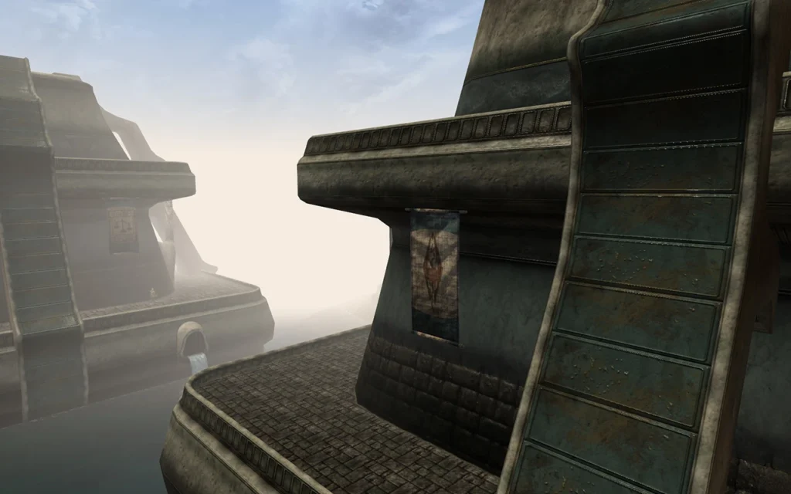
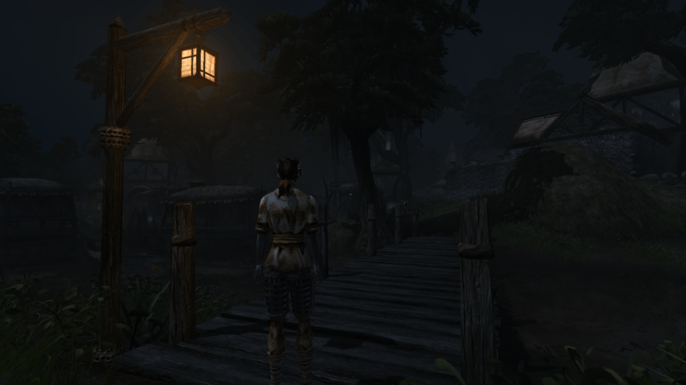
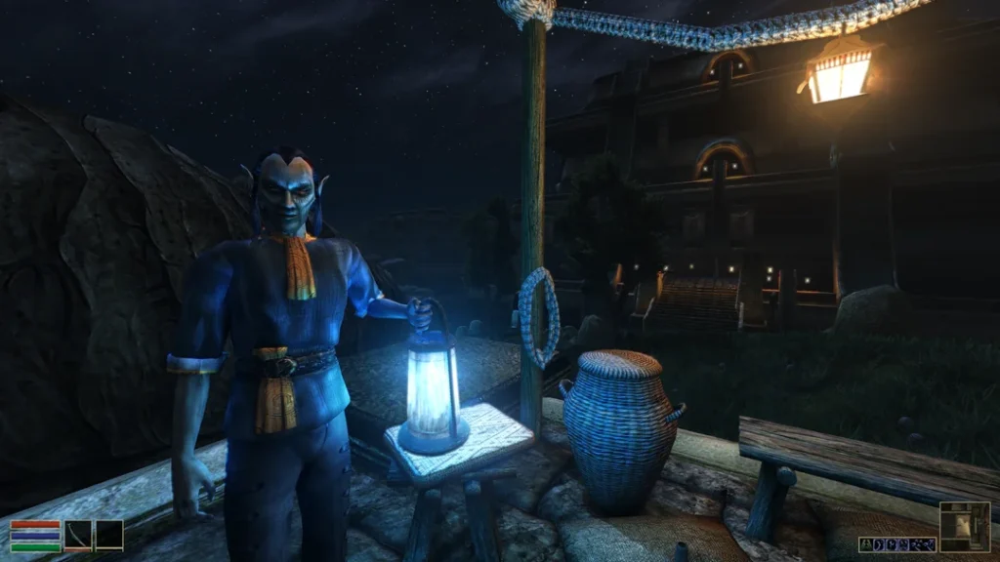

## Who are you, and is it true that you’re killing 99.9% of viruses and bacterias?

It’s true! It’s not very impressive either, since a small area can have like hundreds of billions of either which means there would still be millions left. I should never be allowed at a hospital. Weird that I actually do work at a hospital.

For real though, the name Lysol does in fact not have anything to do with the cleaning agent with the same name (it’s not even available where I live as far as I know). Well, it does indirectly, but that’s because a [really heavy album](https://en.wikipedia.org/wiki/Lysol_%28album%29) by the weird band Melvins was named after said cleaning agent. And \*my name\* was taken from that album because I was a fanboy of that band in my teens.

My actual name is Joakim and I work as a [radiographer](https://en.wikipedia.org/wiki/Radiographer) (or radiology technologist, if the reader is from the US) at a hospital here in Sweden. My developing skills are limited to HTML, CSS and *editing* existing code of javascript and PHP. Truly impressive.

## When did you join the project and why?

I found out about OpenMW when 0.18.0 was released if I recall correctly. There were no animations, no combat, no menus, and executing the engine simply launched you directly into a cave with clipping disabled. For some reason I thought this was the most exciting gaming-related thing I had ever seen. So I started hanging around. A lot. I did some modding. Then one day I ended up volunteering to write a news post on the official blog.

## Are you one of those reasonable people who learned C++ to contribute to OpenMW?

What? No? I’m not that smart. I learned how to generate somewhat decent normal maps because of OpenMW, but that’s it. Never did any coding and most likely never will.

## Ok, but while you didn’t contribute code, you’ve spent a lot of time making it easier for people to use OpenMW, mainly by working on the documentation and translations.

I did do some of that, yeah. The documentation I did was mainly the guide on how to [convert normal maps](https://openmw.readthedocs.io/en/stable/reference/modding/texture-modding/convert-bump-mapped-mods.html) made for Morrowind Code Patch or MGE XE to OpenMW. I now realize I almost forgot I did this and should probably re-read it to see if I wrote something stupid. I probably did some more documentation as well.

Regarding the translations… Yeah, well, when OpenMW got its translation system implemented, I reacted the same way I did when the normal mapping feature was implemented: “neat, gotta try this out”. So now, pretty much everything\* in OpenMW that can be translated is translated to Swedish. A language literally no one will ever ask for to get OpenMW translated into. But it was fun! I learned a lot of new Swedish words, ironically.

\*everything as in “everything until [Andrei Kortunov](https://gitlab.com/akortunov) decided to [make the entire launcher translatable](https://gitlab.com/OpenMW/openmw/-/merge_requests/3571)”.

## You’re the Head of Public Relations And Assorted Propaganda, how do you feel about this?

I can’t talk about that.

Seriously though, it’s been fun. I did quite a few news posts on the main page back in the day but then kids happened and I started having less and less time to do such things. So I rather feel like a femur than a head to be honest. I still hang around the Discord-channel though and try to be helpful whenever I find the time for it.

## I’ve been told that you’re also an avid modder on both Oldwind and OpenMW, is that true?

Well, not that much specifically on Oldwind really. I don’t think I ever released a Morrowind-mod pre-OpenMW actually. But I did \*play\* Morrowind a lot before OpenMW. I also did a lot of modding during that era, but for other games. During my late teens in the late 00s, I did a lot of modelling and texturing for Warcraft III and Rome: Total War (yes, the first one). I won’t say which project I took part in because the work I did back then is horrible. I’ve changed the username since, so you can’t backtrack me, stalkers.

But anyway, when OpenMW became a thing in my life, I returned to modding again, this time being in my 20’s instead. Then kids happened (stay away from it if you want to be a modder for the rest of your life) and I have barely done any modding since.

## You were one of the first modders to create mods with normal and specular maps for OpenMW. Do you want to tell us a bit more about them?

That’s likely correct, yes. In 2016, our lord and fallen hero [scrawl](https://www.youtube.com/watch?v=h8-KiRqAvuo) implemented [normal](https://en.wikipedia.org/wiki/Normal_mapping), [specular](https://en.wikipedia.org/wiki/Specularity#Specular_maps) and [parallax](https://en.wikipedia.org/wiki/Parallax_mapping) mapping into the then freshly baked OSG-version of OpenMW. I got really really hyped and pretty much started F5’ing [Nexusmods](https://www.nexusmods.com/morrowind/) to see the flood of sweet normal mapped texture mods coming out. Except they didn’t. Texture mod after texture mod came out and no one cared about normal maps.

So I went “fine, I’ll do it myself” and started to re-learn photoshop and teaching myself how to best use diffuse-to-normal map-generating software. So [this](https://forum.openmw.org/viewtopic.php?p=38391) old thread happened, which later became [this](https://forum.openmw.org/viewtopic.php?t=3526) thread. Yes, I had to dig deep to find this piece of Lysol history, be grateful.

So, I really just wanted to see how Morrowind would look with 2010 technology. For those that don’t know, [normal maps](https://en.wikipedia.org/wiki/Normal_mapping) are textures with specific colors that instruct the engine how light should fall on an object, to be able to “fake” a complex shape that wasn’t actually there on the model. You can in other words have a flat modelled surface but still have the light fall on it as if the surface was bumpy and detailed. This gives better looks, but with a lower performance hit than if you would have modelled the shape in 3D instead.

This banner here for example is completely flat, but the normal map makes it look like it is a bit wavy.

## With your modder hats on, what is OpenMW doing right, and what is terrible (and should be fixed)?

Right:

- The VFS (virtual file system) is still the best thing that ever happened to a modder. The VFS is the system that makes it possible to keep every mod in a separate directory and tell the engine to load that directory. It’s great for players, but a godsend when you’re modding. It just makes it so much easier to keep track of all your files and of course pack your files for the release.
- Normal, specular and parallax map support still exists.
- Dehardcoding is going according to plan™ and amazing modding capabilities are available already.
- Post-processing shaders are awesome, case in point:

Terrible:

- No official [PBR](https://en.wikipedia.org/wiki/Physically_based_rendering) support, neither for maps nor shaders.

## Speaking of mods, what’s your favourite one(s)?

[This one](https://www.nexusmods.com/morrowind/mods/49735). Anyone still using my imperial towns-mod is an idiot. This was done by someone with actual skill and not only motivated by “no one else is doing this”.

## Has OpenMW lived up to what you expected when you first discovered the project so far?

Oh boy. I got hyped when animations got implemented. Then I got hyped when support for the start scene in the boat got implemented. Then I got hyped when melee combat was implemented. You know, I think OpenMW surpassed my expectations like two hundred times by now.

## What’s the current or next big thing you’re hyped about?

I would like to say “the sum of all the de-hardcoding-related Lua merge requests lately”, but that would be boring. But I guess wazabears upcoming clustered shading is pretty hype-worthy.

## If you could change one thing about OpenMW, what would it be?

Change the scripting language from Lua to JavaScript.

Seriously though. Getting the [VulkanSceneGraph](https://github.com/vsg-dev/VulkanSceneGraph) port done and merged with the project, to bring OpenMW into the future, from OSG to VSG, from OpenGL to Vulkan! But that is being worked on slowly, so we’ll hopefully get there one day.

## Anything else you’d like to add?

A big thanks to all of the people, still active or now inactive, that have been part of making OpenMW what it is today. You’ve all been a big inspiration and I’ve had so much fun hanging around with you on the internet. I never thought I would be part of a community like this for more than ten years and still find the project fascinating!
