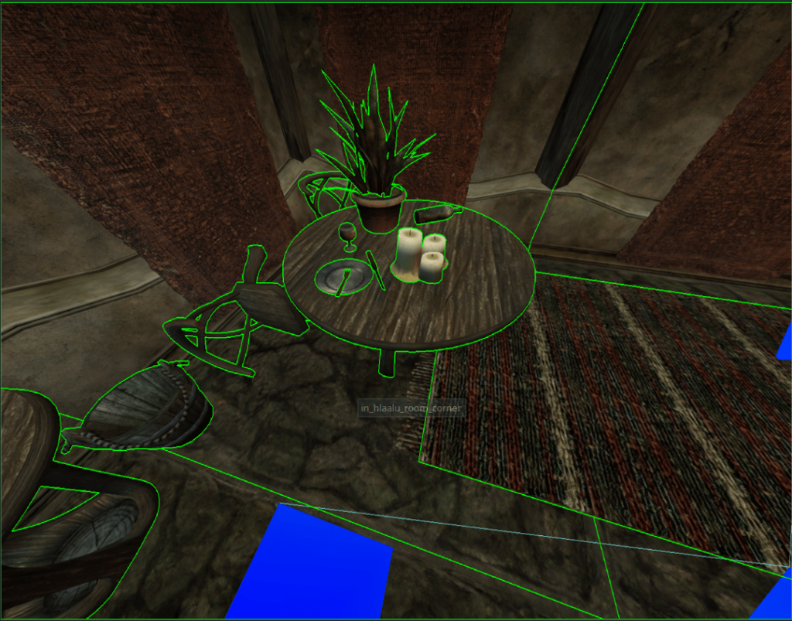
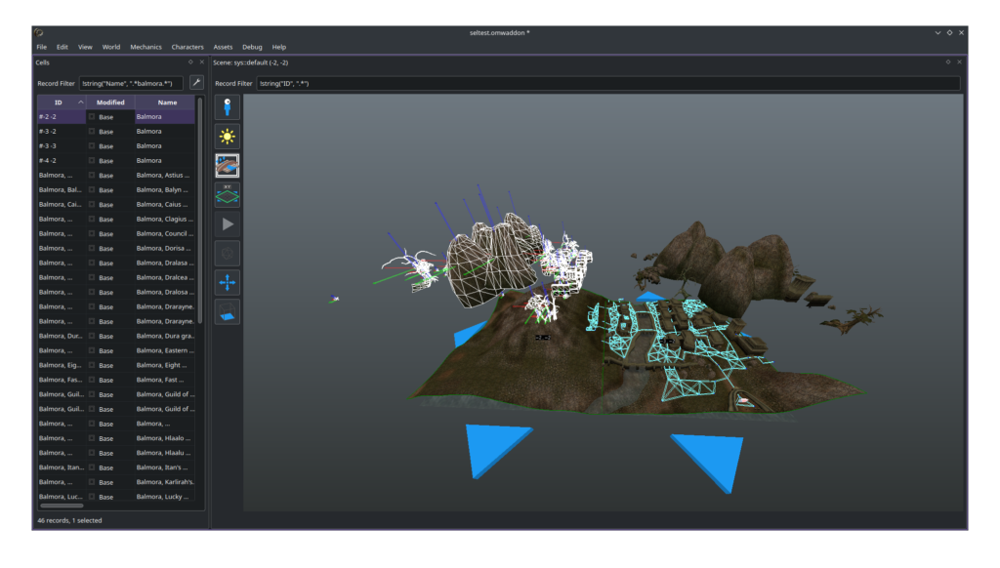
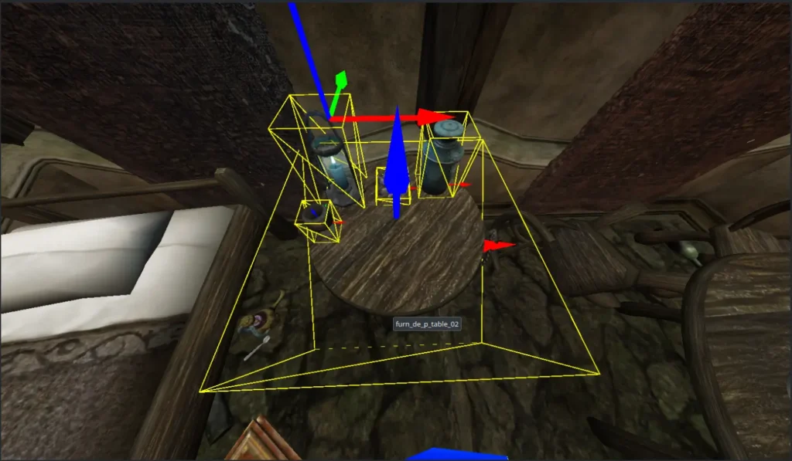

## Who are you?

I am a student programmer from Oklahoma. I actually got into programming seriously because of my interest in OpenMW many years ago. I have two kids and in my free time like to play pool and hack Xboxes. But mostly, I like to spend my free time when I’m not with my kids writing code, specifically for OpenMW or some other Morrowind-related project. You will often find me on Discord helping people with, or researching my own, weird Morrowind problems.

## When and how did you discover the project?

I’m not actually sure offhand when I got into OpenMW. Probably around 2013-14, seemingly after the project moved to C++ and I got my first PC, I started my first playthrough. I vaguely remember stumbling into the project when I was trying to figure out issues with my save games in the original engine. I remember at the time, there was no [MWSE](https://mwse.github.io/MWSE/), and many original bugs in the engine still existed. My saves kept getting corrupted when I saved outdoors, unless I looked at my feet, and I got so frustrated with it I never looked back once my game became stable.

## You learned C++ because of OpenMW‽

I did not learn C++ specifically because of OpenMW. Actually, I had never touched C++ prior to having forked the [TES3MP](https://tes3mp.com/) project and getting together a small group of people to work on it. However, my longtime interest in doing so drove me to attend college for low-level programming so that I could focus eventually on helping to develop the multiplayer components of OpenMW.

## Has OpenMW lived up to what you expected when you became involved with the project?

I think so. I remember back when I first started playing OpenMW, at a time when most basic mods still didn’t work, the plan was always to make the engine useful not only for other Bethesda games, but for other game developers. OpenMW itself is just now in the phase where this is starting to become more and more of a reality by the day, and I personally know many developers who are engaged in original projects specifically geared toward OpenMW.

## You’ve mostly been working with OpenMW-CS while most developers always found it more interesting to work with the engine instead. Why?

I think on some level it is probably because no other developers is currently working on the construction set. I have seen people even ask, “Why does OpenCS exist to begin with?” My personal experience has been that I started modding long enough ago that the Bethesda form of the construction set scared me off, and I see a lot of potential in the design of OpenMW-CS. I always intended to do something with it, but eventually it broke one of my mods, I started hacking at it, and I developed a vision for what it could look like in the future when building my own games with it.

In some ways, the construction set is uncharted territory both because users aren’t really fans of it, and because the developers who were seriously involved with it are no longer active on the project. For those reasons, I see it as a mostly blank canvas to build something great on top of something that is actually fairly solid at its core, if painful to use at times. This gives so much opportunities for improvement, both because there are few if any people and mods to upset when things change, and also because almost anything could be better than what is available now in \*some\* respects. However, its foundation, I think, will easily allow OpenMW to support later games through its construction set once some issues with its renderer have been worked out.

## What have you been working on recently?

Most recently, I have been working to add proper selection outlines to the construction set. Presently when you select an object, its [wireframe](https://en.wikipedia.org/wiki/Wire-frame_model) is drawn to show that you’ve selected it. It makes the resulting scene *extremel*y busy when you’ve gotten even a handful objects, like a table and everything on it. The OpenMW team has helped me to resolve this and to implement what I think should be the basis of a simple shader framework within the construction set.

Once this is done, we can move on to replacing the dynamically generated selection arrows with real selection widgets graciously provided by the MWSE team, and implement many more interactivity shortcuts within OpenMW-CS.

## How do we bribe you to keep working on the CS forever? It wants so much attention.

Nag me in the right direction and I will bash at this thing until it does its job. I really like it and it should be much better than it is. My own projects completely depend on it, so my mods cannot work without it being functional, especially since they’re mostly geared toward multiplayer :)

There are many related ideas I’ve come up with both from trying to use it myself and just hearing [CSSE](https://mwse.github.io/MWSE/references/general/csse/) authors/experienced modders complain about it, so there’s definitely plenty to do.

## So what kind of nice stuff do you expect OpenMW will give us in the future?

I think there are many things in OpenMW whose full potential are yet to be unlocked. Features like groundcover and Lua records are only half-implemented, and one of my goals is to fully integrate these features within the OpenMW-CS so that the power they \*already have\* can be fully leveraged by the construction set. I hope that some of my recent developments which have been greatly assisted by the OpenMW team will open the door for a  post-processing framework within the CS as well. All of that is to say nothing of support for the ESM format from later games, which actually is made very possible by the OpenMW-CS’ architecture, if tedious.

## Any cool things you plan to implement in the future that you haven’t already started working on?

The next, and probably biggest, thing I would like to implement for 0.49 is full support for *LUAL* records in OpenMW-CS. I spent a lot of time decoding what they look like under the hood and learned how integrate omwscripts files into the omwaddon format. Not only will this provide modders with the ability to simply *not* have two plugins with some Lua mods, it will also expand the capabilities of the Lua API for most users, so that it can do what it’s *already capable of* with less effort on the part of the scripter.

## What’s a *LUAL* record? Also, since you’re mentioning Lua, what’s your opinion on MWSE in OpenMW?

Today, when a scripter makes an OpenMW-Lua mod, they must create a .omwscripts file along with it. The entire purpose of this little text file is to say “This script hooks up to this type of thing”, e.g, you may want a script to run specifically on the player, on NPCS, on Doors, and so on. What happens is that this text you type in, is transformed into information that is identical to what is in an .omwaddon, or even, an .esp. The engine interprets them identically – a properly formatted omwaddon or esp file, is no different than a .omwscripts file.

However, there are features buried behind doing this in an .omwaddon, which are not offered by omwscripts. Namely, with *LUAL*, one can attach a script to a specific object, or instance of an object, as opposed to an entire category of objects. For example, instead of attaching your script to *ALL* NPCs, you could hook your script up to, say, just one specific guard in Balmora, or the door that leads into Caius Cosades’ house, instead of every single door in the entire game.

I think that the subject of MWSE in OpenMW was examined a very long time ago and fell apart. It was questionably feasible even at that time. However, I do have faith that the community can find common ground across the implementations of some techniques eventually. Even if there \*are\* two separate engines, there’s only so many ways you can put together an [MCM](https://mwse.github.io/MWSE/apis/mwse.mcm/), after all.

I would like to say that my own developments and many of those of the OpenMW community would categorically not be possible without the awesome contributions of the MWSE team. They have helped me personally along with most of the OpenMW contributors, and carried this community for a very long time. They’re great folks.

## If you could change one thing about OpenMW, what would it be?

If there were only one thing in the world I could change about OpenMW, it would have native multiplayer support. I originally got into working on the engine because of my interest in multiplayer, and I must say there’s no experience quite like it. I strongly encourage any Morrowind fan to give TES3MP a shot, whether with a friend or on a public server. I’ve had a TES3MP server in some form or fashion for about five and a half years now, and there is absolutely nothing like it in the gaming world.

## Why is Multiplayer Really Cool™?

I enjoy multiplayer Morrowind because it allows you to build environments that are the scale of an industrial MMO with relatively little effort, while still being high quality if your scripts worked in the first place. No other framework gives authors the capability of building multiplayer worlds with the same level of ease (and cost) as TES3MP. If nothing else it deserves honorable mention for multiplayer devs in the FOSS space.

## Since OpenMW still plans to add multiplayer, do you think you’ll be able to help with its implementation?

This is my main goal and reason for becoming active in the community. The TES3MP team and I have made some strides in this regard, and many steps back, but ultimately I do hope to help make this possible. I would love at some point to be able to offer something useful to OpenMW in this regard, and have spent probably half of 2023 researching how this could be made real, including some work with the author of TES3MP.

However, OpenMW itself “thinks” very differently than TES3MP does, so it’s my opinion that the ultimate version of OpenMW’s multiplayer implementation will be very different to what is available now. Whatever OpenMW’s multiplayer implementation eventually looks like, my friends and I will have a lot to say about it along the way and do everything we can to make sure it’s the best it can be. Most of that work is very likely to be done in tandem with the original author of TES3MP, [David Cernat](https://github.com/davidcernat), whom I’ve very much enjoyed working with in the limited time I’ve interacted with him.

## Anything else you’d like to add?

Not really. But I am a big fan of the project and have been for a long time. I hope to see tooling and support for the engine grow over time as more independent developers get hold of it and its toolkit is made more usable.
