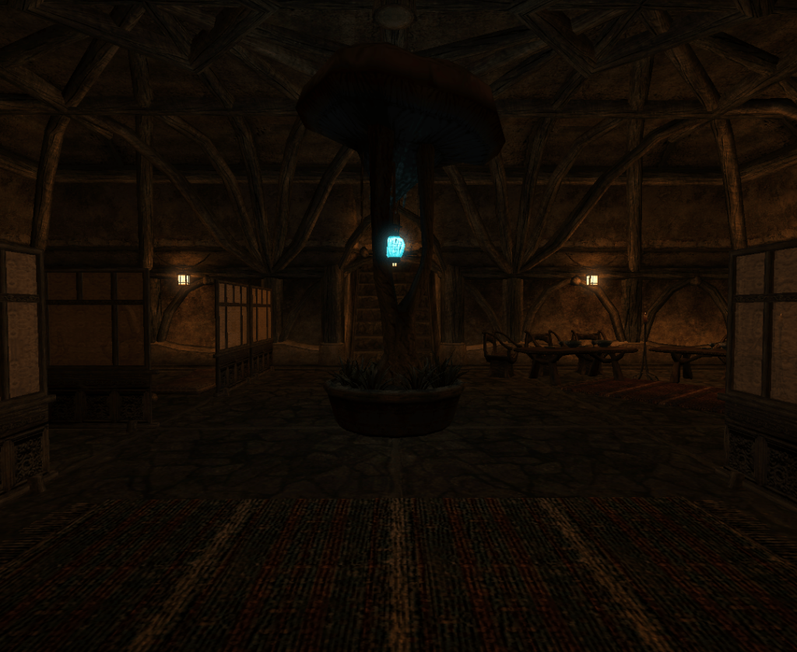
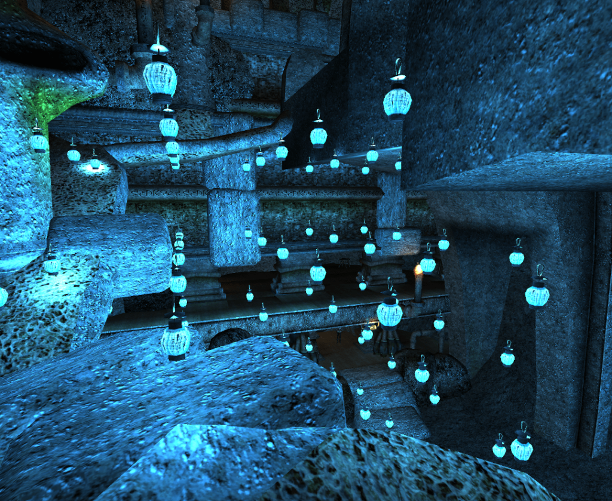
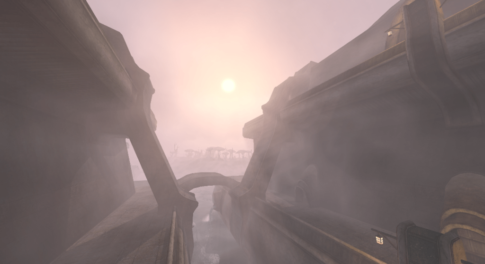

## Who are you and why aren’t you a bear anymore? What happened?

I’m 26 years old and I live in California where I work as a Software Developer. I love the icy cold, and my dream vacation is [Solstheim](https://en.uesp.net/wiki/Lore:Solstheim). If I could meet anyone from the Elder Scrolls universe it would be [Todd Howard](https://en.wikipedia.org/wiki/Todd_Howard). Everyone always asks about the name, and I love telling the story and disappointing them. I needed a handle for some account that I can’t remember many years back. That was the phrase that came to mind, and so goes my origin story.

## When did you join the project and why?

It started sometime around 2019 when a friend introduced me to the OpenMW engine. Prior to that, Morrowind was a distant thought in my mind. I was amazed that not one person, but a team, had designed an engine to run the game of my childhood. I started a playthrough and discovered the world of modding. Rather quickly I realized I enjoyed the modding bit more than the playing bit.

It wasn’t until around 2021 when the thought of contributing to the codebase came to my mind. In my playthroughs I had noticed some terrible light popping in [Balmora](https://en.uesp.net/wiki/Morrowind:Balmora), so I decided to investigate. One thing led to another, and before you know it I had opened up a merge request on the [project’s GitLab page](https://gitlab.com/OpenMW/openmw).

## You’ve been creating mods and shaders for both Morrowind and OpenMW. Are there any that you are particularly fond of?

Not really, due to limitations in MWScript and the engine I was never able to create any of the mods I really wanted to. The ones I published were pretty random and I don’t maintain them much at all. Now that the Lua API is maturing and new rendering features added, these limitations are slowly being lifted. My most ambitious project is writing a Lua driven UI/HUD (named Crystal UI). In 2090 I expect to finally release it, unless someone beats me to the chase. These projects are not my priority nowadays. When I do work on OpenMW, I try and improve the engine itself in some way.

## When it comes to OpenMW itself, what was the most exciting thing for you to work on? Post-processing? Lighting? All of the above? None of the above?

Hard to say. I can tell you the most exciting result was seeing the effect of the [reverse-z depth buffer](https://nlguillemot.wordpress.com/2016/12/07/reversed-z-in-opengl/). It transformed the world of Vvardenfell as I explored it. Before this change, there was incredible precision loss as you look at things farther away. Lava fields would clip through to the mountains, ground level was filled with this awful zig-zag looking artifacts. What’s worse is that the artifacts are view dependent, so they flicker as you move your camera. Now, viewing the sea, mountains, and lava fields in the distance is a pleasurable experience.

My work with the post-processing framework was the most rewarding as I saw graphics artists come and create spectacular shaders shortly after the feature landed.

## You recently implemented clustered rendering in OpenMW, can you talk a bit about it? What it is, and why it’s the best thing since sliced bread?

It’s a relatively modern technique for all things lighting. With the current engine, every object in the game gets assigned a list of lights. Due to hardware limitations and performance bottlenecks, this list is kept quite low. Even later titles like Skyrim enforced such limits, leading to the infamous light pop-in. In fact, most engines using forward renderers have this limit in some form. In most basic terms, clustered lighting takes a new approach by assigning lights to fixed sections of the camera view, instead of assigning them to individual objects in the world. Furthermore, it allows us to easily offload large amounts of work to the GPU. In the end, you’re left with the ability to view a virtually unlimited number of lights in the scene. Being able to look at thousands of fully dynamic point lights without the aid of [baked lighting](https://gamedev.stackexchange.com/questions/9993/what-does-it-mean-to-bake-lights) is truly a breakthrough. AAA titles such as [Doom 2016](https://en.wikipedia.org/wiki/Doom_%282016_video_game%29) used this rendering technique.

While I share progress with the community, it is in the experimental phase only. Hopefully one day I’ll get the time and motivation to make it merge ready. This technique paves way for efficient volumetric lighting, point light shadows, and light culling. It’s far from the end of the road!

## And what have you been working on recently?

Aside from the above, I’ve been slowly working on exposing a [scene graph](https://en.wikipedia.org/wiki/Scene_graph) API in Lua. This would allow you to toggle switch nodes on NIFs and render custom built scenes into textures, which can be used in the UI for things such as item previews and character dolls. It’s a powerful feature so I hope to wrap that up by the end of the year, I’m a slow worker.

## I think you’re part of the OpenMW-Lua Cabal. Can you tell us about its secret plans?

I promise we do only good. The super secret plans can be found on [the projects GitLab issue tracker](https://gitlab.com/OpenMW/openmw/-/issues/?label_name%5B%5D=Lua) and forums. Instead of enumerating all the plans for the future, it’s better to answer this in a different way: OpenMW Lua is a new feature, and it’s missing a lot! Slowly but surely the team is hard at work filling in the gaps and making it into a mature framework which modders can depend on. A couple recent additions were the ability to create UI elements and play sounds. The work continues, we need to be able to do more! Everything from weather, sounds, input handling, combat, AI, etc…, need to be added as a new interface to the Lua framework. As always, we’re looking for new contributors on this front.

## Since you’ve been working on improving OpenMW’s rendering and post-processing capabilities, when can we expect path tracing, tessellation, Lumen-like global illumination?

I’d love to see advanced techniques such as path tracing and global illumination, but a better time for this would be when OpenMW is able to switch rendering backends to something like Vulkan. That isn’t to say there is not a ton of room for improvement in other areas. I’ll talk about these in the other questions. Don’t let that deter you though, if someone is motivated enough we might get these features in our current renderer, I’d be happy to help this land.

## Any cool things you plan to implement that you haven’t already started working on?

I have about 30 local branches where I have a half-baked approach to everything I’ve ever wanted to see implemented. The hardest part is sticking to one and finishing it. If I had to choose, [point light shadows](https://www.cse.chalmers.se/~uffe/ClusteredWithShadows.pdf) are at the top of my list. That will wait until we finally have the clustered renderer we mentioned earlier. Currently, a point light solution would be anti-climactic as it would likely be limited to hand-held light sources like torches due to performance concerns and needing to drastically limit the number of shadow casting lights. I also want to see a parameterized sky which we have accessible through a Lua weather controller, to drive diverse weather and custom particle VFX.

## Speaking of cool things, with OpenMW 1.0 getting closer, how do you envision OpenMW 2.0?

Ask anyone and you’ll get a different answer for this. Version numbers hold little meaning to me and serve as marketing gimmicks mostly, everyone uses different metrics to measure the success and maturity of projects. The general consensus, however, is that 1.0 is about feature parity with \`Morrowind.exe\`, within reason. Past that I would say 2.0 would need a Vulkan renderer that is supported on all major platforms, and multiplayer support.

## And any cool things you’re working on that *aren’t* OpenMW-related?

I see through your trickery. OpenMW is the only project I work on!

## Anything else you’d like to add?

OpenMW is looking for contributors, especially graphics programmers! It’s a small army of dedicated individuals over here and we love to see new faces. For me, I’d love to see someone come in and implement height fog and [atmospheric scattering](https://en.wikipedia.org/wiki/Rayleigh_scattering). OpenMW still uses the most basic form of depth based fogging which emulates the ancient fixed function fog formula. The development team, including me, are always around to help out newcomers, so if you’re interested feel free to start a discussion on [GitLab](https://gitlab.com/openmw/openmw) or [Discord](https://discord.gg/openmw-260439894298460160). We’re all happy to answer the million and one questions you will most certainly have. Thanks to everyone in the community who helps drive this amazing project!
