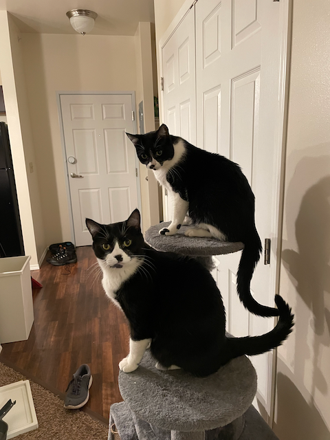
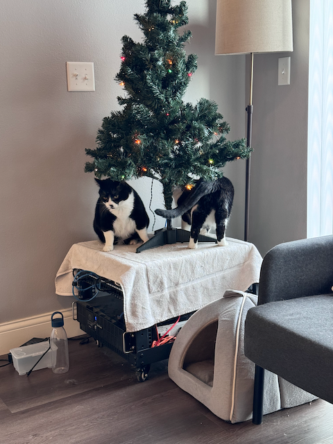

## Who is Zack and does he really have a cat?

I have two cats, a mother and a daughter tuxedo pair. My name isn’t actually Zack, but I live in South Dakota in the USA. I’m 29 years old, and work as a technician at a Managed Service Provider, basically an IT company. When I’m not working on OpenMW or my real job, I spend time attending and staffing Anime Conventions. I grew up playing Morrowind, and the following games in the series, but none lived up to the original TES3!

## You’ve been contributing since mid-2023, but when and how did you discover the project, and why did you decide to join the party?

I discovered the project a long long time ago, I was a member of the Google Groups email list, around August 2009. I’ve used it for playing Morrowind for a long time, I can’t remember when I switched. No later than 2015, since I started making mods for OpenMW primarily around that time. I actually first submitted a merge request in late 2021, but didn’t see it through to the end. I had become busy with other things in life, and came back when the API was far more progressed. It was merged, but [ptmikheev](https://gitlab.com/ptmikheev) was responsible for the finishing touches.

I submitted code again after I read up on C++ a bit more. I had never written C++ seriously before contributing to OpenMW. I wanted to create mods for OpenMW Lua, that required features that weren’t added yet, so I decided to stop waiting around and just add them.

## Has OpenMW lived up to what you expected when you first discovered the project?

Yes, absolutely! As far as I’m concerned, it plays Morrowind flawlessly. I’m excited to see feature parity with [MWSE](https://mwse.github.io/MWSE/), add in [TES3MP](https://tes3mp.com/) into the master branch, and add more support for playing (or rendering) later games from the series.

## Since it was mentioned, what’s your opinion on MWSE?

MWSE is pretty cool, and very powerful. I’ve developed several of my mods to use it. My most recent larger project, [Clone](https://github.com/zackhasacat/Clone), included a library that allowed you to use Lua code for both engines. I’m not sure that is feasible long term. It’s difficult to write mods for both engines, since both have their strengths and weaknesses.

My biggest issue using MWSE is my platform of choice, OpenMW works on Mac and Linux, whereas MWSE of course, doesn’t without major workarounds. I do have a virtual machine set up for it, but just am much more comfy with OpenMW Lua anyways.

## Ohoh, are you planning to add some bits (or maybe, even all) of MWSE unto OpenMW?

There is a good amount I’d like to bring over. The ability to create records is pretty important, especially NPC records. Mostly stuff that I need anyways, but MWSE mods show what can be done once the OpenMW Lua API is even more mature.

However, certainly much of MWSE is beyond my ability at the moment to add to OpenMW. The advanced C++ programmers like [urm](https://gitlab.com/uramer) and [wazabear](https://gitlab.com/glassmancody.info) will most likely be doing the [rendering](https://en.wikipedia.org/wiki/Rendering_%28computer_graphics%29)/[scene graph](https://en.wikipedia.org/wiki/Scene_graph) API.

## You’re effectively co-leading the OpenMW Lua cabal, how do you feel about that?

I’m not sure if I’m leading anything, but I love helping the OpenMW Lua community grow. I try to help anyone in the OpenMW discord who is learning Lua, and all my mods are free for the picking to steal code from. You can get them from my [GitLab](https://gitlab.com/zackhasacat), or my [Nexus Mods](https://www.nexusmods.com/users/790766?tab=user+files&BH=0)

## What have you been working on recently?

I recently got into Mac and iOS app development, using Apple’s [Swift programming language](https://en.wikipedia.org/wiki/Swift_%28programming_language%29). I’m creating a standalone launcher for OpenMW on Mac, that will be able to work as more of a mod manager like [Mod Organizer 2](https://www.modorganizer.org/), as opposed to OpenMW’s launcher.

I’ve got a few concepts for my existing mods, and a few new mod ideas. Notably, I’m hoping to get started on an update to my [MUNDIS](https://www.nexusmods.com/morrowind/mods/43805/) mod that would allow you to travel between save games, and even between OpenMW and MWSE, bringing your character, with their stats and items to the new “timeline”, similar to the real TARDIS.

## What are some mod ideas you look forward to becoming doable in OpenMW?

I really want to build an RTS mode, using Morrowind actors as units, and being able to build structures as in the [Command and Conquer](https://en.wikipedia.org/wiki/Command_%26_Conquer) games. I’ve already implemented a lot of this in my [Ashlander Architect mod](https://www.nexusmods.com/morrowind/mods/52879), we just need to make some improvements in the AI, and implement the user interface.

## What kind of other nice stuff do you expect OpenMW will give us in the future?

I really hope for the ability to create new world spaces, similar to the later games. This will be great for adding new lands in mods. We’ll need to add support for mapping in these spaces.

## How do you feel about OpenMW potentially adding support for more games in the future?

It’s very promising. It may not be fully ready to use until 2090™, but given the relatively short amount of time it took to support Morrowind, I think we can make good progress. I’ve only done one small contribution to help this, but hope to help more soon. Lua might come in handy to implement the mechanics.

## Any cool things you plan to implement in the future that you haven’t already started working on?

Adding access to more record stores is very important. This will be needed for things like dehardcoding user interfaces. Dialogue records are one of the most important features not yet added to the Lua API. I’ve got a few contributions I need to finish before I want to start on this, however.

I want to be able to create new cells, with whatever parameters needed. This would be very handy for Ashlander Architect.

Game weather is not accessible to Lua yet. There has been discussion on this, and I think it is something I will tackle in a few months, if not already done by then.

## Anything else you’d like to add?

I’m very happy that OpenMW has added Lua scripting. I used to be very frustrated with MWScript, Morrowind’s original scripting language, and created huge scripts that covered every use case I could think of. I wanted to add [black soul gems](https://www.nexusmods.com/morrowind/mods/45902/?tab=posts) to Morrowind, but doing it with MWScript caused so many problems, as documented in [this forum thread](https://forum.openmw.org/viewtopic.php?t=6252) After support was added to OpenMW Lua for souls in items (by me, but with help from the rest of the team), it was possible to do this cleanly in OpenMW Lua instead of scripting, or by editing the source of the engine.

## You mentioned cats… can we see them?

