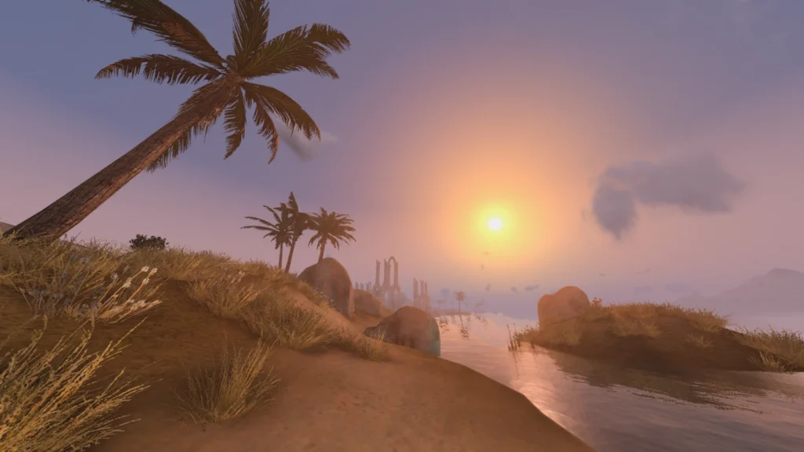

We’re alive! And we’re continuing the [previously announced](/news/2025/openmw-0-49-0-is-now-in-rc-phase) testing of release candidate (RC) builds for our upcoming 0.49.0 stable release while our video editors are hard at work preparing a recap for the years behind us.  
  
It’s been a bit, so as of the time of writing this we are up to round 5 of RC testing. Like before, **you can grab the most recent RC build of 0.49.0** – or 0.49.0 itself, should you be reading from the future – **from our [GitHub releases page](https://github.com/OpenMW/openmw/releases/) for all major platforms**, and like before, we’d love if you tried it out and **reported anything odd/interesting you might find to [our issue tracker](https://gitlab.com/groups/OpenMW/-/issues)** or [0.49.0 forum discussion](https://forum.openmw.org/viewtopic.php?t=7853). Or, at the very least, if you’re already daily-driving an RC, upgrade it to the latest build available for your platform, so that you can’t run into problems that we’re already fixed.  
For example, Steam Deck players should update from RC builds older than RC3 to fix audio crackling. Newer builds also include various crash fixes and make the experimental precipitation occlusion feature work when sky blending is disabled.

*OpenMW 0.49.0 running [Project Cyrodiil](https://www.nexusmods.com/morrowind/mods/44922/) in a modded Morrowind setup*

In this blog post, we would like to address some questions that are frequently asked by our [Discord](https://discord.gg/YegsVV3aRb) and [Reddit](https://www.reddit.com/r/openmw) communities regarding 0.49.0 and the RC testing process.  
  
**Q:** What’s so great about this 0.49.0, anyway? Is there a changelog?  
**A:** 0.49.0 will be our largest release yet, having been in development since August 2022!  
We are preparing a comprehensive changelog and a release video for the full release announcement.  
Historically, RC builds didn’t get them, as they are subject to change. You can, however, get a decent idea of what 0.49.0 will include by glossing through the CHANGELOG.md file included in some RC packages and [available](https://gitlab.com/OpenMW/openmw/-/blob/openmw-49/CHANGELOG.md) on our source code repository. While it’s far from covering *everything*, it’s plenty – take a look!  
  
**Q:** Is updating an RC build to a newer RC build or 0.49.0 stable release mid-playthrough safe?  
**A:** Yes, it is! You don’t have to restart your run and can keep playing on the same saves.  
  
**Q:** Is updating from 0.48.0 to an RC build or 0.49.0 mid-playthrough safe?  
**A:** Very likely! You can definitely still use your 0.48.0 saves.  
However, some modding areas are sensitive to backward compatibility breaks. More specifically, you need to be careful to update your mods that rely on OpenMW-Lua and any mods that touch our internal assets: MyGUI layout files and so-called core shaders (built-in forward pass shaders), not to be confused with post-processing shaders. Whether updating a mod that affects game content mid-playthrough would be safe depends a lot on the mod.  
Do keep in mind the reverse isn’t true. You won’t be able to load 0.49.0 saves in older releases.  
  
**Q:** Is updating from a release older than 0.48.0 mid-playthrough safe?  
**A:** Probably. 0.49.0 preserves support for saves from all releases since 0.45.0 (March 2019).  
If your old save fails to load or has problems for some incomprehensible reason that isn’t because it was made in a release older than that, you’ll want to tell us. If it’s merely an old save, you should be able to make it compatible by re-saving it in 0.48.0, which should *theoretically* be compatible with every single stable release OpenMW save ever made.  
  
**Q:** I’m still running Windows 7 (8, 8.1). Would I be able to run OpenMW 0.49.0?  
**A:** We do not provide support for end-of-life operating systems, so unfortunately, we have to encourage you to update to Windows 10, 11, or a modern Linux distribution.  
While OpenMW is a reimplementation of Morrowind’s engine which itself remains compatible with any Windows OS since Windows 2000, OpenMW targets modern hardware and software, and while we understand that Windows 7 in particular was a hugely successful Windows release, it *is* a Windows from 15 years ago.  
Note this isn’t a new change. Like Microsoft, we dropped Windows 7 support 5 years ago .  
  
**Q:** Why is running OpenMW on a Mac so rough? Is 0.49.0 any better?  
**A:** OpenGL applications like OpenMW are expected to remain in a bad shape on Apple hardware out of the box due to Apple’s deprecation of OpenGL support. Notwithstanding, we’re doing what we can to not make it rougher.  
  
**Q:** 0.49.0 changes the combat and I don’t like it.  
**A:** Well- wait, that’s a statement… Could you rephrase it as a question?  
  
**Q:** What’s with all the talk about hit detection changes?  
**A:** Yeah, that’s better.  
0.49.0 makes some large steps towards making melee combat reimplementation accurate to Morrowind. Importantly, it moves melee target evaluation from the point of impact to the moment of weapon release. This is necessary to ensure the correct audiovisual feedback for missed hits.  
We do not intend to meaningfully overhaul or redesign the classical experience of Morrowind, and we believe it would best be handled by mods from the community. It is currently planned for combat dehardcoding to be a focus in 0.5X releases, which would allow scripts to overhaul it, and for certain combat AI changes to be introduced to further ensure melee combat remains as (not very) challenging as in Morrowind.  
An important detail to note, however: in RC4 and later builds, like in 0.48.0, the target must be within weapon reach upon impact for the hit to be successful. This means that dodging attacks by quickly backing away from the opponent remains possible even if the hit is evaluated as a success upon weapon release. This is consistent with Morrowind.  
  
Anything else? Hm… No, that’s about it, really. Keep an eye out for newer RC builds! We’ll pop back up when we have more RC or release news to share.
