After almost 3 years of development, we’re thrilled to release OpenMW version 0.49.0—our largest and most ambitious update yet! Grab it from our [Downloads Page](/downloads) for all supported operating systems.

This new release brings a hefty number of additions to our Lua scripting API, further polish to every single area of the engine—animations and lighting in particular—and it is the first one that goes beyond Morrowind!

The release announcement video by the tremendous Atahualpa and the stupendous johnnyhostile is entering its final stages of production, and we’ll let you know when it’s ready—but for now, be sure to read below for the full list of changes.

<!--more-->

Special thanks to [Epoch](https://next.nexusmods.com/profile/EpochWon/mods?gameId=100) for providing the lovely visuals for the text announcement!

**Known Issues**

- On macOS, launching OpenMW from OpenMW-CS requires ‘OpenMW.app’ and ‘OpenMW-CS.app’ to be siblings
- [[#7511](https://gitlab.com/OpenMW/openmw/-/issues/7511)] On Windows, a freeze may be reported if engine startup takes too long; ignoring the message is usually harmless as it should eventually disappear, but if it doesn’t, share the freeze dump with us
- [[#8012](https://gitlab.com/OpenMW/openmw/-/issues/8012)] Combat music does not start during pause (e.g., during the dialogue that is scripted to start combat)
- [[#8233](https://gitlab.com/OpenMW/openmw/-/issues/8233)] Hardware antialiasing may cause driver timeouts on AMD GPUs of the RX 6000 and 7000 series; this is a driver bug AMD is yet to address
- [[#8345](https://gitlab.com/OpenMW/openmw/-/issues/8345)] OpenMW-CS might crash randomly on Linux and macOS during global search or saving; this is possibly a bug in Qt 6
- [[#8464](https://gitlab.com/OpenMW/openmw/-/issues/8464)] Shader rendering is tinted red on Apple Silicon; enable per-pixel lighting to prevent that

**Removed Features**

- [[#6624](https://gitlab.com/OpenMW/openmw/-/issues/6624)] Support for pre-0.45.0 saved games. Saves made in 0.45.0 up to 0.49.0 RC remain compatible. Use 0.48.0 to convert older saves
- [[#7394](https://gitlab.com/OpenMW/openmw/-/issues/7394)] Virtual filesystem case-sensitivity support
- [[#7720](https://gitlab.com/OpenMW/openmw/-/issues/7720)] Broken 360° screenshot support
- [[#8214](https://gitlab.com/OpenMW/openmw/-/issues/8214)] Script blacklisting used in the –script-all option and OpenMW-CS script verifier, which served no purpose

**AI and Pathfinding**

*Contributions from* ***Capo, elsid, Evil Eye*** *and* ***Foal***

We taught creatures to drink potions, introduced laws against lycanthropy and vampirism, and told Snowy Granius that his skeleton buddy misses him a lot.

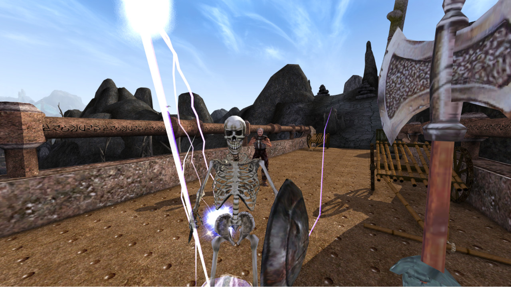

**Fixes**

- [[#2623](https://gitlab.com/OpenMW/openmw/-/issues/2623)] Actors prioritise Bound and Summon spells more
- [[#4207](https://gitlab.com/OpenMW/openmw/-/issues/4207)] Actors prioritise healing spells and potions much less
- [[#5065]](https://gitlab.com/OpenMW/openmw/-/issues/5065) Actors no longer attempt pathfinding while playing scripted animations
- [[#5129](https://gitlab.com/OpenMW/openmw/-/issues/5129)] Actors back up smoother during ranged combat
- [[#5413]](https://gitlab.com/OpenMW/openmw/-/issues/5413) Actors don’t yell taunts when engaging in combat against new allies of their current enemies
- [[#5755](https://gitlab.com/OpenMW/openmw/-/issues/5755)] Friendly hit counter doesn’t increment during combat and resets after it
- [[#6313](https://gitlab.com/OpenMW/openmw/-/issues/6313)] High Fight rating allies no longer become hostile when the player has multiple allies
- [[#6574](https://gitlab.com/OpenMW/openmw/-/issues/6574)] Navmeshes are no longer generated for very distant exterior cells, preventing a crash
- [[#6932](https://gitlab.com/OpenMW/openmw/-/issues/6932)] Actors will no longer give preference to unreachable/invisible enemies in combat
- [[#6964](https://gitlab.com/OpenMW/openmw/-/issues/6964)] Failed path smoothing can no longer cause the path to be rejected
- [[#7064](https://gitlab.com/OpenMW/openmw/-/issues/7064)] Assaulted actors will realise they were assaulted even if they didn’t detect the player
- [[#7450](https://gitlab.com/OpenMW/openmw/-/issues/7450)] Improved obstacle evasion: more movement directions are used depending on the actor’s animations
- [[#7548](https://gitlab.com/OpenMW/openmw/-/issues/7548)] Actors can open doors teleported from a different cell
- [[#7604](https://gitlab.com/OpenMW/openmw/-/issues/7604)] Creatures can properly use potions
- [[#7639](https://gitlab.com/OpenMW/openmw/-/issues/7639)] Weapons are now considered useless if the actor’s relevant skill is 0
- [[#7646](https://gitlab.com/OpenMW/openmw/-/issues/7646)] Ranged attacks against allies make them hostile immediately
- [[#7646](https://gitlab.com/OpenMW/openmw/-/issues/7646)] Magical attacks no longer prompt vocal friendly fire responses
- [[#7647](https://gitlab.com/OpenMW/openmw/-/issues/7647)] Wandering interrupted by a greeting properly resumes
- [[#7661](https://gitlab.com/OpenMW/openmw/-/issues/7661)] AI package assignments interrupt combat
- [[#7685](https://gitlab.com/OpenMW/openmw/-/issues/7685)] Increased follow package activation distance to match Morrowind
- [[#7723](https://gitlab.com/OpenMW/openmw/-/issues/7723)] Legalised assault and murder of vampires and werewolves
- [[#7724](https://gitlab.com/OpenMW/openmw/-/issues/7724)] Guards attack NPC werewolves
- [[#7758](https://gitlab.com/OpenMW/openmw/-/issues/7758)] Water-walking actors now properly consider their ability when pathfinding over water
- [[#7959](https://gitlab.com/OpenMW/openmw/-/issues/7959)] NPC in-world book activations are handled as player book activations
- [[#8132](https://gitlab.com/OpenMW/openmw/-/issues/8132)] Actors no longer face the player for greetings they won’t deliver
- Absorb Skill/Attribute effects, like Drain and Damage effects, are no longer used when the relevant stat is zero and are prioritised based on how important the relevant stat is
- Alternate bound weapon spells aren’t cast if a bound weapon is already in use
- Bound weapon spell priority takes weapon skill and ammunition into account
- Combat taunts are suppressed for On Self and On Touch spellcasting
- Escort packages terminate immediately when no destination is provided
- Wander AI properly supports crossing cell boundaries
- Weapon enchantments no longer receive spell priority multipliers when rated as weapons

**Animations**

*Contributions from* ***akortunov, Capo, cykboy, Foal, MaxYari*** *and* ***unelsson***

0.49.0 introduces built-in support for animation blending. Morrowind’s animation state machine—that we faithfully emulate—lacks proper transitions. Animation blending is a clever way to add them by interpolating between animation group key frames in a variety of styles, improving the feel of the game. It is super-flexible: the transitions between any animation can be configured through YAML files you’d bundle with your animation mod. Have a look at our [documentation on this feature](https://openmw.readthedocs.io/en/openmw-0.49.0/reference/modding/animation-blending.html) to learn more.

This release’s incarnation of OpenMW-Lua also introduces the first iteration of an animation API. Therefore, we had to make a variety of fixes to the look and behaviour of animations played by—you guessed it—scripts, and rework much of the combat animation logic to make it more reliable. For example, non-bipedal creatures you fight can follow you when they’re in the middle of an attack, and scripted animations playing on the player character no longer break upon view mode changes.

**New Features**

- [[#6009](https://gitlab.com/OpenMW/openmw/-/issues/6009)] Animation blending: optional, moddable animation transition smoothing for both NIF and Collada files
- [[#6823](https://gitlab.com/OpenMW/openmw/-/issues/6823)] Animation layering support for Collada files (previously erroneously attributed to 0.48.0)

**Fixes**

- [[#4127](https://gitlab.com/OpenMW/openmw/-/issues/4127)] Segments of attack wind-up and release are played continuously and are thus less choppy
- [[#4610](https://gitlab.com/OpenMW/openmw/-/issues/4610)] Weapons can no longer be unequipped during an attack, which ensures bound weapons appear after spellcasting animation ends
- [[#4742](https://gitlab.com/OpenMW/openmw/-/issues/4742)] Finished scripted animations no longer cause the same animations played afterwards as non-scripted animations to get stuck
- [[#4743](https://gitlab.com/OpenMW/openmw/-/issues/4743)] Scripted animations that can’t loop are no longer automatically disabled
- [[#4822](https://gitlab.com/OpenMW/openmw/-/issues/4822)] Individual NPC body parts can have their own animations
- [[#5062](https://gitlab.com/OpenMW/openmw/-/issues/5062)] Accumulated animation movement is no longer discarded in favour of manual movement. This makes movement match Morrowind more closely, e.g. third-person camera will sway for beast race characters
- [[#5066](https://gitlab.com/OpenMW/openmw/-/issues/5066)] Playing an ongoing scripted animation group with a script no longer restarts it
- [[#5371](https://gitlab.com/OpenMW/openmw/-/issues/5371)] Animations are no longer enabled for x prefix NIF files without *their own* x prefix NIF files when they are used as models
- [[#6723](https://gitlab.com/OpenMW/openmw/-/issues/6723)] Collada files support head tracking and turn to movement direction and smooth movement options
- [[#6992](https://gitlab.com/OpenMW/openmw/-/issues/6992)] Crossbow reloading animation is played on the entire body again
- [[#6993](https://gitlab.com/OpenMW/openmw/-/issues/6993)] Shooting the last round of ammunition is no longer interrupted abruptly
- [[#7042](https://gitlab.com/OpenMW/openmw/-/issues/7042)] Unexpected hit triggers are no longer processed – this stops some weapon animations from applying damage multiple times
- [[#7611](https://gitlab.com/OpenMW/openmw/-/issues/7611)] Manual movement mode is no longer stuck after turning or jumping – this prevents idle sliding
- [[#7636](https://gitlab.com/OpenMW/openmw/-/issues/7636)] Scripted animations persist through view mode changes
- [[#7637](https://gitlab.com/OpenMW/openmw/-/issues/7637)] Scripted animations always restrict movement
- [[#7641](https://gitlab.com/OpenMW/openmw/-/issues/7641)] Scripted animation loop count matches Morrowind
- [[#7886](https://gitlab.com/OpenMW/openmw/-/issues/7886)] Ready Weapon transitions can reuse the animation
- [[#7980](https://gitlab.com/OpenMW/openmw/-/issues/7980)] Paralysed actors no longer play blinking and talking animations
- [[#8191](https://gitlab.com/OpenMW/openmw/-/issues/8191)] Re-enabled sheathed melee weapon animations
- [[#8223](https://gitlab.com/OpenMW/openmw/-/issues/8223)] Movement takes priority over weapon animations for non-bipedal actors, allowing them to react to player movement when they’re trying to attack
- [[#8237](https://gitlab.com/OpenMW/openmw/-/issues/8237)] Spellcasting stance transitions are disabled again for non-bipedal actors (for now)
- Recoil/reloading weapon animation choice matches Morrowind

**Configuration and VFS**

*Contributions from* ***AnyOldName3, austin987, Capo, elsid*** *and* ***Project579***

While many settings are configurable in-game or via the launcher, some can only be changed by editing text files. 0.49.0 is stricter about the configuration of the settings it accepts. It will inform you if it doesn’t like that you set the viewing distance to negative infinity, the number of physics threads to the colour green and the actor collision shape type to a rude emoji. As it happens, the accepted ranges are [documented](https://openmw.readthedocs.io/en/openmw-0.49.0/reference/modding/settings/index.html).

- [[#6085](https://gitlab.com/OpenMW/openmw/-/issues/6085)] Replaced the remaining usage of Boost filesystem library with C++ standard filesystem library
- [[#6876](https://gitlab.com/OpenMW/openmw/-/issues/6876)] Improved setting validation with automatic value adjustment
- [[#7092](https://gitlab.com/OpenMW/openmw/-/issues/7092)] Archive files of the same name are no longer overridden in reverse order
- [[#7924](https://gitlab.com/OpenMW/openmw/-/issues/7924)] On Windows, crash catcher now generates a full memory dump if the OPENMW_FULL_MEMDUMP environment variable is set
- [[#8567](https://gitlab.com/OpenMW/openmw/-/issues/8567)] Paths passed to the applications through the command line support token replacement
- [[#8567](https://gitlab.com/OpenMW/openmw/-/issues/8567)] Passed relative paths are relative to the current working directory

**ESM Format and Saved Games**

*Contributions from* ***akortunov, Capo*** *and* ***Evil Eye***

Providing theoretical compatibility with every single saved game you ever saved sounds great, right? Unfortunately, it gets more and more complicated as we polish the format, with fewer and fewer benefits with each passing year. As mentioned earlier, 0.49.0 will reject saves made in releases before 0.45.0, released in 2019. If you want to keep using them, you’ll want to resave them in 0.48.0.

Like Morrowind, OpenMW warns you when loading saved games that target a completely different content setup, and 0.49.0 will list what specifically is missing from your current content list. If you decide to load the save anyway, we’ve added more guardrails to prevent the save from turning unplayable in some situations.

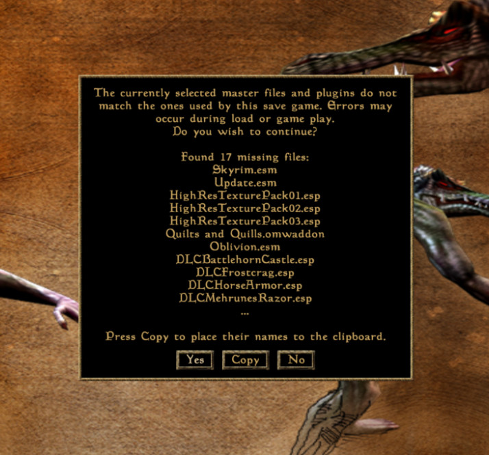

**New Features**

- [[#2566](https://gitlab.com/OpenMW/openmw/-/issues/2566)] Proper NAM9 subrecord handling for item stack counts
- [[#7477](https://gitlab.com/OpenMW/openmw/-/issues/7477)] Magic effect negative light flag support. Not to be confused with normal negative lights, this flag merely inverts the effect’s colour
- [[#7608](https://gitlab.com/OpenMW/openmw/-/issues/7608)] Saved game dependency warning now lists the missing dependencies
- [[#7618](https://gitlab.com/OpenMW/openmw/-/issues/7618)] Saved game info includes the game day and player health

**Fixes**

- [[#5977](https://gitlab.com/OpenMW/openmw/-/issues/5977)] Removed pre-0.43.0 save knockdown state handling, which had side effects in newer saves
- [[#6025](https://gitlab.com/OpenMW/openmw/-/issues/6025)] Subrecords can now overlap the records that follow them, allowing some plugins to load properly
- [[#6754](https://gitlab.com/OpenMW/openmw/-/issues/6754)] NPCs that use default skeleton models use the skeleton requested by their race record
- [[#7134](https://gitlab.com/OpenMW/openmw/-/issues/7134)] Saves with invalid last generated RefNum some OpenMW builds could export can no longer be loaded
- [[#7204](https://gitlab.com/OpenMW/openmw/-/issues/7204)] Missing actor script links are discarded upon loading to prevent runtime problems
- [[#7553](https://gitlab.com/OpenMW/openmw/-/issues/7553)] If multiple faction reactions are defined for a faction, the lowest reaction is used
- [[#7654](https://gitlab.com/OpenMW/openmw/-/issues/7654)] Invalid enchantment effect data is discarded upon loading
- [[#8021](https://gitlab.com/OpenMW/openmw/-/issues/8021)] Fixed incomplete player cell reference reset when a new game is started during an active game session
- [[#8252](https://gitlab.com/OpenMW/openmw/-/issues/8252)] Restored file dependency loading requirement
- Broken dialogue response filter conditions are discarded upon loading
- NPCs with missing races fall back to the first race loaded
- You no longer need to press Sneak twice to leave the stance when a save made while sneaking is loaded and toggle sneak option is enabled
- Terrain texture records are overridden based on ID rather than both index and ID and can be deleted

**Gameplay**

*Major contributions from* ***Capo*** *and* ***Evil Eye***  
*Contributions from* ***akortunov, cykboy, elsid, Foal, Kuyondo, JamesDeciutiis, ptmikheev, trav*** *and* ***zackhasacat***

A lot of what Morrowind reimplementation is about is getting all the mechanics right. Initial implementations tend to be based on educated guesswork, with the verification of more obscure and less obvious aspects sometimes getting neglected. Inevitably, the missed cases eventually bubble up as we aim for a faithful replication of the original game experience, barring crashes and obvious errors.

We’ll start with melee combat. Nobody knows how it works, and if you think you do, you don’t. Even if your name is [Todd Howard](https://en.wikipedia.org/wiki/Todd_Howard). Nevertheless, trying to get it right was a focus for this release, and we replaced the physics-based hits of previous releases with Morrowind’s more simple scanning of the player’s surroundings based on a hit cone defined by the game settings. It comes with replicating some quirks, such as NPCs being unable to look “up” or “down” to attack, or collision box offsets relative to the actor positions not being used. The latter is required for NPCs to be able to hit netches, which have their collision box somewhere in the air rather than at ground level. How does the former work with flying and swimming creatures, such as cliff racers and slaughterfish? Well, they simply don’t do vertical angle checks. Yeah.

What this means is that hitting flying enemies is now much easier, as you can aim lower. It also means that hitting *you* is much easier for *them*…

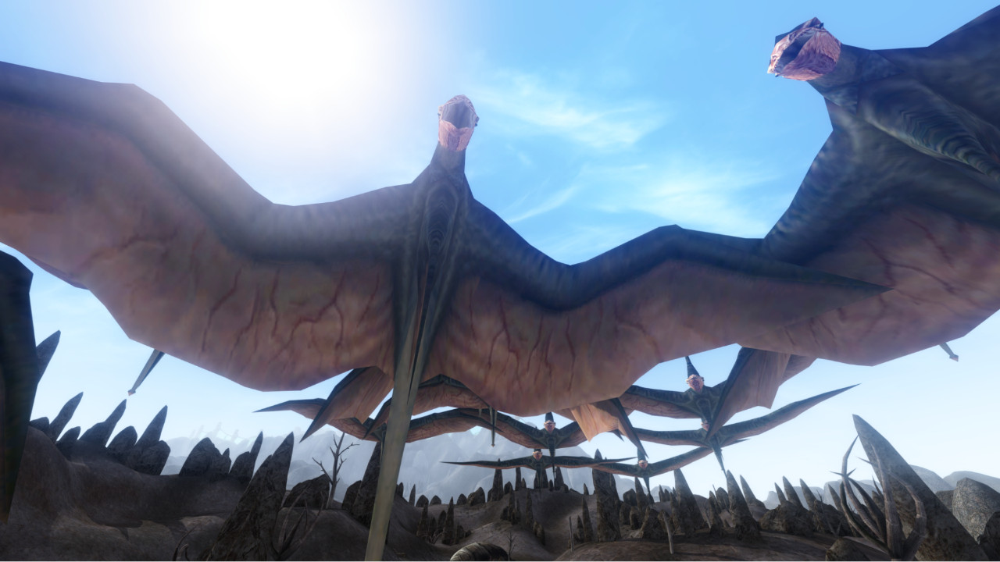

There’s more: much of the initial hit evaluation was moved from the actual weapon impact to weapon release. This is necessary so that the release animation plays with the correct strength and the swish sound plays at the correct pitch when you miss. This also means the attack’s results are determined rather unintuitively early, but there’s still a range check on impact, so you can still dodge attacks if you’re swift enough. There might be more unforeseen “features” in Morrowind’s melee combat, but this should get much more of the gist of it right.

Another slightly controversial change is the reworked Intervention spell and jail marker detection algorithm. 0.48.0 and earlier releases simply calculated the [Euclidean distance](https://en.wikipedia.org/wiki/Euclidean_distance) from the player to every marker of the right type to determine the closest one. Morrowind, however, uses the [Chebyshev distance](https://en.wikipedia.org/wiki/Chebyshev_distance) to pick the marker. It starts from the player’s cell grid and moves through exterior cells in a square counter-clockwise spiral starting from the southwest, and the marker closest to the start of the loop wins. 0.49.0 doesn’t do exactly this, but it emulates it in a way that the results should be the same.

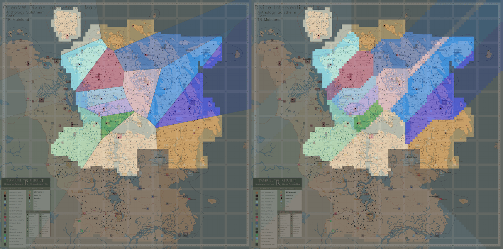

Old Divine Intervention maps previously used by Tamriel Rebuilt  
Left: 0.48.0 algorithm  
Right: Morrowind/0.49.0 algorithms  
(provided for illustrative purposes; full-resolution maps can be found [here](https://www.tamriel-rebuilt.org/galleries/maps))

Moving on from Combat and Intervention, 0.49.0 properly applies temporary crime disposition changes, lets you stack effects from identical enchanted items, and allows equipping ammunition partially. It also comes with fixed Spell Absorption behavior for enchantments (which would previously not restore any Magicka), Sun Damage effect (which previously used a much more simple way to determine sun visibility and wasn’t applied in pseudo-exterior cells), Reflect effect (which used not to reflect beneficial spells), Resist Normal Weapons effect (which was accidentally applying twice for non-creature NPC targets), proper support of On Touch range spells that explode over an area, and much more.

Also, did you know one of the features added to the original game in a patch was spawning of sea creatures in the ocean cells outside the defined map area? OpenMW now has that too.

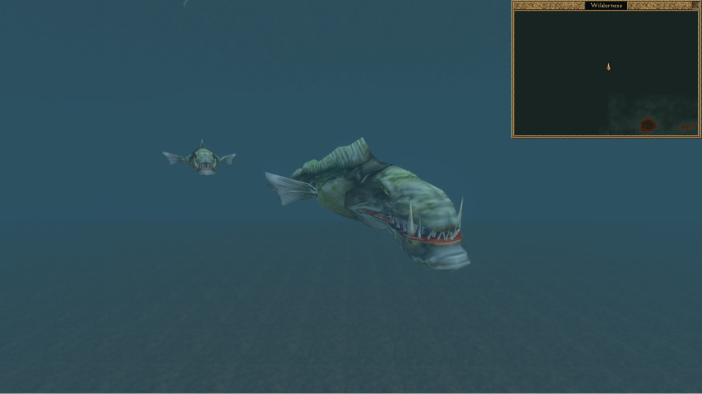

*More fishies!*

**New Features**

- [[#1415](https://gitlab.com/OpenMW/openmw/-/issues/1415)] Infinite fall failsafe for interiors

**Fixes**

- [[#3438](https://gitlab.com/OpenMW/openmw/-/issues/3438)] Overhauled melee hit target selection to match Morrowind much closer
- [[#4204](https://gitlab.com/OpenMW/openmw/-/issues/4204)] Only actors with a base health of 0 are prevented from floating up upon cell reloading
- [[#4508](https://gitlab.com/OpenMW/openmw/-/issues/4508)] Identical enchanted items’ effects can stack
- [[#4683](https://gitlab.com/OpenMW/openmw/-/issues/4683)] Temporary crime disposition changes are properly applied
- [[#4754](https://gitlab.com/OpenMW/openmw/-/issues/4754)] Ammunition can now be equipped partially
- [[#5057](https://gitlab.com/OpenMW/openmw/-/issues/5057)] Melee hit success evaluation now occurs at weapon release rather than apparent target impact
- [[#5714](https://gitlab.com/OpenMW/openmw/-/issues/5714)] On Touch range effects cast by non-actors always explode
- [[#6156](https://gitlab.com/OpenMW/openmw/-/issues/6156)] On Touch spells explode from the correct position
- [[#6894](https://gitlab.com/OpenMW/openmw/-/issues/6894)] To match Morrowind, picked-up ammunition is no longer automatically stacked with equipped ammunition
- [[#6949](https://gitlab.com/OpenMW/openmw/-/issues/6949)] Sun Damage is applied in quasi-exteriors
- [[#6974](https://gitlab.com/OpenMW/openmw/-/issues/6974)] Beneficial effects are reflected
- [[#6977](https://gitlab.com/OpenMW/openmw/-/issues/6977)] Sun Damage properly accounts for sun and cloud visibility
- [[#7034](https://gitlab.com/OpenMW/openmw/-/issues/7034)] Key flag is assigned automatically to items that are used as keys
- [[#7044](https://gitlab.com/OpenMW/openmw/-/issues/7044)] Autocalculated NPCs use service flags from their class
- [[#7122](https://gitlab.com/OpenMW/openmw/-/issues/7122)] Teleporting to a location where Water Walking cannot be active removes the effect
- [[#7163](https://gitlab.com/OpenMW/openmw/-/issues/7163)] Ingredients that do not have the first effect assigned can no longer be consumed instead of breaking the UI
- [[#7284](https://gitlab.com/OpenMW/openmw/-/issues/7284)] *Your weapon has no effect* message of normal weapon resistance shows up regardless of hit success
- [[#7413](https://gitlab.com/OpenMW/openmw/-/issues/7413)] Creatures are now spawned in generated ocean exterior cells
- [[#7415](https://gitlab.com/OpenMW/openmw/-/issues/7415)] Unbreakable lock behaviour matches Morrowind more closely, e.g. they can be unlocked using Open spells
- [[#7428](https://gitlab.com/OpenMW/openmw/-/issues/7428)] Enchantment cost and charge is auto-calculated when the relevant flag is set in the record
- [[#7472](https://gitlab.com/OpenMW/openmw/-/issues/7472)] Fixed the number of items used to calculate the enchantment price
- [[#7573](https://gitlab.com/OpenMW/openmw/-/issues/7573)] Drain effects can bring stats below zero again
- [[#7630](https://gitlab.com/OpenMW/openmw/-/issues/7630)] Charm effect can no longer be applied to creatures
- [[#7631](https://gitlab.com/OpenMW/openmw/-/issues/7631), [#7794](https://gitlab.com/OpenMW/openmw/-/issues/7794)] Fleeing actors can now be activated (with varying results)
- [[#7643](https://gitlab.com/OpenMW/openmw/-/issues/7643)] Any effect is allowed to be used in constant effect enchantments regardless of range support
- [[#7660](https://gitlab.com/OpenMW/openmw/-/issues/7660)] Failed ingredient consumption no longer breaks invisibility
- [[#7660](https://gitlab.com/OpenMW/openmw/-/issues/7660)] Item recharging and repairing and potion brewing break invisibility
- [[#7676](https://gitlab.com/OpenMW/openmw/-/issues/7676)] Ingredient order affects the potion effect order
- [[#7712](https://gitlab.com/OpenMW/openmw/-/issues/7712)] Spells and enchantments are no longer required to have effects to be cast
- [[#7728](https://gitlab.com/OpenMW/openmw/-/issues/7728)] Attempting to use a controller that cannot be used no longer causes a crash
- [[#7742](https://gitlab.com/OpenMW/openmw/-/issues/7742)] Governing attribute training limit now checks modified attributes rather than base attributes
- [[#7744](https://gitlab.com/OpenMW/openmw/-/issues/7744)] Fixed a crash when the player’s starting inventory contains a weapon
- [[#7796](https://gitlab.com/OpenMW/openmw/-/issues/7796)] Absorbing enchantments properly restores Magicka
- [[#7859](https://gitlab.com/OpenMW/openmw/-/issues/7859)] Potion value is auto-calculated when the relevant flag is set in the record
- [[#7970](https://gitlab.com/OpenMW/openmw/-/issues/7970)] Magic effects removed during resting are no longer active throughout the remainder of resting
- [[#7997](https://gitlab.com/OpenMW/openmw/-/issues/7997)] Paralysis blocks camera perspective changes
- [[#8018](https://gitlab.com/OpenMW/openmw/-/issues/8018)] Potion effects of any range now apply, and they apply exclusively to the drinker
- [[#8064](https://gitlab.com/OpenMW/openmw/-/issues/8064)] 360° movement mode camera zoom can be properly disabled by scripting
- [[#8124](https://gitlab.com/OpenMW/openmw/-/issues/8124)] NPCs no longer resist normal weapons twice
- [[#8171](https://gitlab.com/OpenMW/openmw/-/issues/8171)] Items with above 100% condition can no longer be repaired to 100% condition
- [[#8187](https://gitlab.com/OpenMW/openmw/-/issues/8187)] Intervention spell destination logic now uses cell grid-based Chebyshev distance instead of Euclidean distance
- [[#8204](https://gitlab.com/OpenMW/openmw/-/issues/8204)] Storm wind makes you faster when you move away from its origin
- Containers that only contain unresolved levelled items can be properly harvested
- Directional movement controller bindings have been unbound from the DPad and can be rebound
- Diseases cast as spells can no longer be resisted
- If one of multiple active bound effects of the same type expires, a bound item will be properly re-equipped
- Only On Self range constant and permanent effects are applied
- Scripted effect explosions cannot be reflected

**Graphics**

*Major contributions from* ***AnyOldName3, Capo*** *and* ***wazabear***  
*Contributions from* ***akortunov, alekulyn, Cédric Mocquillon, cykboy, elsid, Evil Eye, Qlonever, S3ctor, Sam Kaufman*** *and* ***unelsson***

We’ve made sure to make this list look thoroughly intimidating, as it’s one of the most exciting ones!

0.49.0 overhauls lighting in many subtle ways to minimise pop-in, resemble Morrowind more, provide options to mimic the original Morrowind look if you’re so inclined, and greatly improve the usability of specular mapping by, for example, making all point lights provide specular lighting. It also introduces prettier-looking ripples to our water shader and makes it possible to stop rain and snow from going through roofs and bridges.

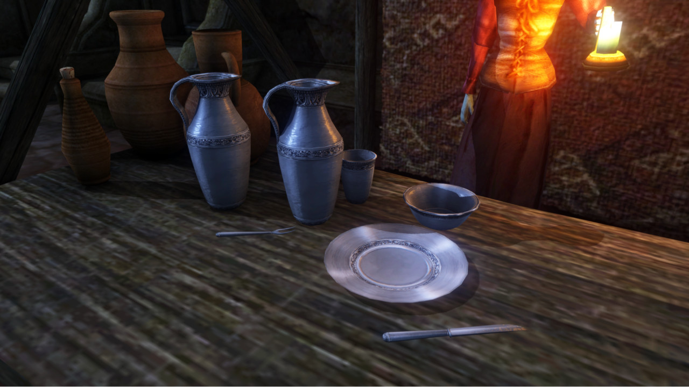

*Featuring specular and normal maps from Pherim’s* [*Silverware Repolished*](https://www.nexusmods.com/morrowind/mods/46385)

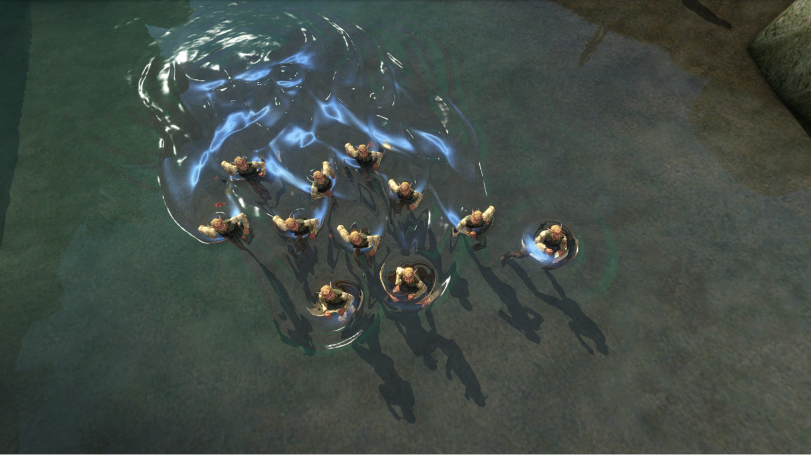

*A herd of Fargoth running in water, leaving pretty ripples in their wake*

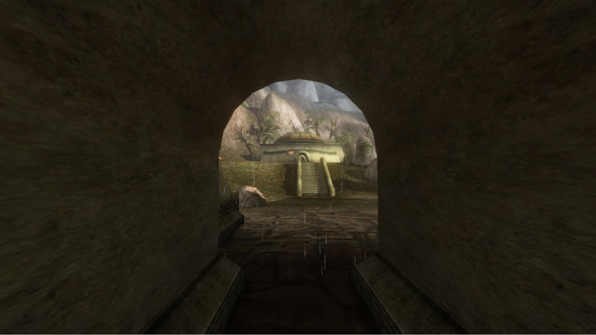

*Keeping ourselves dry from the rain in Balmora*

Please keep in mind that precipitation occlusion can be expensive. Nevertheless, we do care about performance in general. Various cell transition optimisations coming with this release reduce the number of loading screens—just those that *didn’t* use splash screens!— by an order of magnitude or so.

**New Features**

- [[#3537](https://gitlab.com/OpenMW/openmw/-/issues/3537)] Shader water ripples
- [[#5492](https://gitlab.com/OpenMW/openmw/-/issues/5492)] Precipitation occlusion
- [[#5926](https://gitlab.com/OpenMW/openmw/-/issues/5926)] Water transparency is based on vertical depth rather than the distance to the camera
- [[#6188](https://gitlab.com/OpenMW/openmw/-/issues/6188)] Specular lighting for all light sources
- [[#6447](https://gitlab.com/OpenMW/openmw/-/issues/6447)] Improved object paging LOD node handling
- [[#6979](https://gitlab.com/OpenMW/openmw/-/issues/6979)] Object paging automatically uses meshes intended for MGE XE LOD generation
- [[#7129](https://gitlab.com/OpenMW/openmw/-/issues/7129)] Restored non-adaptive vsync option, which, unlike adaptive vsync, is not disabled when the frame rate gets too low
- [[#7180](https://gitlab.com/OpenMW/openmw/-/issues/7180)] Water shader normal map is now overridable
- [[#7292](https://gitlab.com/OpenMW/openmw/-/issues/7292)] Support for Rain Ripples and Snow Ripples Morrowind.ini settings, which control the visibility of ripples emitted by precipitation
- [[#7318](https://gitlab.com/OpenMW/openmw/-/issues/7318)] You can now opt out of terrain-occluded water culling
- [[#7792](https://gitlab.com/OpenMW/openmw/-/issues/7792)] Support for Timescale Clouds Morrowind.ini setting, which links cloud movement speed to game time scaling
- [[#7795](https://gitlab.com/OpenMW/openmw/-/issues/7795)] Support for MaxNumberRipples Morrowind.ini setting, which controls water ripple quantity for non-shader water
- [[#7932](https://gitlab.com/OpenMW/openmw/-/issues/7932)] Two-channel normal map support. This allows BC5-compressed normal maps to be used that come with improved quality and memory efficiency on compatible hardware. Note to third-party maintainers: RGTC-compressed DDS support is exclusive to [our OpenSceneGraph fork](https://github.com/OpenMW/osg/)
- [[#8067](https://gitlab.com/OpenMW/openmw/-/issues/8067)] Added macOS Game Mode support
- Distortion shader effect (see [documentation](https://openmw.readthedocs.io/en/openmw-0.49.0/reference/modding/custom-shader-effects.html))
- In-game per-pixel lighting toggle
- Water shader sunlight scattering and wobbly shores are now optional
- Weapon and shield sheathing support for Collada models

**Fixes**

- [[#3842](https://gitlab.com/OpenMW/openmw/-/issues/3842)] The first rather than the last instance of every bone found in an object’s subgraph is used for skinning
- [[#4898](https://gitlab.com/OpenMW/openmw/-/issues/4898), [#7585](https://gitlab.com/OpenMW/openmw/-/issues/7585)] Sunlight direction in exterior and interior cells now matches Morrowind, which improves accuracy and hides some vanilla asset lighting seam issues
- [[#5280](https://gitlab.com/OpenMW/openmw/-/issues/5280)] Non-skinned geometry is no longer included in skinned body parts
- [[#5883](https://gitlab.com/OpenMW/openmw/-/issues/5883)] Idle actors now also emit water ripples
- [[#6190](https://gitlab.com/OpenMW/openmw/-/issues/6190)] Sunlight (“moonlight”) specularity is no longer disabled for objects and terrain during nighttime
- [[#6190](https://gitlab.com/OpenMW/openmw/-/issues/6190)] Water specularity is no longer subdued harshly during the morning and the evening
- [[#6240](https://gitlab.com/OpenMW/openmw/-/issues/6240)] The same texture file can now be reused for different texture types without them getting confused on enchanted items
- [[#6657](https://gitlab.com/OpenMW/openmw/-/issues/6657)] Diffuse-specular terrain textures (or any terrain textures with an alpha channel) are no longer considered “transparent” by distant terrain (or any non-shader terrain rendering)
- [[#6665](https://gitlab.com/OpenMW/openmw/-/issues/6665)] Creatures should no longer be inappropriately rescaled by turn to movement direction setting
- [[#7040](https://gitlab.com/OpenMW/openmw/-/issues/7040)] Geometry rendered at the same depth as previously rendered geometry is drawn over it, which is important for some modded assets
- [[#7051](https://gitlab.com/OpenMW/openmw/-/issues/7051)] Object paging no longer separates animated Collada models from their collision shapes
- [[#7102](https://gitlab.com/OpenMW/openmw/-/issues/7102)] Shadow maps no longer take up texture slots used for normal textures
- [[#7229](https://gitlab.com/OpenMW/openmw/-/issues/7229)] If the error marker provided by content fails to load, the engine will fall back to the built-in error marker instead of crashing
- [[#7298](https://gitlab.com/OpenMW/openmw/-/issues/7298)] When projectiles hit water, their hit position is now used instead of their current position to emit water ripples, which should prevent ripple rendering issues
- [[#7309](https://gitlab.com/OpenMW/openmw/-/issues/7309)] Sunlight scattering accounts for sun visibility
- [[#7322](https://gitlab.com/OpenMW/openmw/-/issues/7322)] Shadows are properly applied to groundcover when the shadow scene bound calculation method is primitives
- [[#7353](https://gitlab.com/OpenMW/openmw/-/issues/7353)] Fixed a crash when normal maps are assigned to geometry with no UV
- [[#7505](https://gitlab.com/OpenMW/openmw/-/issues/7505)] Terrain samples used to generate distant terrain are now allowed to cover an area larger than a cell
- [[#7535](https://gitlab.com/OpenMW/openmw/-/issues/7535)] Bookart images can be used as regular object textures and vice versa
- [[#7557](https://gitlab.com/OpenMW/openmw/-/issues/7557)] Terrain preloading should no longer attempt to generate and cache terrain that is not going to be used
- [[#7633](https://gitlab.com/OpenMW/openmw/-/issues/7633)] Legacy groundcover now only attempts to instance normal geometry
- [[#7696](https://gitlab.com/OpenMW/openmw/-/issues/7696)] Fixed a potential freeze during distant terrain texture generation
- [[#7737](https://gitlab.com/OpenMW/openmw/-/issues/7737)] Rendering debug stats are now reported for loading screen frames
- [[#7931](https://gitlab.com/OpenMW/openmw/-/issues/7931)] Individual light contribution is no longer capped
- [[#7931](https://gitlab.com/OpenMW/openmw/-/issues/7931)] Light selection is now view-independent, significantly reducing pop-in
- [[#7931](https://gitlab.com/OpenMW/openmw/-/issues/7931)] You can now opt out of the early light cutoff. Classic falloff is more accurate to Morrowind but also more prone to seams/pop-in, especially when active grid paging is enabled
- [[#8002](https://gitlab.com/OpenMW/openmw/-/issues/8002)] Light sources held by creatures properly emit light
- [[#8172](https://gitlab.com/OpenMW/openmw/-/issues/8172)] Generating extremely complex path grid geometry for TogglePathGrid or OpenMW-CS views no longer causes a crash
- [[#8439](https://gitlab.com/OpenMW/openmw/-/issues/8439)] Fixed a variety of crashes when a creature doesn’t have a model
- [[#8462](https://gitlab.com/OpenMW/openmw/-/issues/8462)] Fixed crashes when the window is resized or a setting is changed on macOS builds using SDL 2.24.0 or newer
- Fixed blizzard wind and particle effect direction mismatch
- Herbalism switch nodes no longer change state when a compatible container is reloaded and herbalism switch node support is disabled
- Skinned models properly support switch node-based harvesting
- Water will no longer sometimes turn invisible due to interior water level changes
- Water waves are no longer flipped whenever you change water settings

**NIF Format**

*Contributions from* ***Capo, elsid*** *and* ***Evil Eye***

Not the most exciting section, but we certainly didn’t neglect Bethesda’s favourite model format in this release! How so? You’ll see in a bit.

**New Features**

- [[#5173](https://gitlab.com/OpenMW/openmw/-/issues/5173)] NiFogProperty support. It is a property often used to disable fogging for parts of the model
- [[#6945](https://gitlab.com/OpenMW/openmw/-/issues/6945)] S3TC-compressed and BGR format NiPixelData embedded image support
- [[#7634](https://gitlab.com/OpenMW/openmw/-/issues/7634)] NiParticleBomb support. It is a particle effect used to simulate explosions

**Fixes**

- [[#6550](https://gitlab.com/OpenMW/openmw/-/issues/6550)] Environment maps are assigned to the affected node’s immediate children to ensure certain armour meshes can properly use them
- [[#7380](https://gitlab.com/OpenMW/openmw/-/issues/7380)] NiZBufferProperty can *really* disable depth testing this time
- [[#7763](https://gitlab.com/OpenMW/openmw/-/issues/7763)] Extra data flags are no longer handled for nested nodes
- [[#7780](https://gitlab.com/OpenMW/openmw/-/issues/7780)] Non-ASCII NIF strings are properly handled
- [[#8231](https://gitlab.com/OpenMW/openmw/-/issues/8231)] NiCollisionSwitch nodes should no longer be accidentally optimised out by active grid object paging or in general

**Physics**

*Contributions from* ***Capo, elsid, S3ctor*** *and* ***unelsson***

No, what the above section promises is not here. Wait for it. You’ll know when you see it.

Oh, concerning physics—we’ve purged *a lot of* guesswork from actor collision box detection. What, is that not exciting? No? Huh. Maybe removing the unintentional per-object collision shape triangle limit is more exciting.

- [[#6027](https://gitlab.com/OpenMW/openmw/-/issues/6027)] Collision shapes are no longer merged for the entire object and are generated in a more optimal way. This improves the performance of very complex meshes and prevents breakage when objects have more than 21 thousand triangles
- [[#7009](https://gitlab.com/OpenMW/openmw/-/issues/7009)] Falling actors no longer teleport to the ground without taking any damage when their cell is reloaded
- [[#7077](https://gitlab.com/OpenMW/openmw/-/issues/7077)] Empty Collada collision shapes no longer cause a crash
- [[#7763](https://gitlab.com/OpenMW/openmw/-/issues/7763)] Collision shapes track the scale of animated nodes
- [[#7763](https://gitlab.com/OpenMW/openmw/-/issues/7763)] Bounding box nodes are detected based on the node name rather than unused flags
- [[#7763](https://gitlab.com/OpenMW/openmw/-/issues/7763)] Detected bounding boxes no longer override non-actor collision shapes
- [[#7950](https://gitlab.com/OpenMW/openmw/-/issues/7950)] Fixed a potential crash when an object is removed from the scene in the middle of physics simulation
- [[#8048](https://gitlab.com/OpenMW/openmw/-/issues/8048)] Invalid extent bounding boxes are replaced with autogenerated bounding boxes

**Post-Processing**

*Major contributions from* ***wazabear***  
*Contributions from* ***Capo*** *and* ***hazardMan***

Unlike a certain other API, post-processing does not acquire a ton of flashy new features. Instead, it gets improved stability!

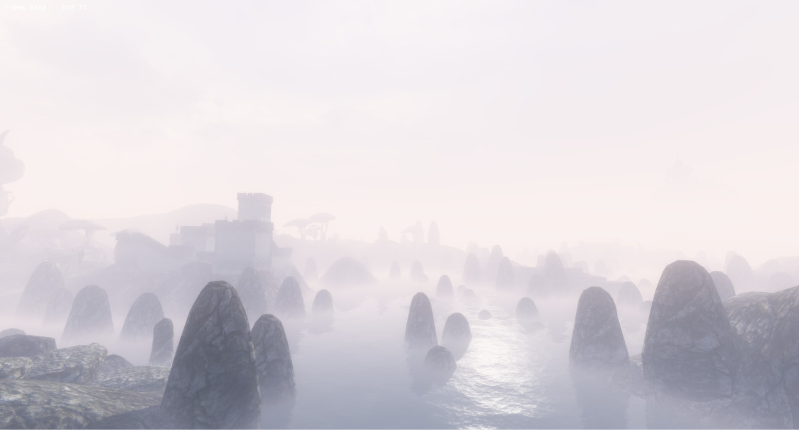

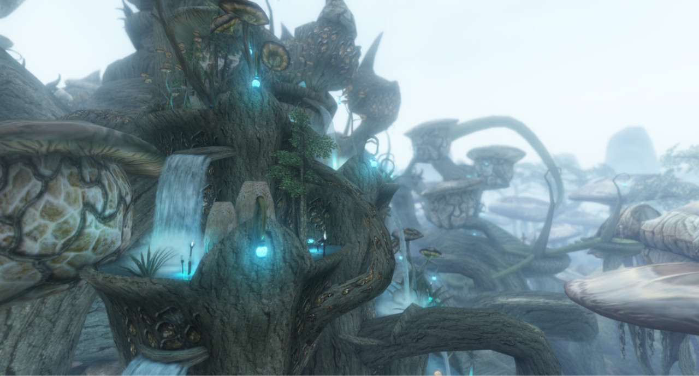

*Vistas of post-processed Morrowind*

Note that due to macOS’ limited and, frankly, somewhat broken OpenGL support, some post-processing shaders in the wild are not built with macOS compatibility in mind. While we took care of some common errors and stability issues on this platform, you might still encounter crashes—please report them to us and also the shaders’ authors, as they can sometimes be worked around.

**New Features**

- Dropdown menus as shader setting control type
- API version shader uniform
- Frame number shader uniform
- Sky and ambient colour shader uniforms
- Render targets can be persistent across frames, which allows temporal effect support

**Fixes**

- [[#7145](https://gitlab.com/OpenMW/openmw/-/issues/7145), [#7146](https://gitlab.com/OpenMW/openmw/-/issues/7146), [#7202](https://gitlab.com/OpenMW/openmw/-/issues/7202)] Fixed various problems with exposed normals
- [[#7168](https://gitlab.com/OpenMW/openmw/-/issues/7168)] Average luminance is now based on a rescaled power-of-two resolution render target, which gives more accurate results
- [[#7354](https://gitlab.com/OpenMW/openmw/-/issues/7354)] Disabling post-processing in-game will no longer cause a crash when reverse Z depth buffer and soft particles are disabled
- [[#7364](https://gitlab.com/OpenMW/openmw/-/issues/7364)] Post-processing is reflected in saved game previews
- [[#7487](https://gitlab.com/OpenMW/openmw/-/issues/7487)] Shader compilation errors caused by intentionally unsupported Clamp wrap mode are more informative
- [[#7587](https://gitlab.com/OpenMW/openmw/-/issues/7587)] Invalid dynamic shader entries should no longer cause crashes upon reloading the game
- [[#7652](https://gitlab.com/OpenMW/openmw/-/issues/7652)] Inactive post-processing shaders are now sorted alphabetically
- [[#7679](https://gitlab.com/OpenMW/openmw/-/issues/7679)] Average luminance is no longer hard reset every time you configure a shader that uses it
- [[#8295](https://gitlab.com/OpenMW/openmw/-/issues/8295)] Fixed a crash when the post-processing chain refers to an existing shader file in a different case
- [[#8295](https://gitlab.com/OpenMW/openmw/-/issues/8295)] Fixed a crash when the post-processing chain includes an existing shader file nested into a subdirectory of the shaders directory (which is going to be unusable)
- [[#8465](https://gitlab.com/OpenMW/openmw/-/issues/8465)] Fixed broken rendering on macOS when hardware antialiasing is enabled
- GLSL versions above 1.20 are properly requested on setups that don’t support UBO rendering (such as macOS)
- GLSL versions above 3.30 are no longer handled as legacy versions
- Sun uniforms are properly set when you enter interiors

**Scripting: mwscript**

*Major contributions from* ***Evil Eye***  
*Contributions from* ***akortunov, Capo, elsid*** *and* ***zackhasacat***

These are mostly minor changes to address the never-ending stream of obscure mod compatibility issues. Of note is the restored functionality of GetCollidingPC and friends, used e.g. in Tamriel Rebuilt for walls that damage you when you touch them, which were broken for a while after the release 0.47.0.

We know, we know: OpenMW-Lua this, OpenMW-Lua that. But we will never forget about Morrowind’s own scripting language. It is forever in our hearts and minds. Living in them rent-free, you could say.

**New Features**

- [[#6983](https://gitlab.com/OpenMW/openmw/-/issues/6983)] Get/Set/ModPCVisionBonus functions, which interact with the base value of the Night-Eye magic effect
- [[#7058](https://gitlab.com/OpenMW/openmw/-/issues/7058)] TestModels (T3D) instruction, which is used for testing the loading of every single model used by your game content
- [[#7194](https://gitlab.com/OpenMW/openmw/-/issues/7194)] OutputRefInfo (ORI) debug instruction now also prints the object’s currently bound textures. Missing textures are not bound
- [[#7609](https://gitlab.com/OpenMW/openmw/-/issues/7609)] AllowWerewolfForceGreeting variable, which controls whether ‘ForceGreeting’ works if the player is in werewolf form
- [[#7625](https://gitlab.com/OpenMW/openmw/-/issues/7625)] AddItem, RemoveItem, StartScript, StopScript and AddTopic provide more helpful warnings if the relevant records are not available

**Fixes**

- [[#3846](https://gitlab.com/OpenMW/openmw/-/issues/3846)] Unquoted string arguments that start with a period or a minus are supported in more cases
- [[#4289](https://gitlab.com/OpenMW/openmw/-/issues/4289)] Disabling objects that have no placed instances is now allowed
- [[#4816](https://gitlab.com/OpenMW/openmw/-/issues/4816)] GetWeaponDrawn starts returning 1 when the weapon is attached, rather than the moment you enter combat stance
- [[#4996](https://gitlab.com/OpenMW/openmw/-/issues/4996)] Redundant function arguments are ignored in a generalised way (but not yet ignored in expressions)
- [[#6716](https://gitlab.com/OpenMW/openmw/-/issues/6716)] Comparison operator parsing is more restrictive in terms of white space and less restrictive in terms of allowed special characters. This means combinations such as >!&lt;&lt;= and “> =” are now parsed as greater-than, like in Morrowind
- [[#6807](https://gitlab.com/OpenMW/openmw/-/issues/6807)] Special characters at the start of the line are ignored
- [[#6987](https://gitlab.com/OpenMW/openmw/-/issues/6987)] Set/ModBlindness instructions, which interact with the base value of Blind magic effect, no longer have a visual effect
- [[#7053](https://gitlab.com/OpenMW/openmw/-/issues/7053)] Collision detection functions such as GetCollidingPC work properly again
- [[#7084](https://gitlab.com/OpenMW/openmw/-/issues/7084)] Resurrect and levelled creature respawn now recognise if the relevant base records have changed and use the updated records
- [[#7148](https://gitlab.com/OpenMW/openmw/-/issues/7148)] Significantly improved script execution performance due to optimised string literal lookup
- [[#7416](https://gitlab.com/OpenMW/openmw/-/issues/7416)] ModPCCrimeLevel can clear crimes and can no longer make the bounty negative
- [[#7770](https://gitlab.com/OpenMW/openmw/-/issues/7770)] Various script functions and instructions that work with actor stats such as GetMagicka and AddSpell can now be used on objects (to no effect)
- [[#7770](https://gitlab.com/OpenMW/openmw/-/issues/7770)] GetItemCount can now run on objects without an inventory
- [[#7770](https://gitlab.com/OpenMW/openmw/-/issues/7770)] GetItemCount and GetSoundPlaying will return 0 instead of interrupting script execution when they have no instance to run on
- [[#7943](https://gitlab.com/OpenMW/openmw/-/issues/7943)] Add/RemoveSoulGem and Drop instructions now work on creatures that cannot equip items
- [[#8097](https://gitlab.com/OpenMW/openmw/-/issues/8097)] GetEffect can detect active effects that have 0 magnitude
- DisablePlayerControls no longer disables controller camera movement while DisablePlayerLooking now *does*
- GetHealthGetRatio now returns a ratio of 1 for actors that have a maximum health of 0
- OutputRefInfo (ORI) command can be used in its unabbreviated form
- SetAngle alternative ZYX rotation order axes are ordered properly
- –script-all-dialogue option no longer attempts to compile dialogue result scripts for actors that do not use the relevant responses

**Scripting: OpenMW-Lua**

*Major contributions from* ***akortunov, Evil Eye, Foal, ptmikheev, urm*** *and* ***zackhasacat***  
*Contributions from* ***Capo, Calandiel, cykboy, elsid, fallchildren, johnnyhostile, Kuyondo, MaxYari, Mitten.0, mpeco, Pharis, S3ctor, trav*** *and* ***wazabear***

As promised in the previous release’s announcement, 0.49.0 is a marked step forward for OpenMW-Lua.

Lua scripting can now interact with the game’s animations, audio, magic, quests, virtual filesystem, create and teleport game objects, load YAML data serialisation format files, load and save the game, and more. It is also *much* more stable!

For a full overview of the current state of OpenMW-Lua beyond the limits of the comprehensive yet brief list below, please consult [the scripting API reference](https://openmw.readthedocs.io/en/openmw-0.49.0/reference/lua-scripting/api.html).

**Now Dehardcoded**

- [[#7538](https://gitlab.com/OpenMW/openmw/-/issues/7538)] Skill and level progression
- Player input controls
- Exploration, combat, and death music

**New Interfaces and Packages**

- [[#6726](https://gitlab.com/OpenMW/openmw/-/issues/6726)] Object manipulations: creation, teleportation and removal
- Custom Activator, Armor, Book, Clothing, Light, Miscellaneous, Potion and Weapon records can be created and spawned
- [[#7142](https://gitlab.com/OpenMW/openmw/-/issues/7142)] Overhauled mwscript bindings, previously limited to local variables; the new API supports global scripts
- [[#7648](https://gitlab.com/OpenMW/openmw/-/issues/7648)] Saved game interactions
- [[#7805](https://gitlab.com/OpenMW/openmw/-/issues/7805)] New script context: menu scripts, which can run when no game is loaded and interact with main menu functionality
- [[#8109](https://gitlab.com/OpenMW/openmw/-/issues/8109)] Crimes: allows triggering built-in crime events
- Animations (openmw.animation): various controls for actor and object animations that are also used internally
- Custom input actions as a part of overhauled input package (openmw.input)
- Factions: access to NPCs’ faction-related mechanics
- Magic: access to spells and individual effects active on every actor
- Music and sounds (openmw.ambient): allows scripts to play music and sounds
- Quests: journal access and interaction API that exposes functionality previously reserved to mwscript
- UI stack interaction: allows adding and removing the original UI windows as well as unpausing individual GUI modes
- Virtual filesystem (openmw.vfs): read-only access to loaded data directories
- YAML file loading and decoding (openmw.markup)

**New Bindings**

- [[#6727](https://gitlab.com/OpenMW/openmw/-/issues/6727), [#6795](https://gitlab.com/OpenMW/openmw/-/issues/6795), [#7468](https://gitlab.com/OpenMW/openmw/-/issues/7468), [#7964](https://gitlab.com/OpenMW/openmw/-/issues/7964)] Armor, Birthsign, Class, Clothing, Dialogue, Enchantment, Faction, Levelled Creature, Light, Magic Effect, Race, Spell and Static records
- Skills, attributes and magic schools as non-standard ESM records
- Imported and validated Morrowind.ini settings as game setting records
- [[#7916](https://gitlab.com/OpenMW/openmw/-/issues/7916)] Active AI package distance, duration, repeat flag, and Wander package idle chances (all assignable to new packages)
- Global AI, god mode, collision and mwscript scripting debug toggles (toggleable)
- [[#7860](https://gitlab.com/OpenMW/openmw/-/issues/7860)] Actor AI ratings (writable)
- Actor and container encumbrance and capacity
- Actor barter gold, offered services and travel destinations
- Actor death process flags
- [[#8087](https://gitlab.com/OpenMW/openmw/-/issues/8087)] Actor essential and respawn flags
- Actor fleeing status
- Actor record IDs
- Cell “can rest” flag
- Cell water level
- Cell, player and typed record lists, which replace record binding as the preferred way to locate records
- Container and door lock and trap data (writable)
- [[#8038](https://gitlab.com/OpenMW/openmw/-/issues/8038)] Container organic and respawn flags
- Container resolution status (writable)
- Controller cursor (toggleable)
- [[#8087](https://gitlab.com/OpenMW/openmw/-/issues/8087)] Creature movement, bipedal and weapon use flags
- Creature skills, soul values and type
- Door state and interaction
- Ingredient and potion effects
- Inventory item holding container
- Item condition (modifiable)
- Item restock and carriability status
- Miscellaneous item souls (writable)
- NPC disposition (the base disposition is modifiable)
- NPC models
- Object initial position and rotation
- Object world-space bounding boxes
- Object ownership data and scale (writable)
- Player bounty (modifiable)
- Player teleportation block (toggleable)
- Real (unpaused) frame duration

If not otherwise noted, the exposed information is read-only.

Interfaces listed above provide bindings not listed here.

**New Utility Functions**

- [[#6971](https://gitlab.com/OpenMW/openmw/-/issues/6971)] Number remapping and rounding
- Closest navmesh position based on provided object position and parameters
- Deep UI element update and destruction
- Unicode handling library
- Whether AI is currently being processed for a specific actor
- World-to-view coordinate conversion

**New Events and Engine Handlers**

- Actor death
- Object activation (in global scripts). Standard activation can now be overridden
- Object teleportation
- Mouse input

New packages and interfaces provide other events and handlers not listed here.

**Other New Features**

- [[#7091](https://gitlab.com/OpenMW/openmw/-/issues/7091)] Local script attachment now supports custom initialisation data
- [[#7245](https://gitlab.com/OpenMW/openmw/-/issues/7245)] New AI package assignments no longer have to cancel previous assignments
- Camera toggling source tag support
- In-game profiler (second page of F10 debug window)
- Storage data lifetime can be set manually
- Events can contain object lists
- Table setting value support
- Teal declarations
- UI elements can be implemented as layout children, allowing for better optimisations and state tracking
- You can now reload all scripts
- You can now reset the actor’s currently selected enchanted item/spell. Selecting a new spell also resets the currently selected enchanted item
- Rendering ray casts can now ignore certain objects
- Vector swizzling

**Fixes**

- [[#6146](https://gitlab.com/OpenMW/openmw/-/issues/6146)] Item equipment properly sets the relevant mwscript variables
- [[#6893](https://gitlab.com/OpenMW/openmw/-/issues/6893)] Disabled and deleted objects are handled in a way consistent with mwscript
- [[#7449](https://gitlab.com/OpenMW/openmw/-/issues/7449)] Fixed type validation in cell:getAll
- [[#7469](https://gitlab.com/OpenMW/openmw/-/issues/7469)] Fixed a potential crash when an orphan UI element is destroyed
- [[#7546](https://gitlab.com/OpenMW/openmw/-/issues/7546)] To improve lore accuracy, Morrowind now starts on Fredas in the Lua calendar
- [[#7627](https://gitlab.com/OpenMW/openmw/-/issues/7627)] Internal content library execution failures should no longer cause crashes
- [[#7787](https://gitlab.com/OpenMW/openmw/-/issues/7787), [#8099](https://gitlab.com/OpenMW/openmw/-/issues/8099)] Script memory allocation and compiled byte code loading errors should no longer cause crashes
- [[#7823](https://gitlab.com/OpenMW/openmw/-/issues/7823)] Empty Lua storage files no longer cause a crash upon loading
- [[#7912](https://gitlab.com/OpenMW/openmw/-/issues/7912)] Rendering raycasts now report if they hit the terrain
- [[#8503](https://gitlab.com/OpenMW/openmw/-/issues/8503)] Camera and timescale bindings no longer accept infinities and NaN as input, preventing hardlocks
- [[#8541](https://gitlab.com/OpenMW/openmw/-/issues/8541)] Fixed incorrect util.color:asHex results for colour channels darker than 0x10
- Actions finish applying before a save is made or loaded to prevent mid-action world state issues and crashes
- Invalid ‘select’ renderer setting values are now visually apparent
- Inactive object script data is serialised and deserialised on demand, significantly reducing runtime memory usage
- TextEdit widget text length is now unlimited
- Fixed thick border UI template textures
- self:isActive() binding properly returns false for inactive objects
- UI layer bindings work properly
- Unassigned enchantment and script IDs are exposed as nil values rather than empty strings

**Other**

- [[#6149](https://gitlab.com/OpenMW/openmw/-/issues/6149)] Lua documentation now shows the relevant Lua API revision
- Contents of containers (exposed as content) are now additionally exposed as inventory for consistency with actor inventories
- Control switch bindings have been moved from input API to player API (input API counterparts are deprecated)
- Deprecated cell isQuasiExterior flag binding (use cell.hasTag(“QuasiExterior”))
- Object rotations are now exposed as quaternions rather than Euler angles
- The toggle sneak setting has been moved to the in-game settings for the dehardcoded input controls, OMWControls
- Various getter functions now have a get prefix; the original bindings are deprecated

**Sound and Media**

*Contributions from* ***akortunov,*** ***Capo, cykboy, Epoch, Evil Eye*** *and* ***Kuyondo***

Building OpenMW with FFmpeg 5.1.1 and above is now supported.

If you’ve been paying attention, you’ve noticed above that OpenMW-Lua now lets content developers interact with the game’s audio. And of course, there are additions other than that, such as the option to use the camera as the sound listener in third-person view and fixes to where and how often region sounds are played.

Most importantly, the Sound spell effect now *has a sound!*

- [[#4382](https://gitlab.com/OpenMW/openmw/-/issues/4382)] Default sound output device changes are now tracked
- [[#5849](https://gitlab.com/OpenMW/openmw/-/issues/5849)] Landing sound will no longer constantly restart due to paralysis
- [[#5944](https://gitlab.com/OpenMW/openmw/-/issues/5944)] In third-person view, the camera can now optionally be used as the sound listener
- [[#6402](https://gitlab.com/OpenMW/openmw/-/issues/6402)] Thunder sound effects are now interrupted indoors
- [[#6645](https://gitlab.com/OpenMW/openmw/-/issues/6645)] Shield hit sound now plays when the shield is hit rather than based on an unused animation text key
- [[#6986](https://gitlab.com/OpenMW/openmw/-/issues/6986)] Sound magic effect makes a noise
- [[#7172](https://gitlab.com/OpenMW/openmw/-/issues/7172)] Empty Explore playlist is allowed to interrupt Battle music
- [[#7568](https://gitlab.com/OpenMW/openmw/-/issues/7568)] Combat music no longer interrupts scripted music
- [[#7675](https://gitlab.com/OpenMW/openmw/-/issues/7675)] Successful Lock magic effect cast plays a sound effect
- [[#7761](https://gitlab.com/OpenMW/openmw/-/issues/7761)] Ambient and rain weather sound effects can now play simultaneously
- [[#7872](https://gitlab.com/OpenMW/openmw/-/issues/7872)] Region sound chance rolls are no longer independent and sounds that come later in the list are less likely to play
- [[#8063](https://gitlab.com/OpenMW/openmw/-/issues/8063)] Menu videos that have audio should no longer freeze the game
- [[#8207](https://gitlab.com/OpenMW/openmw/-/issues/8207)] Critical hit sound now only plays when the target is hurt
- [[#8441](https://gitlab.com/OpenMW/openmw/-/issues/8441)] Menu videos are paused when the window is minimised to prevent freezes
- Battle music ends when the last hostile’s death ends rather than when it starts
- Region sounds now play in quasi-exteriors such as Mournhold

**User Interface**

*Major contributions from* ***akortunov*** *and* ***Capo***  
*Contributions from* ***AbduSharif, Chris Vigil, cykboy, Evil Eye, holorat, Kagernac, Kuyondo, ptmikheev, S3ctor, shi.han42, valpackett, wazabear*** *and* ***zackhasacat***  
*Translators (French):* ***jvoisin, tcotys***  
*Translators (German):* ***Atahualpa***  
*Translators (Russian):* ***akortunov, Capo, ptmikheev***  
*Translators (Swedish):* ***Lysol***

Kudos to the international community of our Discord/IRC servers for helping us translate OpenMW!

[MyGUI 3.4.3](https://github.com/MyGUI/mygui/releases/tag/MyGUI3.4.3) is now the minimum requirement for building OpenMW.

This time the console got some love: you can now search through its output, while the command history will be preserved between sessions.

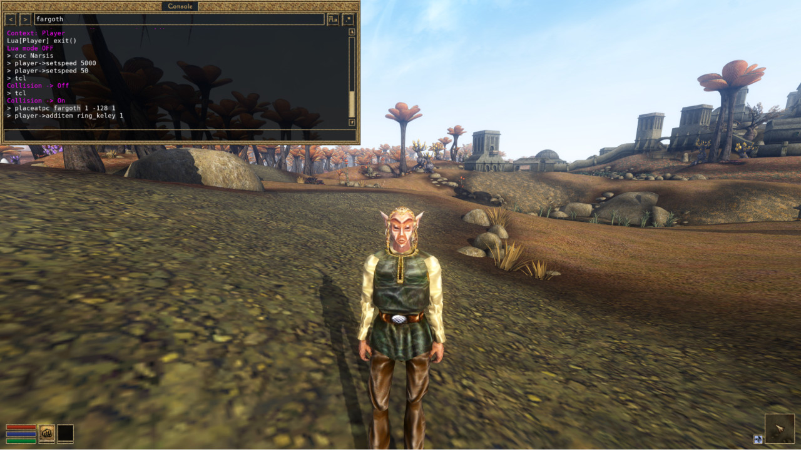

A few other quality-of-life things were added for consistency with Morrowind as usual. Repair and recharge menus now sort their items alphabetically. The alchemy menu, meanwhile, lets you pick or deselect the apparatuses rather than always force you to use the highest quality ones, giving you more freedom in how to brew your perfect “Fortify Intelligence 52363819 pts for 368 years” potion.

Also, we must reveal a truly terrible secret: we’ve been rendering *all* the bitmap fonts wrong all along due to a misunderstanding of how kerning works in the format. That is, any text would be positioned *one* pixel off. No more, we say!

**New Features**

- [[#6933](https://gitlab.com/OpenMW/openmw/-/issues/6933)] High-resolution cursor replacer support
- [[#6995](https://gitlab.com/OpenMW/openmw/-/issues/6995)] Duration strings used in effect and light source duration (show effect duration setting) are now localised
- [[#7125](https://gitlab.com/OpenMW/openmw/-/issues/7125)] Console command history is preserved across game sessions
- [[#7130](https://gitlab.com/OpenMW/openmw/-/issues/7130)] MyGUI logging verbosity is now configurable (matches global logging verbosity)
- [[#7214](https://gitlab.com/OpenMW/openmw/-/issues/7214), [#7248](https://gitlab.com/OpenMW/openmw/-/issues/7248)] In-game console search
- [[#7554](https://gitlab.com/OpenMW/openmw/-/issues/7554)] Shoulder buttons of controllers can now be used to navigate menus
- [[#7923](https://gitlab.com/OpenMW/openmw/-/issues/7923)] Nameless higher ranks are no longer shown in faction tooltips
- [[#7971](https://gitlab.com/OpenMW/openmw/-/issues/7971)] Time Played is now displayed in a more intuitive format and is no longer behind a setting
- F10 window dimensions and position are now preserved across sessions
- System-scaled high-DPI support
- Localisation files can refer to string game settings
- Various lines used in the main menu, loading screens, saved game dialogue and settings window, as well as disabled post-processing and screenshot notifications are now exposed to YAML localisation

**Fixes**

- [[#4710](https://gitlab.com/OpenMW/openmw/-/issues/4710)] Fixed focus tooltip position for partially offscreen objects
- [[#5870](https://gitlab.com/OpenMW/openmw/-/issues/5870)] Selected object is reset in the console if it turns unavailable
- [[#6222](https://gitlab.com/OpenMW/openmw/-/issues/6222)] Global map cell size is capped at 50 pixels as excessive cell size can cause problems
- [[#6427](https://gitlab.com/OpenMW/openmw/-/issues/6427)] Actor health bar is kept visible when damage is dealt continuously
- [[#6661](https://gitlab.com/OpenMW/openmw/-/issues/6661)] Saved games that do not have a valid preview image no longer cause crashes or break the saved game dialogue
- [[#6758](https://gitlab.com/OpenMW/openmw/-/issues/6758)] The Settings window is now rendered over the main menu and its video
- [[#6985](https://gitlab.com/OpenMW/openmw/-/issues/6985)] Built-in Mystic Cards font now aligns non-punctuation characters by width and includes Latin letters with diacritics
- [[#6973](https://gitlab.com/OpenMW/openmw/-/issues/6973)] Training time advancement now happens after the screen fades out
- [[#7013](https://gitlab.com/OpenMW/openmw/-/issues/7013)] The local map should no longer become corrupted due to object movement affecting interior cell bounds
- [[#7054](https://gitlab.com/OpenMW/openmw/-/issues/7054)] Quests are now sorted alphabetically
- [[#7065](https://gitlab.com/OpenMW/openmw/-/issues/7065)] Big versions of magic effect icons now support forward slash-separated paths
- [[#7087](https://gitlab.com/OpenMW/openmw/-/issues/7087)] Resolution changes are disabled for windowed full-screen mode
- [[#7088](https://gitlab.com/OpenMW/openmw/-/issues/7088)] Deleting the last saved game of the only remaining character resets the character drop-down menu
- [[#7131](https://gitlab.com/OpenMW/openmw/-/issues/7131)] Shader uniform edit widget no longer defines an invalid padding property
- [[#7307](https://gitlab.com/OpenMW/openmw/-/issues/7307), [#7698](https://gitlab.com/OpenMW/openmw/-/issues/7698)] Names of attribute/skill effects no longer specify whether they affect an attribute or a skill
- [[#7459](https://gitlab.com/OpenMW/openmw/-/issues/7459)] It is now guaranteed only one item stack can be dragged at a time
- [[#7475](https://gitlab.com/OpenMW/openmw/-/issues/7475)] Equipping constant effect items properly updates active effect icons in the spell window
- [[#7531](https://gitlab.com/OpenMW/openmw/-/issues/7531)] Bitmap font Windows-1252 character substitutions are now accurate to the original game
- [[#7582](https://gitlab.com/OpenMW/openmw/-/issues/7582)] Skills should now always be displayed in the correct specialisation column of the custom class creation dialogue
- [[#7603](https://gitlab.com/OpenMW/openmw/-/issues/7603)] Scripts menu visible area is properly resized when page contents are updated
- [[#7617](https://gitlab.com/OpenMW/openmw/-/issues/7617)] Death save loading prompt now lets you load the last save you’ve saved or loaded like in Morrowind rather than the most recent save overall
- [[#7619](https://gitlab.com/OpenMW/openmw/-/issues/7619)] User marker text is now shortened on the global map like in Morrowind
- [[#7623](https://gitlab.com/OpenMW/openmw/-/issues/7623)] Full help text has been moved below the rest of the item tooltip
- [[#7642](https://gitlab.com/OpenMW/openmw/-/issues/7642)] Items are now sorted alphabetically in repair and recharge dialogues
- [[#7665](https://gitlab.com/OpenMW/openmw/-/issues/7665)] The alchemy menu allows picking and deselecting the apparatuses
- [[#7832](https://gitlab.com/OpenMW/openmw/-/issues/7832)] Fortify Maximum Magicka effect magnitude is no longer shown for ingredients
- [[#7875](https://gitlab.com/OpenMW/openmw/-/issues/7875), [#7914](https://gitlab.com/OpenMW/openmw/-/issues/7914)] UI windows can no longer be moved out of the visible area and are no longer snapped to the edge of the screen
- [[#7908](https://gitlab.com/OpenMW/openmw/-/issues/7908)] Shown key names no longer depend on their name in the currently used keyboard layout
- [[#8005](https://gitlab.com/OpenMW/openmw/-/issues/8005)] F3 profiler lines are now generally ordered chronologically
- [[#8364](https://gitlab.com/OpenMW/openmw/-/issues/8364)] The dialogue menu scrollbar no longer crashes the game upon use when the text area is exactly 1 pixel longer than the scroll area
- [[#8378](https://gitlab.com/OpenMW/openmw/-/issues/8378)] Partial bitmap font textures no longer prevent the game from running
- [[#8378](https://gitlab.com/OpenMW/openmw/-/issues/8378)] Bitmap font kerning is now accurate to the original game
- [[#8378](https://gitlab.com/OpenMW/openmw/-/issues/8378)] Non-breaking space glyph is always rendered in dialogue and books
- [[#8576](https://gitlab.com/OpenMW/openmw/-/issues/8576)] Fixed a potential crash on exit when a container with scripted items is open
- English in-game text specific to OpenMW uses title case where applicable to improve stylistic consistency with Morrowind’s lines
- Displayed region names are substituted with their IDs if they are unavailable
- Topic colouring is no longer temporarily reset if you talk to a creature after talking to an NPC or vice versa
- Topic colouring reacts to mouse focus
- Saved game loading interruption should no longer cause UI issues
- User-defined nearest-neighbour filtering can now be properly changed to bilinear/trilinear in the settings window

**Launcher and Wizard**

*Major contributions from* ***akortunov*** *and* ***AnyOldName3***  
*Contributions from* ***Capo, Evil Eye*** *and* ***Yury Stepovikov***  
*Translators (French):* ***jvoisin, tcotys***  
*Translators (Russian):* ***akortunov, Capo***  
*Translators (Swedish):* ***Lysol***

Building the Qt tools and the editor under Qt 6 is now supported ([#6491](https://gitlab.com/OpenMW/openmw/-/issues/6491)) and our first-party packages use Qt 6. Building under Qt 5.15 is still possible but it is deprecated due to its standard support ending.

0.49.0 introduces French, Russian, and Swedish localisation to the launcher and installation wizard. The language is automatically detected by Qt depending on your system preferences; if you want to change it back to English (or any other language), change the system’s preferred language or set the LANG environment variable to the shorthand of that language like en. Or nuke all the unwanted translation files, if that’s what you prefer.

0.49.0 also makes the launcher UI fresher and faster in a variety of ways, and even introduces Windows 11 dark mode support. Check it out!

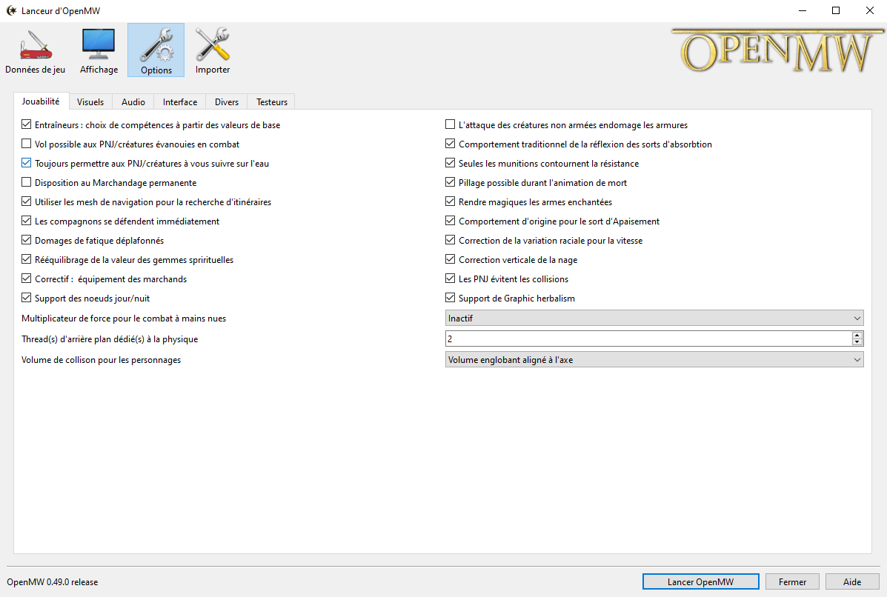

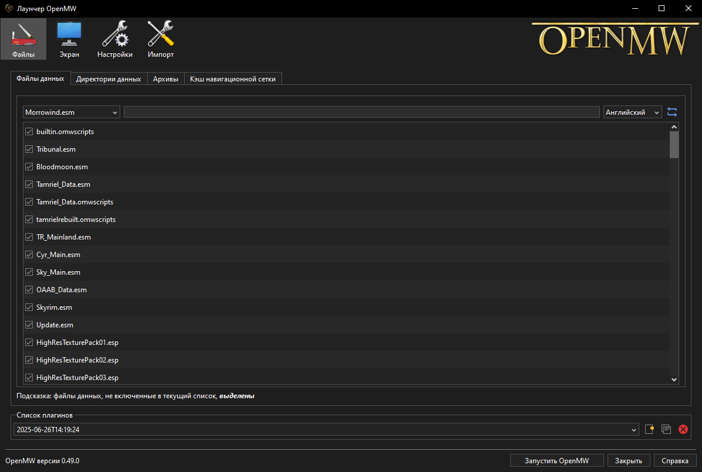

By the way, we accept contributions that add support for other languages, both for the engine and the Qt applications.

**New Features**

- [[#6411](https://gitlab.com/OpenMW/openmw/-/issues/6411)] Localisation support
- [[#6922](https://gitlab.com/OpenMW/openmw/-/issues/6922), [#7709](https://gitlab.com/OpenMW/openmw/-/issues/7709)] Revised and optimised launcher UI
- [[#7606](https://gitlab.com/OpenMW/openmw/-/issues/7606)] Extended selection in archive and data directory lists
- [[#7936](https://gitlab.com/OpenMW/openmw/-/issues/7936)] Built-in icons have been converted to SVG format and are now scalable
- [[#7985](https://gitlab.com/OpenMW/openmw/-/issues/7985)] Windows 11 Dark Mode support
- [[#8130](https://gitlab.com/OpenMW/openmw/-/issues/8130)] New context menu option: copy the selected data directory paths
- [[#8130](https://gitlab.com/OpenMW/openmw/-/issues/8130)] New context menu option: open the selected data directory
- [[#8286](https://gitlab.com/OpenMW/openmw/-/issues/8286)] openmw.cfg will no longer be overwritten if it already contains all the settings that were going to be written
- [[#8287](https://gitlab.com/OpenMW/openmw/-/issues/8287)] Removed unintuitive special handling for commas in openmw.cfg setting values when comments are preserved

**Fixes**

- [[#6846](https://gitlab.com/OpenMW/openmw/-/issues/6846)] Launcher, bulletobjecttool and navmeshtool properly support [portable OpenMW configurations](https://openmw.readthedocs.io/en/openmw-0.49.0/reference/modding/paths.html#custom-configuration-directories)
- [[#7103](https://gitlab.com/OpenMW/openmw/-/issues/7103), [#7733](https://gitlab.com/OpenMW/openmw/-/issues/7733)] Content files are once again properly overridden based on data directory priority
- [[#7502](https://gitlab.com/OpenMW/openmw/-/issues/7502), [#8085](https://gitlab.com/OpenMW/openmw/-/issues/8085)] Data directory autodetection and insertion should be much less unreliable
- [[#7840](https://gitlab.com/OpenMW/openmw/-/issues/7840)] The default viewing distance is no longer inappropriately rounded
- [[#7891](https://gitlab.com/OpenMW/openmw/-/issues/7891)] User-provided shadow map resolutions are no longer overridden
- [[#7993](https://gitlab.com/OpenMW/openmw/-/issues/7993)] Tribunal is no longer force-enabled if Bloodmoon is enabled
- [[#8080](https://gitlab.com/OpenMW/openmw/-/issues/8080)] Fixed various problems with non-user openmw.cfg handling
- [[#8189](https://gitlab.com/OpenMW/openmw/-/issues/8189)] INI importer checkbox states are now saved
- [[#8200](https://gitlab.com/OpenMW/openmw/-/issues/8200)] Fixed a crash when the loaded content list attempts to define a BSA multiple times
- [[#8208](https://gitlab.com/OpenMW/openmw/-/issues/8208)] Added a lower limit to the viewing distance spin box
- [[#8445](https://gitlab.com/OpenMW/openmw/-/issues/8445)] Fixed a crash on exit due to start cell list generation being interrupted
- Equivalent data paths no longer cause the content list to be duplicated
- Relative paths are no longer overridden with canonical paths

**OpenMW-CS**

*Major contributions from* ***S3ctor***  
*Contributions from* ***akortunov, Capo, cykboy, Evil Eye, Lamoot, SaintMercury*** *and* ***unelsson***

OpenMW-CS is also a Qt app, but it, unfortunately, didn’t get localised for this release. It did get some UI updates, though!

In this release, the CS gets a variety of quality-of-life features such as axial locking for instance movement, reference snapping, instance cloning, Equalise submode for terrain and various useful shortcuts. It is also now more capable of saving more vanilla-compatible content files, by e.g. saving dialogue, sound generator and terrain records more like The Elder Scrolls Construction Set (although bear in mind it still does not compile scripts).

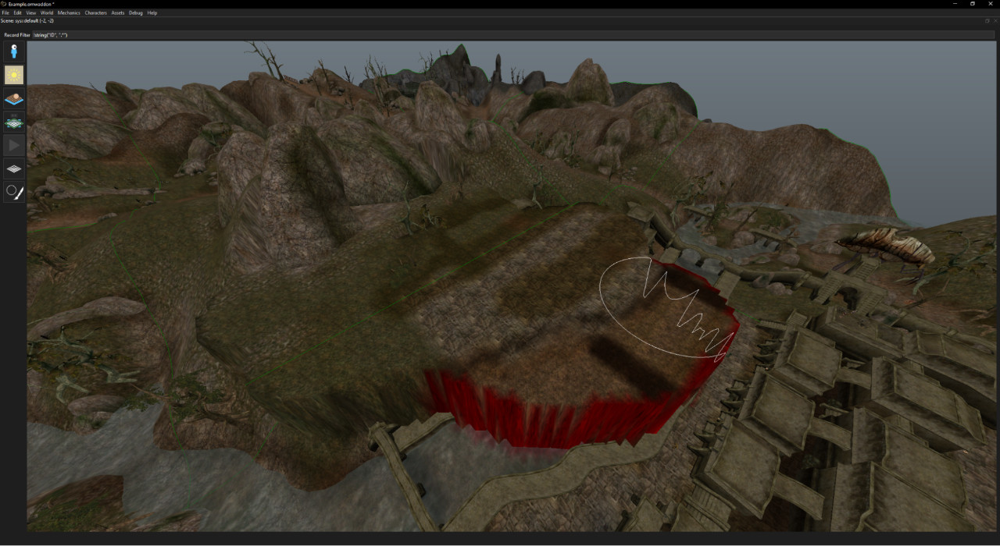

*Terrain equalisation brush in action*

**New Features**

- [[#3501](https://gitlab.com/OpenMW/openmw/-/issues/3501)] Axial locking support for instance movement/rotation (X, Y and Z shortcuts)
- [[#7161](https://gitlab.com/OpenMW/openmw/-/issues/7161)] Dragging a topic to the topic responses table instantly creates a new response to that topic
- [[#7499](https://gitlab.com/OpenMW/openmw/-/issues/7499)] Dragging a record to a table generates a record filter relevant to that record
- [[#7985](https://gitlab.com/OpenMW/openmw/-/issues/7985)] Windows 11 Dark Mode support
- Terrain height equalisation brush
- Reference snapping: you can now pick a snap target for the instances you move (see [documentation](https://openmw.readthedocs.io/en/openmw-0.49.0/manuals/openmw-cs/cell-view.html))
- Instance cloning: Shift-C duplicates the selected object instances
- Magic effect projectile speed can now be edited (admittedly, it does not currently affect anything in-game)
- Spell, potion, and ingredient effect verification
- Object instance verifier reports duplicate RefNums, which are known to sometimes happen and cause problems
- Tab cycles the camera mode
- Ctrl-&lt;number> shortcuts create groups of selected instances that can be re-selected using &lt;number> shortcuts
- G, V and R shortcuts toggle move/scale/rotate submodes
- Space resets the current selection
- H temporarily hides the selected instances (Alt-H makes them visible)

**UX Improvements**

- [[#7160](https://gitlab.com/OpenMW/openmw/-/issues/7160)] Topic response text column has been moved closer to the left
- [[#7953](https://gitlab.com/OpenMW/openmw/-/issues/7953)] Icons are now scalable and support using colours from alternative colour schemes
- Tables and the script editor also react better to rescaling and alternative colour schemes
- [[#8141](https://gitlab.com/OpenMW/openmw/-/issues/8141)] The four instance snap-down modes have been combined into the most useful one (originally Drop to Collision Separately)
- Improved Preferences window and operation progress bar layout
- Left Click was swapped with Middle Click in default selection, navigation and Open action shortcuts

**Fixes**

- [[#5859](https://gitlab.com/OpenMW/openmw/-/issues/5859)] User openmw-cs.cfg no longer claims that it is settings.cfg
- [[#6939](https://gitlab.com/OpenMW/openmw/-/issues/6939)] Table subview columns are automatically resized based on their contents
- [[#7447](https://gitlab.com/OpenMW/openmw/-/issues/7447)] Fixed a crash when a cell of a different type is dragged into the scene view
- [[#7707](https://gitlab.com/OpenMW/openmw/-/issues/7707)] Terrain flags are properly handled and saved, ensuring exported terrain Morrowind/Construction Set compatibility
- [[#7721](https://gitlab.com/OpenMW/openmw/-/issues/7721)] Any printable character is allowed to be used in created record IDs, like commas and apostrophes often used in cell IDs
- [[#7753](https://gitlab.com/OpenMW/openmw/-/issues/7753)] NPCs in the scene view are scaled based on their height and weight
- [[#7765](https://gitlab.com/OpenMW/openmw/-/issues/7765)] Fixed stability problems of undoing/redoing the changes of the Touch command introduced in 0.48.0
- [[#7785](https://gitlab.com/OpenMW/openmw/-/issues/7785)] Affected skills and attributes are reset if a spell effect that cannot affect the relevant stat is assigned
- [[#7841](https://gitlab.com/OpenMW/openmw/-/issues/7841)] Cell water height is no longer saved unless explicitly changed or originally included in the record
- [[#7861](https://gitlab.com/OpenMW/openmw/-/issues/7861)] Dialogue type is now copied to topic response records to improve compatibility with tools that expect it to be there
- [[#7887](https://gitlab.com/OpenMW/openmw/-/issues/7887)] Script bytecode size reported by the script is recalculated based on the actual provided bytecode, preventing crashes during saving
- [[#7896](https://gitlab.com/OpenMW/openmw/-/issues/7896)] Parent file indices are now resolved and saved correctly, preventing some issues when multiple files modify the same object instance
- [[#7898](https://gitlab.com/OpenMW/openmw/-/issues/7898)] Object instance scale is clamped to [0.5; 2.0] range to mirror engine behaviour
- [[#7899](https://gitlab.com/OpenMW/openmw/-/issues/7899)] Locks can be properly unlocked
- [[#7901](https://gitlab.com/OpenMW/openmw/-/issues/7901)] Unusable teleport data is no longer shown when you are not working with a teleport door
- [[#8181](https://gitlab.com/OpenMW/openmw/-/issues/8181)] Generated topic response ID format has been changed to improve saved topic response compatibility with Morrowind/Construction Set
- [[#8299](https://gitlab.com/OpenMW/openmw/-/issues/8299)] Fixed a crash when smoothing terrain at the border with an undefined cell
- Follow and Escort package duration is no longer handled as Wander package duration and no longer corrupts the package when edited
- NPC verifier no longer complains about attributes set to 0
- Object instance verifier now recognises body part records as valid objects
- Regions can be dragged from their table to the region map
- Sound generator records are now saved after creature records so that their creature references can work properly in Morrowind/Construction Set
- Topic response records are now saved after quest records so that their quest filter conditions can work properly in Morrowind/Construction Set
- Training service can no longer be enabled for creatures since they do not have skills and cannot provide training
- Wander package idle chance columns are now numbered correctly
- Water is displayed using a different brush on the region map

**The Elder Scrolls IV and Beyond**

*Contributions from* ***alekulyn, Cédric Mocquillon, Capo, elsid, ptmikheev, Tetramir, wazabear*** *and* ***zackhasacat***  
*Retroactive contributions from* ***Azdul*** *and* **especially *cc9cii***

You’ve read that right. Leveraging community research, we’ve begun prototyping support for Oblivion (2006), Skyrim, Fallout 3, Fallout: New Vegas and Fallout 4, games based on later revisions of Bethesda’s open-world game engine. Their game files can be enabled as “mods” for Morrowind or the [OpenMW Example Suite](https://gitlab.com/OpenMW/example-suite) in the launcher. The console can then be used to teleport to their locations. As we’re picking the low-hanging fruits, early support includes very basic “walking simulator” functionality.

Extended NIF support currently requires the load unsupported nif files setting to be added to the [Models] section of settings.cfg and set to true. OpenMW-CS does not currently support newer NIF formats or loading TES4 format content files.

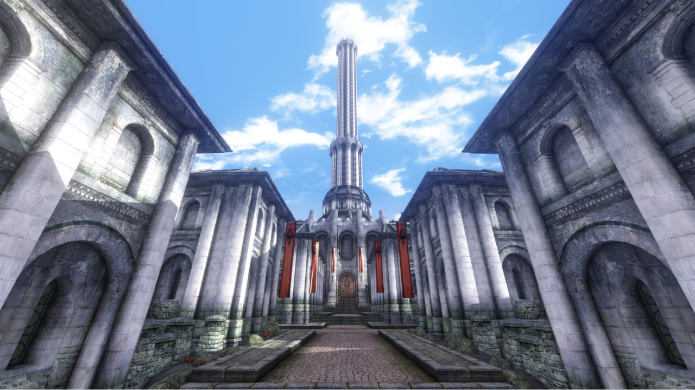

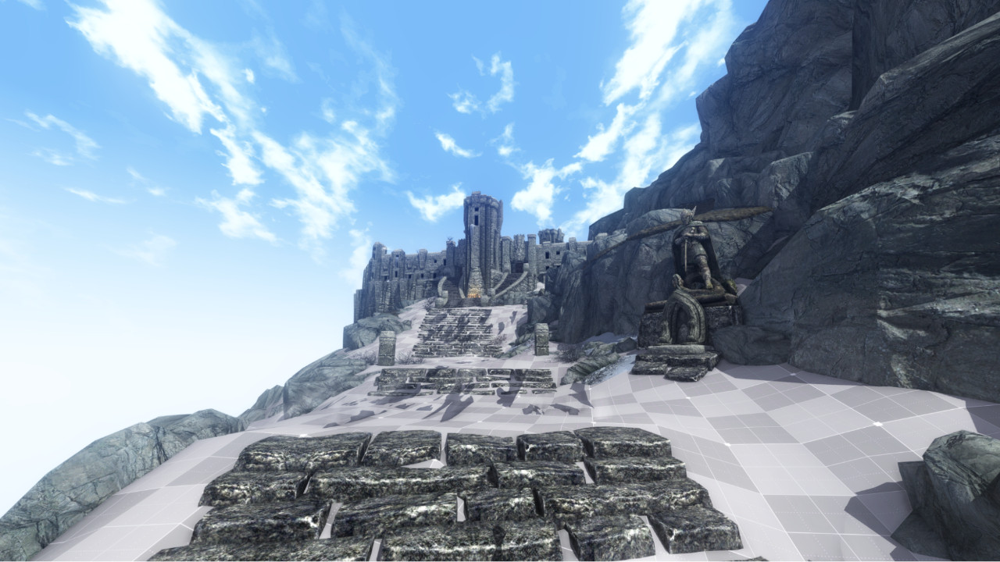

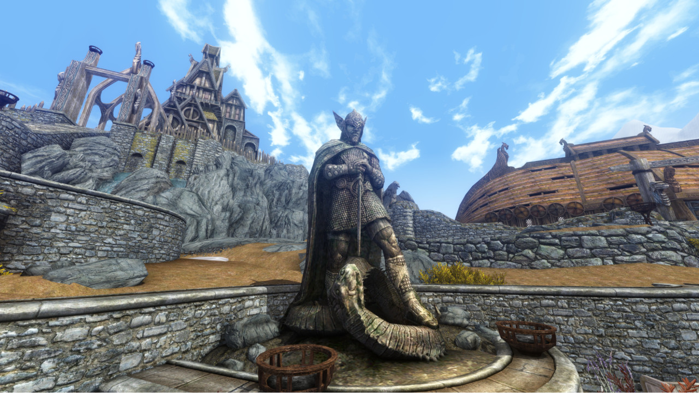

Of course, this doesn’t mean we’re moving on from Morrowind. No, Morrowind compatibility is likely to forever remain the primary and sacred focus. That being said, and OpenMW being technically a very strange implementation of the Creation Engine, adapting it to other games will actually allow us to improve Morrowind-compatible tooling and file formats and have Bethesda’s own ideas and improvements on their open world game formula guide us. It will also let modders and game developers eventually use the tooling produced by Bethesda and the community for the later games.

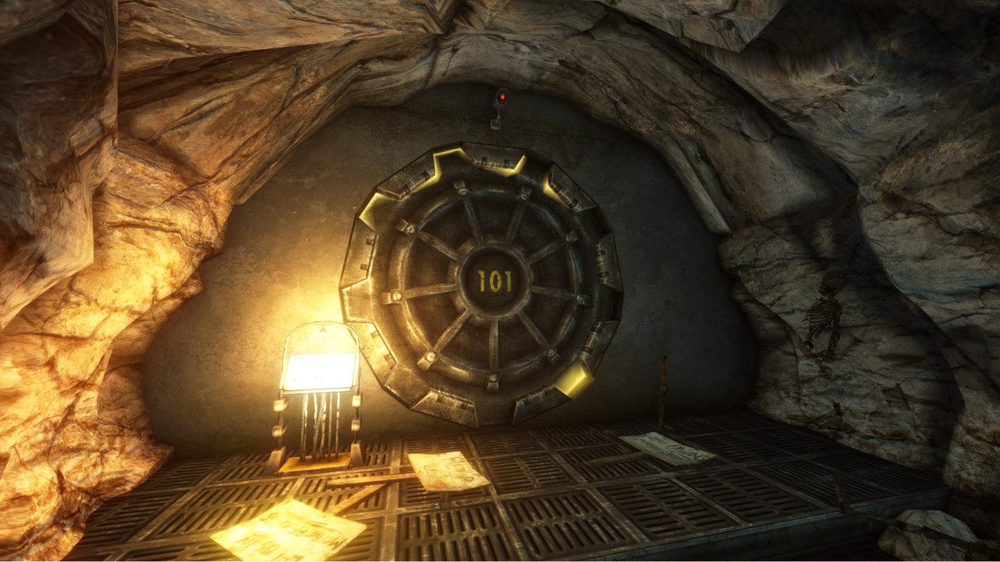

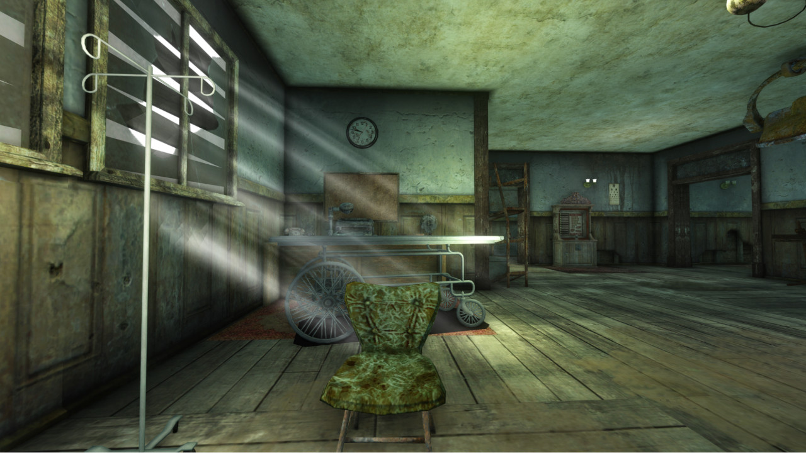

Some of you may be familiar with a fork of OpenMW that teased more advanced functionality in this area, developed by cc9cii. While upstream OpenMW owes a ton to cc9cii’s efforts, the fork is based on a much older and substantially different version of the code. Its existence does not mean the equivalent features can be easily added to modern OpenMW.

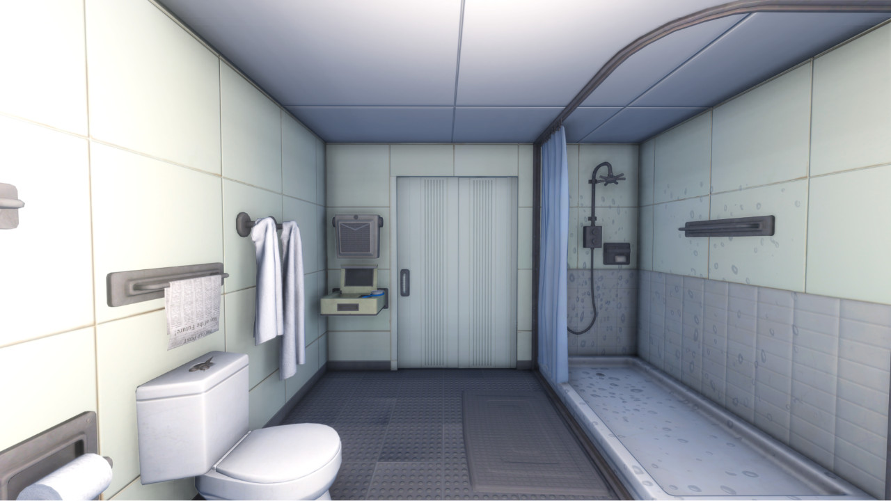

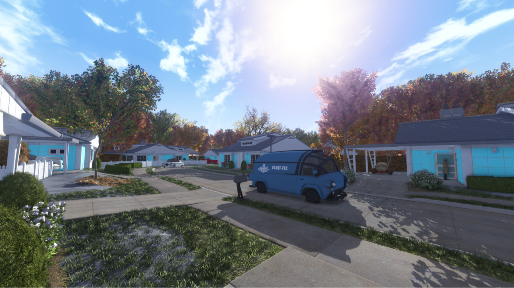

And there’s likely another question on your mind: are we ever going to support the recently released Oblivion Remastered? Well, no. Despite lifting a lot from Oblivion’s Gamebryo, it is an Unreal Engine game. It might surprise you, but OpenMW is not a reimplementation of Unreal.

Skyblivion, though? That could be within reach.

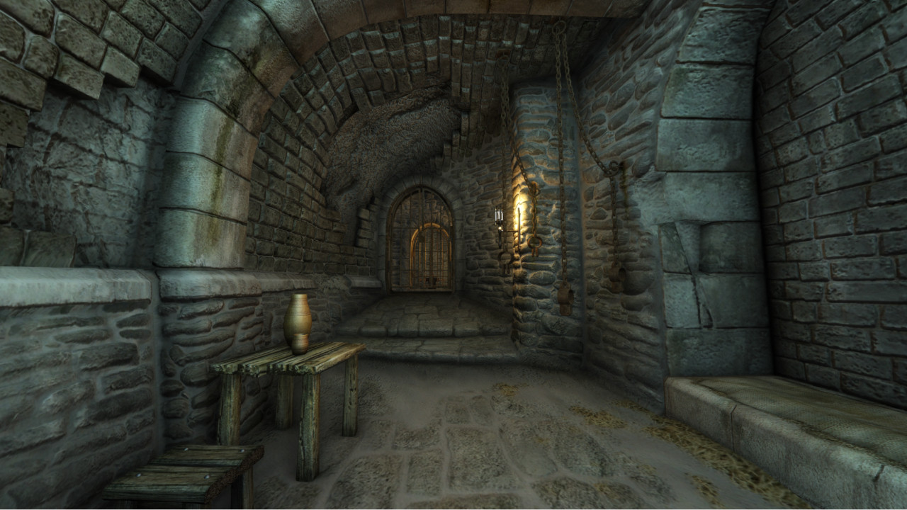

*No, this is not Skyblivion*

**Archives**

In 0.46.0, Azdul ported the TES4+ BSA file format reader from cc9cii’s fork and in 0.47.0, Skyrim Special Edition BSA format support was added.

- [[#7292](https://gitlab.com/OpenMW/openmw/-/issues/7292)] BA2 reading support; 0.49.0 can read Fallout 4, Fallout 4 next-gen update and Fallout 76 BA2s
- Significant optimisations to compressed BSA loading

**ESM and Scene**

In 0.48.0, the TES4 ESM format file format reader was introduced by cc9cii himself, based on original research and research conducted by UESP contributors. It laid the necessary groundwork for loading Oblivion, Fallout 3, New Vegas and Skyrim files. For 0.49.0, it was refined, integrated into the engine and extended to cover Fallout 4 based on the research conducted by [xEdit contributors.](https://github.com/TES5Edit/TES5Edit)

- Initial engine integration of the reader: world loading and terrain heightmap rendering
- Various objects are loaded into the scene: statics, light sources, items, doors, containers, flora, etc.
- Initial NPC rendering; currently very primitive and exclusive to Oblivion, 2011 Skyrim and Fallout 4
- Basic book reading and door interaction mechanics

**NIF and Rendering**

Since 0.46.0, OpenMW’s own NIF reader has been getting updates to handle newer format models. These efforts have been spearheaded by Capo and are not derived from cc9cii’s work.

- Complete parsing of all official NIF files from Oblivion, Skyrim, and Fallout 3/NV/4/76 based on the research by [NifTools contributors](https://github.com/niftools/nifxml/) and [ousnius](https://github.com/ousnius/nifly)

Also known to handle files from Culpa Innata and Civilization IV

- Basic textured geometry rendering support for the official files. This includes diffuse mapping, normal mapping, glow mapping and Oblivion diffuse parallax mapping, as well as soft effect and refraction flag support and [[#7777](https://gitlab.com/OpenMW/openmw/-/issues/7777)] basic support for shader material files used in Fallout 4/76.

We’re currently missing skinned geometry for Skyrim SE, particles, any animation, SpeedTree, FaceGen or Bethesda Havok support. Collision geometry is based on the rendered geometry for games up to 2011 Skyrim and isn’t generated for Skyrim SE and Fallout 4/76.

And that’s about it. We hope you’ll enjoy this extensive update. Thank you for your interest in OpenMW and for reading this!
