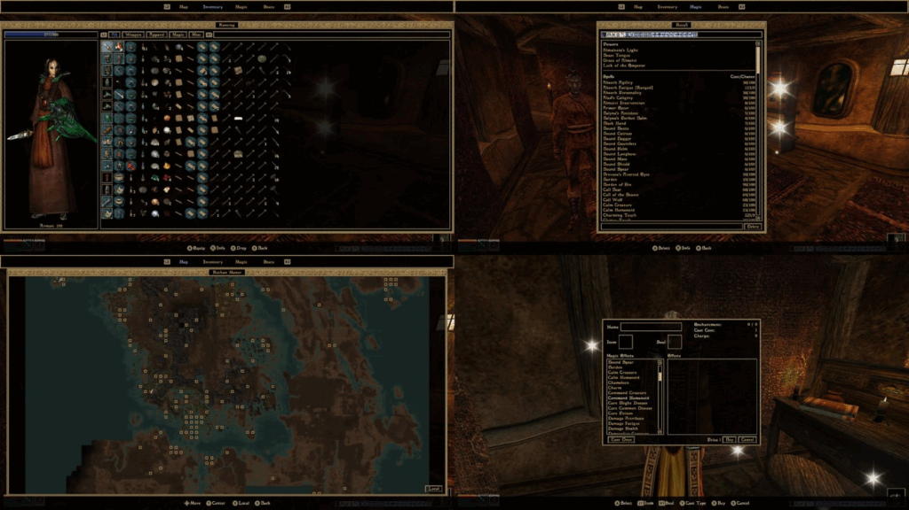

It’s barely been a few months since 0.49.0, but wouldn’t you know it — version 0.50.0 is on the horizon, as we are ready to share the release candidate (RC) builds with you! Grab one from our [GitHub releases page](https://github.com/OpenMW/openmw/releases) for all supported operating systems.

Despite the nice round number, 0.50.0 is a focused release — its core highlight is the improved gamepad support and optional gamepad-tailored UI (which you can enable in the launcher). But even if you’re a hard-boiled mouse and keyboard enthusiast, you should appreciate the variety of UI fixes and game mechanics fixes coming with this update, as well as the steps made towards dehardcoding combat.

As usual, our intention for the RC period is to have you break it — run into any uncaught crashes, freezes, regressions, or other unexpected issues, and report them to us on our [issue tracker.](https://gitlab.com/OpenMW/openmw/-/issues) You may also suggest improvements to the gamepad UI, and some of your ideas may end up in the final release. If by chance you don’t run into any issues whatsoever, don’t be shy — tell us!

If you’re eager to test 0.50.0, updating from 0.49.0 and continuing your existing playthroughs should be safe, but keep in mind that mods that work extensively with UI layout files **must** be updated to be compatible with the UI changes. Some mods that use OpenMW-Lua may also need to be updated — so double-check if your setup is up to speed. Updating from a previous release is as simple as using the installer or unpacking the archive to a new directory, though if you were using a portable installation, remember to repeat the process of setting one up. Your configuration and save files are otherwise stored [elsewhere](https://openmw.readthedocs.io/en/latest/reference/modding/paths.html).

We took care not to change the saved game format since 0.49.0. This means that you should be able to revert to 0.49.0 on your ongoing playthrough if you experience issues in the new release, although this is not recommended. For RC testing purposes, this also allows you to compare any behaviour between 0.49.0 and 0.50.0 easily.

If you’re *not* eager to test and would rather try out a battle-tested release, visit [our Downloads page](/downloads). 0.49.0 is not going anywhere.

Read the RC1 prerelease description for a preliminary but comprehensive list of other changes coming in the upcoming stable release. And see you around then!

(Oh, by the way. Kindly try not to refer to this release as 0.5. OpenMW 0.5 [was released 17 years ago.](https://sourceforge.net/projects/openmw/files/openmw/openmw-0.5/))
