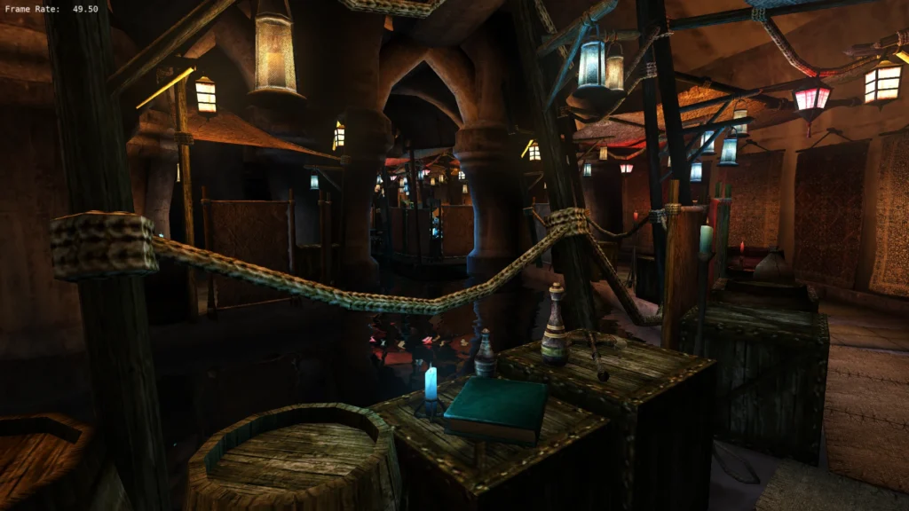
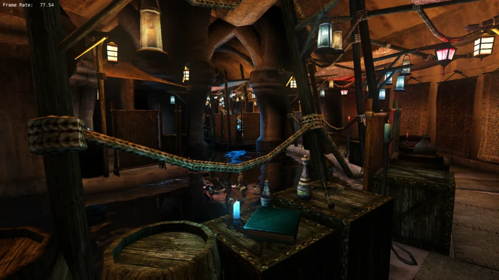
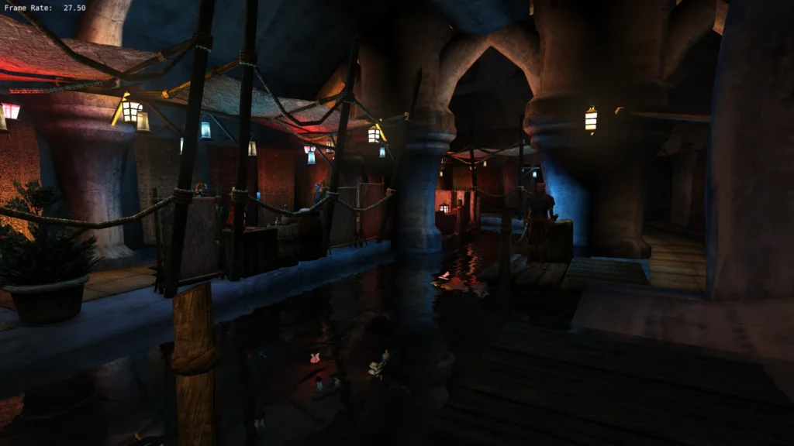
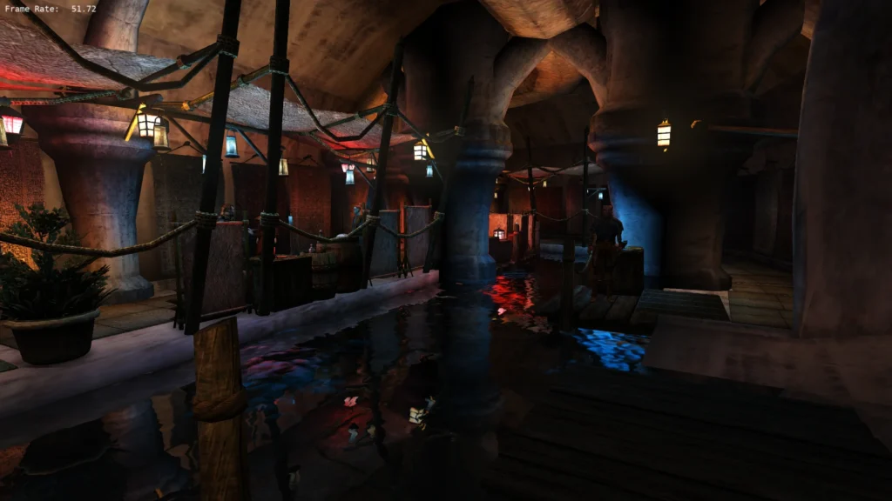

Well-lit, traveller! This is a rare development blog post sighting. We haven’t had one of those [in a while](/news/2022/shiny-new-things-are-coming)… While version 0.52.0 of our open-source engine is still baking in the oven and will take some time to finish, we’d like to talk about some of the exciting changes coming with it.

<!--more-->

### Lighting

One of the annoying limitations of Morrowind’s original rendering engine is the light limit: every object can only be lit by up to 8 light sources. What happens if there are more? Any extra lights are simply ignored for that object. This can lead to flickering or harsh lighting seams in particularly well-lit areas. Level designers traditionally had to work around this limit, carefully designing areas so players wouldn’t notice, but even the most meticulous layout can’t account for every scenario in a game as dynamic as Morrowind and its myriad of mods, and for our optimisations, like active grid object paging, merging objects on the fly.

OpenMW has included a setting to raise the light limit to an arbitrary value for a while now. But there has always been a catch: a performance hit. What if we told you that doesn’t have to be the case?

The next release introduces an implementation of [volume-tiled forward shading](https://www.3dgep.com/wp-content/uploads/2017/07/3910539_Jeremiah_van_Oosten_Volume_Tiled_Forward_Shading.pdf), nicknamed [“Project Magnus”](https://gitlab.com/OpenMW/openmw/-/merge_requests/5212) and referred to in-game as [**clustered lighting**](https://www.aortiz.me/2018/12/21/CG.html). Supported by any hardware that can run OpenGL 4.3 or higher, it completely removes the per-object light limit by dividing the screen into small tiles and assigning lights to them. The best part is that it has a dramatically lower performance impact than raising the limit to Aetherius. In fact, the performance can in some cases be better than with the regular light limit, like in the below scene.

*Light limit: 8*

*Clustered*

This lays the groundwork for an eventual implementation of **bindless rendering** (not binding rendering states like materials, textures, and lights to individual objects at all), which will offer major performance gains, even surpassing full [texture atlasing](https://en.wikipedia.org/wiki/Texture_atlas).

Also, don’t tell anyone, but a secret, rad feature of clustered lighting is that it makes water reflect point lighting!

*Light limit: 8*

*Clustered*

*Hardware: Nvidia GeForce GTX 1050 and Intel Pentium G4560*

*Mod:* [*Balmora Underworld*](https://www.nexusmods.com/morrowind/mods/42448). *Impact on more standard scenes may not necessarily be as dramatic.*

### Billboards

We have another important graphical update: up until now, our implementation of [billboards](https://learn.microsoft.com/en-us/windows/win32/direct3d9/billboarding) (sprite-like geometry) has effectively been a stub, offering only partial functionality compared to the original engine.

In Morrowind, billboards are used for Reflect and Spell Absorption visual effects, which look noticeably incorrect in OpenMW 0.51.0.



The upcoming release properly [reimplements](https://gitlab.com/OpenMW/openmw/-/merge_requests/5373) the three original billboard modes. Two of them allow billboards to rotate fully toward the camera, while the third keeps them aligned with the vertical axis (a mode frequently used in modded assets). What’s significant is that they now support rotations applied by animations, allowing the visual effects to look as designed.



…Well, mostly. Full disclosure: multiple instances of these effects currently overlap. We’ll fix that some day, pinky promise!

### Spellcasting

*“What if I don’t care about billboards? Give me gameplay! Give me Lua!”*

While [the previous release](/news/2026/openmw-0-51-0-released) gave modders the ability to create custom spell effects, the ongoing effort to **dehardcode spellcasting** will revolutionise magic modding. The goal is to move effect application, projectile movement, and casting-related animations into built-in Lua scripts.  
  
Once complete, modders will be able to override these mechanics to implement things like swift casting, dual casting, homing projectiles, custom projectile trajectories, and much more.

So far, most of the temporary magic effect application has been [dehardcoded](http://gitlab.com/OpenMW/openmw/-/merge_requests/5361), and we are currently polishing [magic projectile hit application](https://gitlab.com/OpenMW/openmw/-/merge_requests/5483) before moving on to the rest of the subsystem. While not every single part might make it into 0.52.0, rest assured that the upcoming release will still be a massive leap forward.

### Combat

You might be wondering: *“Wait, what about 1.0 and Morrowind parity? Are you working on anything that isn’t billboards (which I still don’t care about)?”* Absolutely!

Spellcasting is often used in combat, and 0.52.0 will contain AI accuracy fixes for melee encounters. NPCs and creatures will feel slightly more responsive: they’ll [follow you closer](http://gitlab.com/OpenMW/openmw/-/merge_requests/5357) when you backpedal and [face you](https://gitlab.com/OpenMW/openmw/-/merge_requests/5409) and [attack you](https://gitlab.com/OpenMW/openmw/-/merge_requests/5440) quicker.



### Custom records

Back to Lua! The load context system introduced in 0.51.0 is being [expanded](https://gitlab.com/OpenMW/openmw/-/work_items/9109) further. In the latest development builds, modders can inject custom classes, factions, levelled lists, lockpicks, races, and repair items as game records directly through Lua, with support for additional object types on the way. Beyond that, work is in progress to allow custom skills and attributes to be injected.

That wraps it up for now. This is non-exhaustive! You can test these features (and many more) right now in our latest [development builds](/downloads). Expect more to read or watch about 0.52.0 as we get closer to its release. Until next time!
